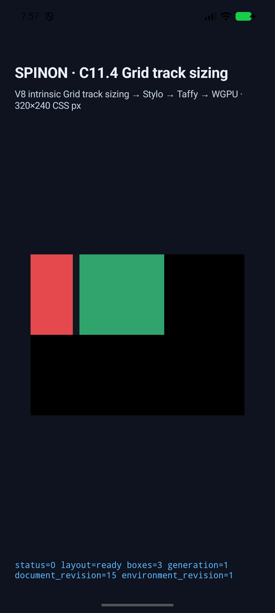
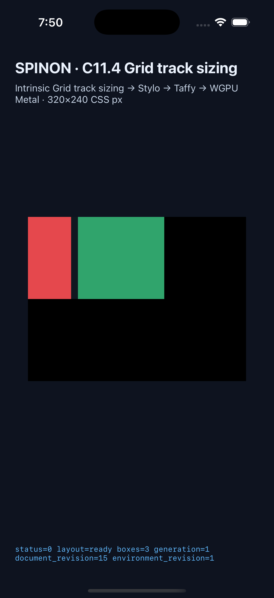

# C11.4 §11.7 flexible track app-runtime slice

## 결과와 범위

기존 §11.7 독립 기대값 네 개를 `RuntimeBlockFlexGridTrackSizingV1` opt-in 앱 fixture에서 실행했다. Android API 37 ARM64 16 KB AVD와 iPhone 17 Pro / iOS 26.2 Simulator에서 각 scene의 `ExpandFlexibleTracks` snapshot, target-axis pass, gutter topology, root와 두 marker frame, draw/present를 확인했다. 두 플랫폼 모두 4/4 scene이 통과했다. scene별 최종 원본 로그와 캡처는 각 실행 폴더에 있다.

| Scene | 축 | §11.7 expected base | Android/iOS runtime base | 남은 공간 |
| --- | --- | --- | --- | ---: |
| `weighted-columns` | Columns | `[190/3, 380/3]` | `[63.333332, 126.666664]` | `0.000004` |
| `frozen-row` | Rows | `[80, 110]` | `[80, 110]` | `0` |
| `subunit-columns` | Columns | `[85, 20]` | `[85, 20]` | `85` |
| `zero-fr-row` | Rows | `[24, 166]` | `[24, 166]` | `0` |

기대값은 [§11.7 사전 비교](../c11-4-flex-stage-oracle-precomparison-2026-10-28/README.md)의 독립 유리수 계산과 JSON에서 가져왔다. 런타임 유한 `f32` 관측은 `1e-4 CSS px` 허용오차로 비교했다. Chrome 156의 1/64px 최종 geometry는 별도의 브라우저 대조군이며, 이 실행 근거는 Chrome에서 내부 stage 상태를 추론하지 않는다.

앱 matcher는 하나의 grid trace와 순서가 맞는 양축 pass를 요구한다. scene의 target axis에는 `Initialize`, `MaximizeTracks`, `ExpandFlexibleTracks`, `StretchAutoTracks { applied: false }`가 각각 한 번씩 이 순서로 있어야 한다. `gutter` flag로 CSS track을 고르고 CSS track 두 개와 10px 내부 gutter 하나, collapsed 경계 sentinel을 확인하며 최종 base가 유한한지도 검사한다. 고정 반대축도 별도로 확인한다. Rust fixture는 이 네 scene ID만 노출한다. 미등록 scene 및 충돌하는 C11.2.1 profile 요청은 양 플랫폼에서 거부됐다.

## 실행 근거

- Android: [최종 matcher 반영 manifest](runs/c114-flex-stage-android-avd-20261027T225654572Z-2745705b/android-simulator.json), [빌드 로그](runs/c114-flex-stage-android-avd-20261027T225654572Z-2745705b/android-build.log), [source summary 로그](runs/c114-flex-stage-android-avd-20261027T225654572Z-2745705b/android-runtime-weighted-columns.log). AVD `spinon_api37_1_compat16k`, API 37, ARM64, 16 KB, 1080×2400; APK SHA-256은 `e684fd47709402584296e374b6d5e79812eba29c5e989df19c49df6843ef2480`이다.
- iOS: [manifest](runs/c114-flex-stage-ios-simulator-20261027T224932984Z-8e6b2435/ios-simulator.json), [빌드 로그](runs/c114-flex-stage-ios-simulator-20261027T224932984Z-8e6b2435/ios-build.log), [source summary 로그](runs/c114-flex-stage-ios-simulator-20261027T224932984Z-8e6b2435/ios-runtime-weighted-columns.log). iPhone 17 Pro / iOS 26.2, 1206×2622; 앱 실행 파일 SHA-256은 `7bac6dc04cfab6efc74dbeded86eb3656a9e0ad58e33c6b2a190893dccfe340c`이다.
- 두 앱 빌드 모두 고정 V8 revision `7b50b62cb18f28617959e8452e2cd18195b38bcf`을 사용하고, 빌드 전후 clean 상태와 입력·artifact hash를 기록했다. 두 runner는 unknown-scene과 conflicting-profile 거부 경로를 확인한 뒤 Spinon 앱만 종료했다. 이미 booted였던 AVD와 simulator는 계속 boot 상태다.
- [Independent log and frame verifier](../../../../tools/css-reference/c11-4-flex-stage-runtime/verify.py) checked both manifests, all eight scene reports, trace chunks, frame values, screenshot PNG hashes, and Android/iOS expected-track tables against the independent expected JSON. Its seven negative controls reject duplicate scene IDs, duplicate JSON keys, missing axis, `Initialize` after `MaximizeTracks`, missing Expand stage, non-finite track base, and wrong frame. Machine output: [verification.json](verification.json).
- [정적 FFI archive 검사](artifact-boundary/artifact-boundary.json): product `c04-runtime-gpu`에서는 scene 문자열 0/4와 fixture ABI text/defined symbol 부재를 확인했다. opt-in fixture-test에서는 scene 문자열 4/4와 fixture ABI text/defined symbol 존재를 확인했다. release 최적화기는 positive control에서도 내부 Rust `runtime_source` symbol을 남기지 않았으므로 이 값은 기록만 하고 합격 조건으로 쓰지 않는다. macOS ARM64 `spinon-ffi` 정적 archive의 경계만 확인했으며 APK·iOS app/IPA 또는 release bundle 전체의 제외 여부를 증명하지 않는다.

## 대표 화면

스크린샷은 렌더된 배치를 보여준다. Pixel equality 또는 compositor 제출 뒤 readback을 뜻하지 않는다.

## 검증과 한계

- `cargo test -p spinon-ffi --features c04-runtime-gpu-fixture-test`: 147 passed, 0 failed, 2 ignored.
- `cargo clippy -p spinon-ffi --no-deps --all-targets --features c04-runtime-gpu-fixture-test -- -D warnings`: 통과. 의존성까지 검사한 별도 실행은 변경 밖의 `spinon-runtime/.../c11_4_grid_layout_auto_tracks/validation.rs:329` `clippy::type-complexity` 경고로 중단됐다. 해당 파일은 수정하지 않았다.
- `cargo fmt --all -- --check`, Swift helper `swiftc -typecheck`, JS runner 구문 검사, Python verifier 음성 대조와 `git diff --check`를 실행했다.
- FFI archive와 simulator 결과는 별도 빌드 경계로 기록했다. Screenshot은 배치 관찰용이며 color/pixel equality, GPU readback 또는 실기기 동작을 검증하지 않는다.
- 이 slice는 definite-space 고정 입력 네 개만 다룬다. Intrinsic item contribution, spans, indefinite free space, repeat, 일반 author CSS admission, 전체 WPT 및 전체 C11.4를 검증하지 않는다. C11.4 checkbox와 공식 완료 `72/213`은 미완료로 유지한다.
