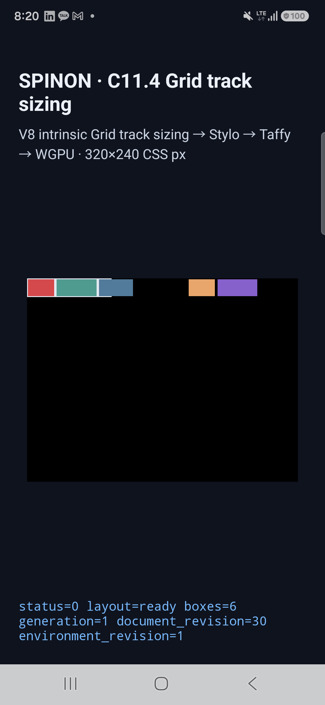
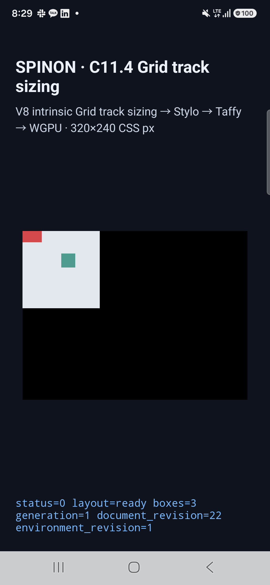
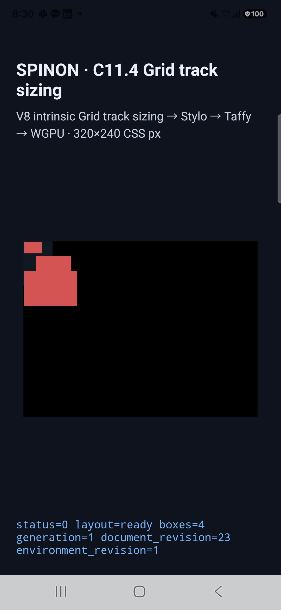

# C11.4 누적 150-scene Android 실기기 검증

- 실행일: 2026-10-21
- 소스 commit: [source-revision.json](./source-revision.json) (`24eea910ff734aa82a26fa3ed936c6a6997e0bf3`, 실행 APK를 빌드한 revision)
- 기기·GPU·설치 APK hash: [마지막 실행 device.json](./android-device-c114-remaining-android-device-20261020T232953066Z-6811a4c3/device.json)
- 누적 결과: [result.json](./result.json)
- 파일 무결성: [SHA256SUMS.txt](./SHA256SUMS.txt)
- PR 변경 실패 관점 검토: [pr-diff-review-30.md](./pr-diff-review-30.md)

Samsung SM-S731N (Android 16/API 36, arm64-v8a, `ro.kernel.qemu=0`)에서 현재 C11.4 fixture의 전체 150개 scene을 실행했다. 앱 WGPU backend는 Samsung Xclipse 940 Vulkan을 선택했고, 설치된 `base.apk`와 로컬 APK SHA-256은 `b9c803c31ffcfa178388a5b8d134d9372c2d4480162b7d80d5adc2d31a2390e3`으로 일치한다.

## 결과

150개 고유 scene 각각의 track trace, 전체 node frame, `SPINON_C0410_DRAW ... presented`를 확인했다. 실행을 이어 붙인 집계는 첫 실행 126개, `typed-mixed-cycle` 단독 재실행 1개, 나머지 23개다. 장면별 logcat 추출본과 1080×2340 화면 캡처는 아래 디렉터리에 있다. 텍스트 로그에서는 줄 끝 공백만 제거했으며 marker·값·화면 이미지는 바꾸지 않았다.

- [첫 실행 — 126개 통과와 다음 scene의 진단 자료](./android-device-c114-full-android-device-20261020T231750694Z-12208a65/)
- [typed-mixed-cycle 재실행 — 1개 통과](./android-device-c114-typed-retest-android-device-20261020T232934681Z-face95a6/)
- [나머지 23개 — 모두 통과](./android-device-c114-remaining-android-device-20261020T232953066Z-6811a4c3/)

초기 harness 실행은 run kind가 길어 scene 11에서 앱의 80자 run ID 한도에 걸려 종료됐다. [실패 로그](./android-device-c114-c114-full-physical-regression-android-device-20261020T231652490Z-e968208f/)와 같이 실행 매개변수 문제였으며, 짧은 `full` run kind로 다시 시작했다.

첫 `full` 행렬과 첫 단독 probe는 `typed-mixed-cycle`의 layout summary와 track trace를 남겼지만 150초 안에 draw 완료 marker가 오지 않아 중단됐다. 이후 같은 scene의 단독 재실행에서 frame·trace·draw/present 검사가 통과했다. 처음 marker가 빠진 원인은 확인하지 못했으며, [실패 로그](./android-device-c114-typed-probe-android-device-20261020T232553541Z-dd412095/)와 [통과한 재실행](./android-device-c114-typed-retest-android-device-20261020T232934681Z-face95a6/)을 함께 보존했다.

Android `SurfaceView` PixelCopy는 9개 scene의 표본 42/42개에서 기대 RGBA와 정확히 일치했다. 표본은 root 내부·경계·외부, root 밖으로 넘친 item과 item 뒤 배경을 포함한다. 다음 화면은 초과 배치가 포함된 실기기 결과다.



추가로 재실행한 typed mixed track 장면과 image intrinsic multi-span 장면:





## 범위와 한계

이 결과는 한 대의 물리 Android 기기에서 제한된 C11.4 fixture 150개를 검증한 보충 근거다. C11.4 전체 지원, CSS Grid 전반, WPT 또는 다른 기기 검증을 뜻하지 않으며 상태 대장의 완료 체크와 공식 완료 수는 바꾸지 않는다.

Image multi-span 장면은 replaced-element intrinsic input, track 크기, frame, 장면 제출을 확인한다. 이 fixture에서 `runtime_image_count=0`, `image_draw_count=0`이므로 image texel painting은 검증하지 않았다. PixelCopy 표본은 선택 지점만 확인하며 CSS border stroke 전체의 픽셀 정확성을 입증하지 않는다.

## 재현

```sh
mise exec -- env SPINON_ENABLE_C04_RUNTIME_GPU=1 SPINON_ENABLE_C04_RUNTIME_GPU_FIXTURE_TEST=1 SPINON_ENABLE_C11_GRID_METAL_SURFACE_PIXELS_TEST=1 bun run build:android
mise exec -- node tools/css-reference/capture-c11-4-auto-repeat-neighbors-simulator.mjs android-device R5KYB06SMPE --run-kind=full --evidence-group=c11-4-full-matrix-physical-android
```
