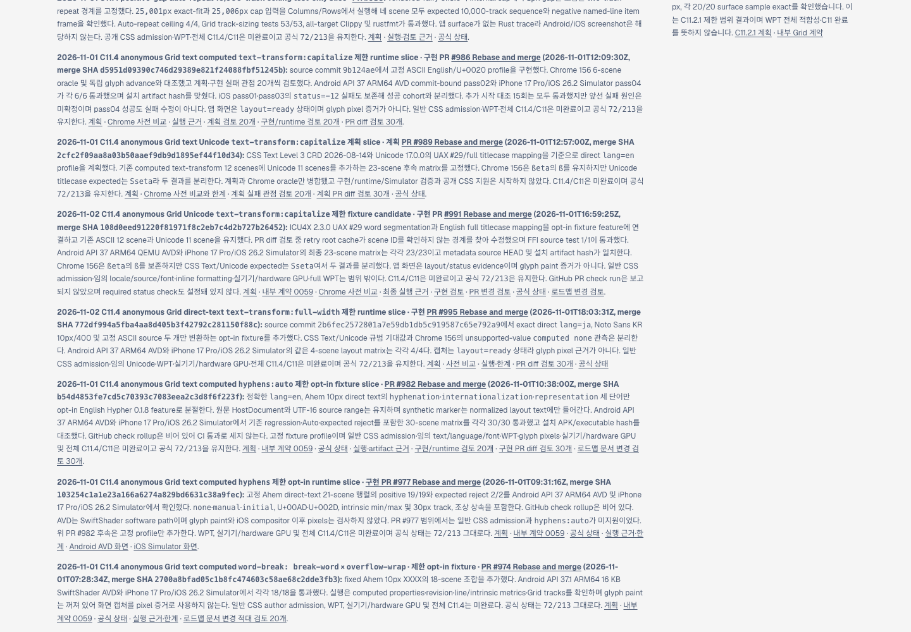
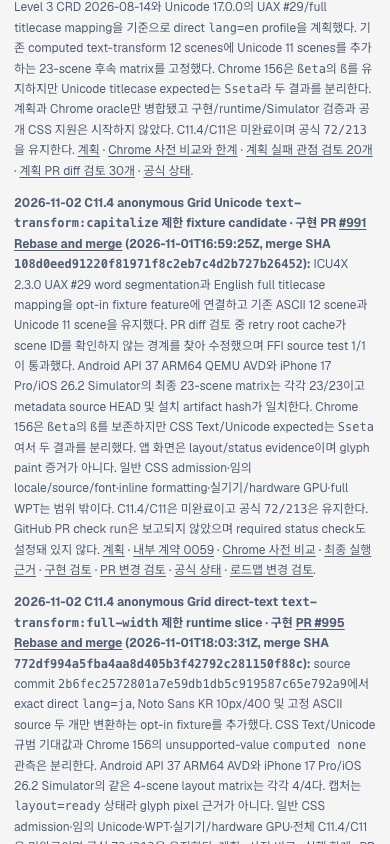

# C11.4 full-width 병합 후 로드맵 Tailnet 동기화

2026-11-01 병합된 구현 [PR #995](https://github.com/ohah/spinon/pull/995)과 문서 [PR #996](https://github.com/ohah/spinon/pull/996)을 반영해 사용자 지정 Tailnet 미리보기의 로드맵을 갱신했다. publication은 PR #996 병합 HEAD `c2a30611244a9bb2d73ff135387157d5fe92109c`에서 만들었다. 공식 구현 상태는 `72/213`이며 C11.4와 C11은 미완료다.

## 선택 문서 build

- RSPress 2.0.22 선택 build는 성공했다. 1,253개 기존 publication route를 보존하고 최신 상태 대장·로드맵·내부 계약·C11 계획·full-width 계획과 비교/runtime 증거를 overlay했다.
- 최종 publication은 1,463 route, 64,730,712 bytes다. 이전 publication 대비 210 route를 추가하고 296 route 내용을 변경했으며 route 삭제는 없다.
- 이번 build는 선택 문서 root에 대해 dead-link/dead-image 검사를 껐다. 전체 문서 링크 적합성을 확인한 build로 해석하지 않는다.
- [선택 build 기록](./selected-build-summary-pass02.json) · [root manifest](./selected-root-pass02.json) · [publication manifest](./selected-publication-pass02.json)

## Tailnet 동기화

- Tailscale backend `Running`, `127.0.0.1:8768` preview server PID `28040`, 변경 대상 open handle 0개를 사전 확인했다.
- 최종 pass02에서 hash 이름이 바뀐 RSPress JS route 95개를 추가하고 기존 route 95개를 원자 교체했다. 교체 전 95개는 고유 backup에 보존했고 hash 95/95를 확인했다. 이전 hashed JS asset을 포함해 기존 route는 삭제하지 않았다.
- pass02는 PR #996에 이미 병합된 `roadmap-postmerge-review-30.md` 원문을 복원한 최종 selected build다. 이 문서의 publication 및 Tailnet 결과는 pass02 원장으로 판정한다.
- Tailnet URL의 1,463/1,463 route가 publication hash와 일치한다. 로드맵·상태 대장·계약·계획·비교/runtime 근거 등 핵심 18개 route는 local HTTP와 Tailnet HTTPS에서 모두 200 및 hash 일치를 확인했다.
- 기존 preview server는 재시작하지 않았다. 상세 원장은 [사전 점검](./preflight-pass02.json), [복사·backup](./copy-and-backup-pass02.json), [served verification](./served-verification-pass02.json)이다.
- pass02 검토 자료의 SHA-256 목록: [SHA256SUMS-pass02.txt](./SHA256SUMS-pass02.txt).

## Agent Browser 화면 확인

Agent Browser에서 실제 Tailnet URL을 열어 PR #995 merge SHA, full-width 설명, `72/213` 및 각 카드 링크를 확인했다. 390px mobile viewport에서 document/body 폭이 390px이었다. browser 세션을 닫은 뒤 Agent Browser/terminal-browser 프로세스가 남지 않은 것을 확인했다. [세션 종료 기록](./agent-browser-lifecycle-pass02.json) · [이번 동기화의 별도 변경 검토 30개](./tailnet-sync-pr-diff-review-30.md)

## 작업 범위

이 동기화는 문서 미리보기를 갱신한 작업이다. C11.4의 제한 full-width fixture 동작은 Android API 37 ARM64 AVD와 iPhone 17 Pro/iOS 26.2 Simulator에서 각각 4/4 layout scene을 통과했지만, 캡처는 `layout=ready` 상태이며 glyph pixel을 증명하지 않는다. 일반 CSS admission, 임의 Unicode, WPT, 실기기/hardware GPU, 전체 C11.4/C11은 완료 처리하지 않았다. [상태 대장](../../../STATUS.md)과 PR #995의 제한 범위를 유지한다.
