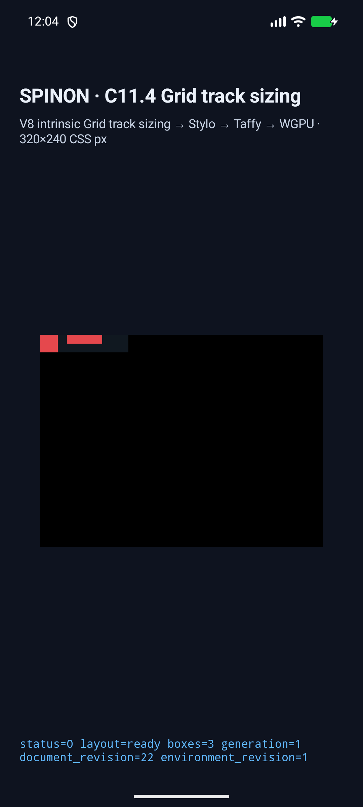

# C11.4 generic direct-text intrinsic runtime evidence

## Scope

This evidence validates the single feature-gated app scene `generic-root-normal`, with two direct `A BC` text items. It does not complete C11.4 Stage A or the full C11.4 suite. The official roadmap remains 72/213 complete, with C11.4 incomplete.

The six-scene Rust collector tests cover a wider HostDocument fixture set. Android/iOS app coverage is deliberately limited to this canonical scene; source/style/fallback rejection controls remain Rust tests. These screenshots show layout boxes and the app surface. Both logs report `runtime_text_count=0` and `glyph_batch_draw_count=0`, so they do not demonstrate glyph painting or pixel equality.

## Build and simulator result

Run ID: `c114-generic-direct-text-20261026T023012Z-12741e45-pass01`

- Android V8 and iOS Simulator V8 were rebuilt from the pinned local V8 source checkout. Archive SHA-256: Android `e0288be05fdedd7b5bed945dc446f7ec7dc11454034d0efc3dfe297d32cd7813`; iOS `7a3e24607ea7b419d3fd858c35c094a566660f9d3112015487fa010d99e99815`.
- Android fixture-test Debug APK build passed with `c04_runtime_gpu_fixture_test=1`. APK SHA-256: `c46439a58b4a7f5ee3e287def55874f61a17cb7f451552116504200d81401773`.
- iOS Simulator fixture-test Debug app build succeeded with the same fixture route enabled. App executable SHA-256: `bfa5400c9c87474c44e5bfab757202191b7632616a5e989cdf09bb97a46b3df3`.
- Android API 37 ARM64 AVD (`spinon_api37_1_compat16k`) passed `status=0`, `layout=ready`, `boxes=3`, expected node frames and intrinsic/track trace, and `SPINON_C0410_DRAW status=0 presented boxes=3`.
- iPhone 17 Pro / iOS 26.2 Simulator passed the same layout, frame, trace and draw/present assertions.
- The runner stopped the app on both platforms after capture. The Android package process was absent afterward; the iOS Simulator launch services had no remaining SpinonBootstrap process.

## Screenshots

Android screenshot: 1080×2400, SHA-256 `61026041f6f2743fe6cefe72804b64cde15bef2dd00a479950710ae373338b0f`.

iOS screenshot: 1206×2622, SHA-256 `ec1f791bb08643105acdf68f370b8f31d04c5105f507ef5fbfa6b5504edae50e`.

## Runtime trace values

The app scene resolves the invalid author values `max-width:auto`/`max-height:auto` to valid `none` values. The observed runtime diagnostics report `layoutInputRevision.intrinsicSize=0` for this new HostDocument. The app matchers verify a HostDocument source and nonnegative revision values.

- Intrinsic Text inputs: item nodes 2 and 4, source order 0 and 1, Ahem font registry revision 1, inline min/max 20/40px, block min/max 20/10px, no anonymous text sources.
- Columns content track sizes: `[20, 40]`; row content track size: `[20]`.
- Serialized tracks include collapsed zero-size outer gutters and a 10px gutter between the two columns.
- Columns contributions include node 2 `MinContent=20`, and node 4 `MinContent=20` plus `MaxContent=40`. Repeated identical tuples are accepted.
- Rows contributions are measured at each assigned column width: node 2 contributes 20px for `Minimum`, `MinContent`, and `MaxContent`; node 4 contributes 10px for each. All spans are 1 and `crossesFlexibleTrack=false`.
- Frames: root `(0,0,100,20)`; `generic-normal-a` `(0,0,20,20)`; `generic-normal-b` `(30,0,40,10)`.

These contribution values and track gutters describe Spinon's emitted runtime trace; the saved Chrome DOM observation does not expose Taffy contribution kinds.

## Validation artifacts

- [Full simulator matrix log](./runs/c114-generic-direct-text-20261026T023012Z-12741e45-pass01/simulator-matrix.log)
- [Android build/runtime logs](./runs/c114-generic-direct-text-20261026T023012Z-12741e45-pass01/android-avd/)
- [iOS successful build/runtime logs](./runs/c114-generic-direct-text-20261026T023012Z-12741e45-pass01/ios-simulator/)
- [Focused Rust test](./runs/c114-generic-direct-text-20261026T023012Z-12741e45-pass01/rust-focused-test-final.log): 9 passed
- [Focused FFI source test](./runs/c114-generic-direct-text-20261026T023012Z-12741e45-pass01/ffi-focused-test-final.log): 1 passed
- V8 build logs are under the same run's `v8/android/` and `v8/ios/` directories.

The `android-avd-early/`, `android-avd-corrected-early/`, and `android-avd-refined-early/` directories retain diagnostic attempts. The final pass is in `android-avd/` and `ios-simulator/`. The first run caught invalid `max-*` CSS; the next caught matcher expectations that did not reflect runtime trace output. Both issues were corrected before the final matrix.

This saved run built the Java matcher SHA-256 `e4653bffedd0714936d4f026b9ed66fb17f89d69cd5453fd331398e9cec35f1b` (source mtime 12:03:54; Android APK/build log 12:04:16; runtime log 12:04:25) and iOS matcher SHA-256 `2007028254b6e67fe5cfa1a6595941369eff2956dc55af8220819899d9707692` (source mtime 11:56:13; successful build 11:57:06; runtime log 12:04:28). Later axis-specific matcher updates changed the current Java and Swift sources to `c702dd18f3803e1a6a17d81e4ad28c7dc350dcc22ec3daf679e5ade3b79e2346` and `f061c7bed7644729f9679aa010dff95d69efa112ec1f6e79ef25d83578a530ea`; those source revisions are not covered by this saved run. The post-commit matrix rerun will verify them and record commit-bound provenance.

No simulator snapshots or evidence PNGs were deleted. The final `source-head.txt` is refreshed after the reviewed implementation is committed and the same matrix runner is repeated against that commit.
