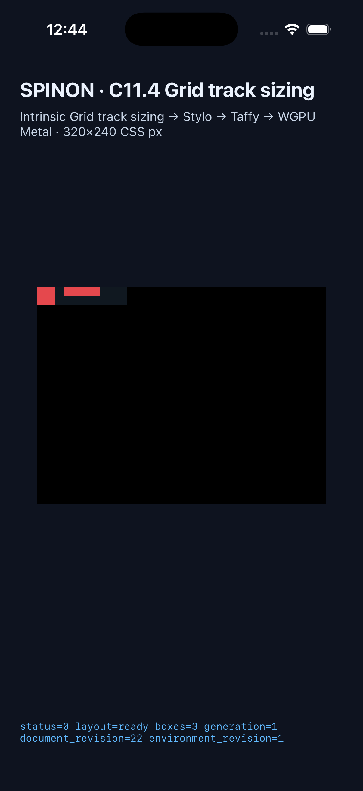

# C11.4 generic direct-text intrinsic runtime 실행 근거

## 범위

이 근거는 fixture-test 전용 앱 경로의 `generic-root-normal` scene 하나를 검증한다. 두 direct text item은 `A BC` 문자열과 고정 Ahem profile을 사용한다. 이는 C11.4 Stage A 또는 전체 C11.4 suite 완료가 아니다. 공식 대장은 `72/213` 완료를 유지하며 C11.4는 미완료다.

Rust collector tests는 HostDocument 여섯 scene과 source/style/fallback 거부 경계를 검사한다. Android/iOS app 검증은 canonical scene 하나에 한정한다. 아래 캡처는 layout box와 app surface만 보여준다. 양쪽 로그의 `runtime_text_count=0`, `glyph_batch_draw_count=0`은 글리프 페인팅 또는 pixel equality를 증명하지 않는다.

## 최신 빌드와 시뮬레이터 실행

Run ID: `c114-generic-direct-text-20261026T034304Z-f45596b8-pass03`

- Source commit과 `source-head.txt`: `f45596b8b0b8a4d35807028bac30314a5dceaaab`.
- Android/iOS 빌드는 고정 V8 source checkout `/Users/yoonhb/Documents/workspace/spinon/build/v8-source/v8` (`7b50b62cb18f28617959e8452e2cd18195b38bcf`)을 `SPINON_V8_DIR`로 지정해 통과했다. 이 feature worktree에는 별도 V8 checkout이 없으며 checkout 동기화는 실행하지 않았다. 재사용한 V8 archive SHA-256은 Android `e0288be05fdedd7b5bed945dc446f7ec7dc11454034d0efc3dfe297d32cd7813`, iOS `7a3e24607ea7b419d3fd858c35c094a566660f9d3112015487fa010d99e99815`다.
- Android fixture-test Debug APK SHA-256: `af9ddbcce26afde99c697de215735887197e76beb9686ad75cbdd344a59acc24`.
- iOS Simulator app executable SHA-256: `74873e9c2a7ee25ca2b3b14ac1b2a1342c1e8697da8749f5d8582c6ef81a9728`.
- Android API 37 ARM64 AVD `spinon_api37_1_compat16k`와 iPhone 17 Pro / iOS 26.2 Simulator에서 `status=0`, `layout=ready`, `boxes=3`, 기대 frames와 intrinsic/track trace, draw/present가 통과했다. Runner는 캡처 뒤 두 앱을 종료했다.
- 검증된 Android Java 및 iOS Swift matcher SHA-256은 각각 `c702dd18f3803e1a6a17d81e4ad28c7dc350dcc22ec3daf679e5ade3b79e2346`, `f061c7bed7644729f9679aa010dff95d69efa112ec1f6e79ef25d83578a530ea`다.

## 시뮬레이터 화면

Android 캡처는 1080×2400이며 SHA-256은 `9b74719ac4872fa9068b9cc02f1fc4a3f8a89c83c4fadb613ad7cf62642e5a73`다.

iOS 캡처는 1206×2622이며 SHA-256은 `a7b38f7a12f89040962c0bc64fa731d4693baa31e534f041d962a7d3764ea721`다.

## 관찰한 runtime trace

- Intrinsic Text 입력은 item node 2와 4, source order 0과 1, Ahem registry revision 1, inline min/max `20/40px`, block min/max `20/10px`이며 anonymous text source는 없다.
- Columns content track은 `[20, 40]`, row content track은 `[20]`이다. Serialized trace는 양끝의 collapsed zero-size gutter와 두 column 사이의 10px gutter를 보존한다.
- Columns contribution은 node 2 `MinContent=20`, node 4 `MinContent=20`과 `MaxContent=40`을 포함한다. 같은 tuple 반복은 허용된다.
- 각 item의 assigned column width에서 Rows contribution은 node 2 `Minimum`/`MinContent`/`MaxContent` 각각 20px, node 4는 각각 10px이다. Span은 1이고 `crossesFlexibleTrack=false`다.
- Frames: root `(0,0,100,20)`, `generic-normal-a` `(0,0,20,20)`, `generic-normal-b` `(30,0,40,10)`.

이 값은 Spinon이 출력한 runtime trace다. 저장된 Chrome DOM observation에는 Taffy contribution kind가 직접 표시되지 않는다.

## 재현 및 원본 artifact

- [Android/iOS simulator matrix log](./runs/c114-generic-direct-text-20261026T034304Z-f45596b8-pass03/simulator-matrix.log)
- [Android 빌드와 runtime 로그](./runs/c114-generic-direct-text-20261026T034304Z-f45596b8-pass03/android-avd/)
- [iOS 빌드와 runtime 로그](./runs/c114-generic-direct-text-20261026T034304Z-f45596b8-pass03/ios-simulator/)
- [generic Rust fixture tests](./runs/c114-generic-direct-text-20261026T034304Z-f45596b8-pass03/rust-generic-test.log): 9/9
- [C11.4 Rust tests](./runs/c114-generic-direct-text-20261026T034304Z-f45596b8-pass03/rust-c11-4-tests.log): 34/34
- [C11.4 runtime tests](./runs/c114-generic-direct-text-20261026T034304Z-f45596b8-pass03/rust-c114-tests.log): 19/19
- [FFI scene source test](./runs/c114-generic-direct-text-20261026T034304Z-f45596b8-pass03/ffi-focused-test.log): 1/1
- [Targeted runtime Clippy](./runs/c114-generic-direct-text-20261026T034304Z-f45596b8-pass03/runtime-clippy.log)와 [Cargo fmt check](./runs/c114-generic-direct-text-20261026T034304Z-f45596b8-pass03/cargo-fmt-check.log)이 통과했다.
- 기존 고정 V8 빌드 로그는 pass01의 `v8/android/`, `v8/ios/` 아래에 있다. pass02 및 pass03은 같은 고정 archive를 사용했다. pass01/pass02 evidence와 모든 기존 PNG는 유지했다. pass02의 V8 경로 누락 진단 로그도 삭제하지 않았다.

pass03에서 collector가 추가로 HTML `` 혼합 입력을 fail-closed 하도록 수정했다. 회귀 test는 기존 빈 HTML block sibling 허용 동작을 유지하면서 두 text item과 root image sibling이 함께 있는 입력을 거부한다. C11.4 전체 완료, 일반 CSS admission, Release APK/IPA fixture exclusion, WPT 또는 glyph paint는 이 실행의 범위 밖이다.
