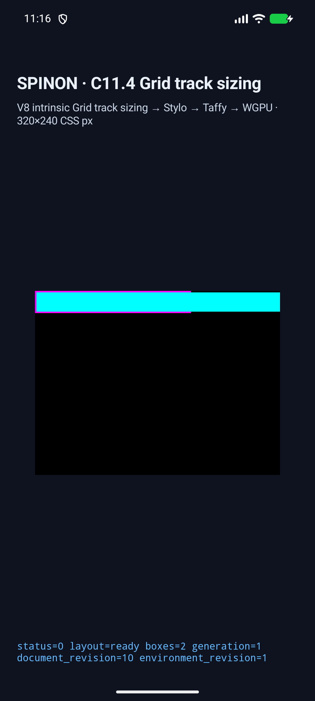
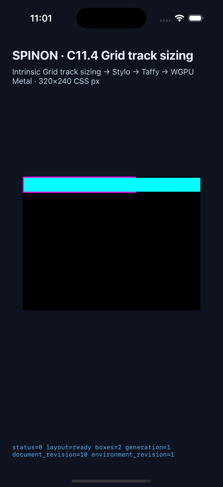

# C11.4 `grid-auto-fit-columns-001.html` runtime 근거

**현재 상태:** 구현 후보 검증 중. 공식 C11.4 완료 체크와 로드맵 `72/213`은 변경하지 않았다. 실행 당시 HEAD는 `e37e0764483022d8587d832f4f384fbc5d4f8c0c`이며, 이 작업 트리의 변경은 아직 PR에 병합되지 않았다.

## Android·iOS 35개 scene

Pinned WPT 입력의 35개 root와 37개 direct item을 C11.4 opt-in fixture에서 실행했다. Android는 API 37 ARM64 AVD, iOS는 iPhone 17 Pro / iOS 26.2 Simulator다. 두 플랫폼 모두 scene별 root/item frame, used columns/rows, 반복 수, explicit·implicit track 수, expanded line-name, collapse/gutter 및 sizing stage trace를 검사했다. Android 증거는 실제 `SPINON_C0410_DRAW ... status=0 presented boxes=N` 행까지 대조한다.

| 플랫폼 | 결과 | 산출물 SHA-256 | 상세 근거 |
| --- | ---: | --- | --- |
| Android API 37 ARM64 AVD | 35/35, draw/present 35/35 | Debug APK `32eefcfb7ca300d96927c6faae9c248b9b3e31292fc09e0e8dff427ef8e275ac` (설치본과 일치) | [matrix summary](android-20261027T141559Z-summary.json), [scene log 예시](android-grid-auto-fit-07-20261027T141559Z.log) |
| iPhone 17 Pro / iOS 26.2 Simulator | 35/35, draw/present 35/35 | app executable `716dc2238d6a5b4faf73bf92c993b3922aa6298ac3a56e6b87c744e2813bd927` | [matrix summary](ios-20261027T140118Z-summary.json), [scene log 예시](ios-grid-auto-fit-07-20261027T140118Z.log) |

각 전체 scene 실행은 320×240 CSS px 환경이다. Android matrix runner가 run ID가 붙은 evaluation summary의 프로세스 PID를 얻고 같은 PID에서 `presented boxes=N` draw를 기다리도록 보강했다. 이전 runner는 이 draw를 기다리지 않고 0.3초 뒤 캡처해 Android scene 07에 시작 화면([superseded screenshot](android-grid-auto-fit-07-20261027T141144Z.png), [geometry-only summary](android-20261027T141144Z-summary.json))이 저장됐으므로 해당 이전 이미지는 PR 근거로 사용하지 않는다. [최종 scene 07](android-grid-auto-fit-07-20261027T141559Z.png)은 실제 magenta border 밖까지 이어지는 cyan item과 layout-ready 상태를 보여준다.

## Overflow surface pixel matrix

WPT index 7, 8, 11, 14, 19, 31에서 각 플랫폼 6 scene × 4 표본, 총 24/24 정확히 일치했다. 표본은 root border, root border 밖 item fill, item 끝 직후 background, 별도 outside control이다. 최신 실행 결과는 [summary](overflow-pixels-20261027T141243Z-summary.json)에 있다. [Android scene 07 PixelCopy](android-overflow-07-20261027T141243Z-pixelcopy.png)와 [iOS scene 07 Simulator 캡처](ios-overflow-07-20261027T141243Z-simulator.png)를 함께 보존했다.

Pixel matrix 전용 환경은 overflow 위치를 화면 안에서 표본화하기 위해 480×240 CSS px로 설정했다. 일반 35-scene 실행은 320×240 CSS px를 유지한다. Android 색 값은 SurfaceView의 PixelCopy이고 iOS 값은 compositor 제출 전 WGPU Metal drawable readback이다. 두 결과를 Android hardware GPU, iOS compositor 이후 화면 또는 physical device 결과로 해석하지 않는다.

초기 Android scene 07 PixelCopy에서 item 끝 다음 표본이 틀린 실행은 [mismatch log](android-overflow-07-20261027T134138Z-mismatch.log)와 [캡처](android-overflow-07-20261027T134138Z-pixelcopy-mismatch.png)에 남겼다. Surface 교체 후 논리 viewport 폭이 320으로 초기화되는 원인을 수정했고 최종 480px 표본은 통과했다. iOS의 초기 canvas scale 실패와 surface-pixel feature 미활성 빌드 로그도 삭제하지 않았다.

## 미등록 scene 거부

두 simulator에서 `grid-auto-fit-columns-36`을 실행해 `SPINON_C114_GRID_ARGUMENT_ERROR rejected=true`를 확인했다. 해당 PID/run의 eval, trace, summary, presentation marker는 나타나지 않았다. Android [로그](c114-reject-android-20261027.log)와 [기록](c114-reject-android-20261027.json), iOS [로그](c114-reject-ios-20261027.log)와 [기록](c114-reject-ios-20261027.json)을 보존했다. Rust FFI의 untrusted scene ID와 잘못된 pointer/count 단위 검사도 별도 통과했다.

## 기본 제품과 opt-in FFI archive 경계

macOS ARM64에서 동일한 `target/debug/libspinon_ffi.a`를 두 feature 조합으로 순차 빌드했다. 결과는 [archive summary](archive-boundary-summary.json), [재생성 runner](run_archive_boundary.py), 각 빌드 및 제한된 symbol scan에 있다.

| Feature 조합 | Archive SHA-256 | C11.4 WPT 심볼 | 35개 scene marker | 기대값 marker |
| --- | --- | ---: | ---: | --- |
| `c04-runtime-gpu` | `eb53a0350bf45280314b54e4430aa41212488695fd439f684dabc2fe163b89bd` | 0 | 0/35 | 없음 |
| `c04-runtime-gpu-fixture-test` | `a20eb41edc19e6d380d089eb8e6289e79d729d0bcde043626137b2907d3a982b` | 2 | 35/35 | 있음 |

심볼 검사는 rustc 1.96.1 / LLVM 22.1.2에 맞는 `llvm-nm`을 사용했다. Xcode의 `nm`은 이 archive 내 Rust LLVM bitcode의 새 attribute kind를 읽지 못해 제외했다. 이 결과는 macOS ARM64 static FFI archive만 다룬다. Android APK·iOS app bundle의 전체 fixture exclusion, Release APK/IPA 또는 app size는 검사하지 않았다.

## 빌드와 focused checks

- Android opt-in simulator build: `SPINON_ENABLE_C04_RUNTIME_GPU=1 SPINON_ENABLE_C04_RUNTIME_GPU_FIXTURE_TEST=1 mise exec -- bun run build:android` 성공. [build log](android-build-fixture-final.log)
- iOS opt-in simulator build: `SPINON_ENABLE_C04_RUNTIME_GPU=1 SPINON_ENABLE_C04_RUNTIME_GPU_FIXTURE_TEST=1 SPINON_ENABLE_C11_GRID_METAL_SURFACE_PIXELS_TEST=1 mise exec -- bun run build:ios-sim` 성공. [build log](ios-simulator-build-final.log)
- `cargo fmt --all -- --check` 및 `cargo clippy --locked --workspace --all-targets -- -D warnings` 통과.
- `spinon-layout` lib tests 287/287, `spinon-style-to-layout` lib tests 247/247, auto-fit WPT FFI tests 3/3, FFI scene rejection 1/1, pixel pointer/count rejection 1/1 통과.
- fixture module boundary test 26/26, iOS build flags test 39/39 통과.

전체 명령별 원본 stdout/stderr는 `*-final.log` 파일들에 보존했다. Android compileSdk 37.2 / AGP 8.13.2 호환성 안내와 iOS AppIntents·dSYM 경고가 있었지만 두 app build는 성공했다.

커밋된 텍스트 로그는 줄 끝 공백과 EOF의 빈 줄만 제거하고 LF로 정규화했다. 정규화 전후 SHA-256과 대상 파일은 [정규화 manifest](text-log-normalization.json)에 기록했다.

## 구현/runtime 실패 관점 검토

서로 다른 구현 실패 경로 20개와 근거는 [implementation/runtime review](implementation-runtime-review-20.md)에 기록했다. PR 최종 diff 검토는 변경 확정과 PR 생성 후 별도 문서로 진행한다.

## 범위

이는 pinned WPT 문서 35개를 고정된 opt-in runtime 입력으로 실행한 결과다. Public CSS admission, Spinon WPT suite 전체 적합성, 다른 auto-fit input, physical device/hardware GPU, iOS compositor 이후 pixels, Stage B 전체 또는 C11.4/C11 전체 지원을 증명하지 않는다. 상위 C11.4 공식 완료 표시와 `72/213`은 유지한다.
