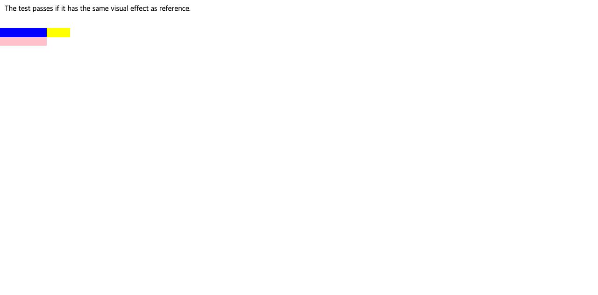

# C11.4 · `grid-layout-auto-tracks.html` 사전 비교

## 고정 출처

- WPT revision: `c999c58338ee1d223df5ad62e48be1202ced0d37`
- 원본: `css/css-grid/grid-definition/grid-layout-auto-tracks.html`
- 원본 SHA-256: `37b73eb2a4234fcc7901a6a3ea3f42415c4e941969e76a9187ea373d2c28d698`
- reference: `css/css-grid/reference/grid-layout-auto-tracks-ref.html`
- reference SHA-256: `b32809afab70e070b4913855e60e461c1e14ce191a535e872c50cf5db8070294`
- 테스트 종류: screenshot reftest. WPT `testharness` 실행 결과가 아니다.

두 upstream 파일을 Agent Browser가 사용하는 Chrome 156에서 각각 열었다. CSSOM과 `getBoundingClientRect()`를 읽어 원본의 columns `[100,50]px`, rows `[19,19]px`, root `100×38px`, items `100×19`, `50×19`, `100×19px`를 관찰했다. 원본과 reference 화면 PNG hash가 모두 `49afd0839e03c11fceaaf65e4219e806d4aaa16a4398af598e1d04417514fbef`로 같다. 원본의 19px line box는 Chrome 기본 글꼴의 관찰값이며 앱 fixture의 독립 규범값으로 재사용하지 않는다.

## 앱 fixture용 결정적 입력

고정된 Ahem `10px/10px`를 쓰는 [fixture source](https://github.com/ohah/spinon/blob/main/tests/fixtures/css/c11/grid-layout-auto-tracks-c114-precomparison.html)는 WPT의 track/placement 관계를 유지한다.

- 명시 columns: `100px`; 명시 rows: `auto`
- `a`: row 1, column 1, direct Ahem `&nbsp;`
- `b`: row 1, positive implicit column 2, width `auto`; 자식 block은 `width:50px`이고 Ahem `&nbsp;`를 포함한다.
- `c`: positive implicit row 2, column 1, direct Ahem `&nbsp;`
- auto-flow row, auto implicit rows/columns, zero gap/edge, `align-items:start`

Agent Browser Chrome 156에서 Ahem font load 완료를 확인했다. observed columns `[100,50]px`, rows `[10,10]px`, root `100×20px`; `a=(0,0,100,10)`, `b=(100,0,50,10)`, `c=(0,10,100,10)`이다. `b`의 자식 content box는 `(100,0,50,10)`이다. Root 바깥 `(125,5)`와 `(149,5)`는 `b`의 content box에 속하고 `(150,5)`는 body에 속했다.

## 독립 기대값

CSS Grid Layout Module Level 1 2025 CRD의 track sizing algorithm에서 auto min sizing function을 가진 단일-span item contribution은 해당 track base를 올린다. Ahem direct text와 고정 line-height는 각각 10px block contribution을 만든다. 첫 row의 `a`와 `b`는 같은 row에 있지만 최대 기여가 10px이고, `c`의 두 번째 positive implicit row도 10px이다. 따라서 rows는 `[10,10]px`, auto-sized grid height는 `20px`이다. `b`의 nested child width 50px이 positive implicit auto column을 `[50]px`로 키워 explicit 100px column 뒤에 놓인다. Root width는 100px이므로 그 implicit column의 50px는 root inline border box 밖으로 이어진다.

판정은 columns/rows track array와 item/root frame을 각각 검사한다. Root frame이나 screenshot만으로 track 값 또는 span placement를 추론하지 않는다. 밖으로 넘치는 `b` content box의 지정 좌표도 별도 표본으로 확인한다. 정확한 JSON 원본은 `spec/internal/evidence/c11-4-grid-layout-auto-tracks-precomparison-2026-10-27/expected.json`이다.

## 화면과 원본 실행

- 
- 
- 
- Ahem fixture SHA-256: `a1c50d04455e0feb5c2e1980730fafb8dbf2822c923cf975d9ec893e4605eafa`
- Browser: Agent Browser, `HeadlessChrome/156.0.0.0`, viewport `1280×633`, DPR 1.
- Agent Browser session and browser process were closed after capture.

This comparison is not a Spinon WPT pass and does not prove public CSS admission, general Grid support, simulator runtime, or C11.4 completion.

## 문서 빌드

`mise exec -- bun install --frozen-lockfile` 뒤 `mise exec -- bun run docs:build`를 실행했다. 전체 문서 빌드는 기존 evidence 페이지의 dead link와 누락된 캡처 파일 때문에 exit 1이다. 최종 build log에서 이 변경의 파일명은 오류로 보고되지 않았다. 따라서 전체 docs build는 통과로 기록하지 않는다.

- [계획 PR 변경 검토 30개](./plan-pr-diff-review-30.md)

- [계획 문서](https://github.com/ohah/spinon/blob/main/plan/c11-4-grid-layout-auto-tracks-wpt.md)
