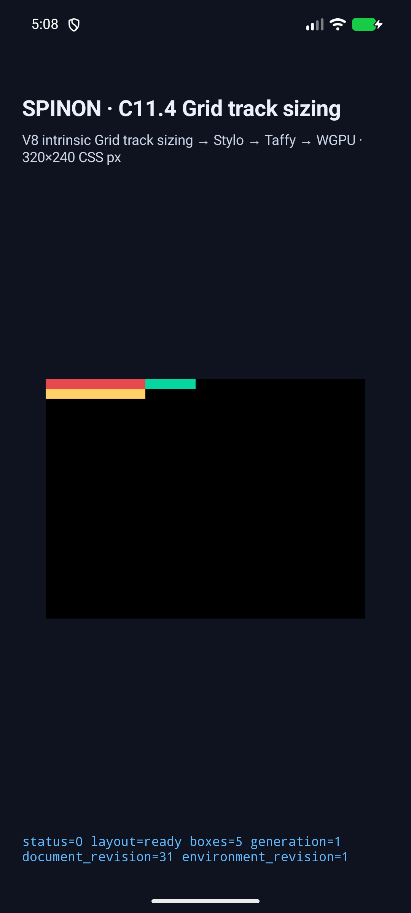
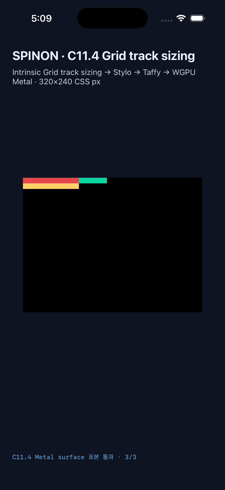

# C11.4 · `grid-layout-auto-tracks.html` runtime candidate

이 기록은 WPT screenshot reftest의 고정 장면 하나를 C11.4 opt-in runtime fixture로 연결한 구현 후보 결과다. WPT testharness 실행이나 일반 CSS Grid 지원을 뜻하지 않는다. C11.4 공식 checkbox는 미완료이며 완료 집계는 `72/213`으로 유지한다.

## 독립 기대값과 구현 범위

[사전 비교](../c11-4-grid-layout-auto-tracks-precomparison-2026-10-27/README.md)에서 고정한 Ahem `10px/10px` 입력과 CSS Grid Layout Module Level 1 2025 CRD 기대값을 사용한다. Chrome 156의 원본 기본 글꼴 `19px` 관찰은 normative oracle로 재사용하지 않는다.

| 결과 | 기대값 | Android API 37 ARM64 AVD | iPhone 17 Pro / iOS 26.2 Simulator |
|---|---|---|---|
| columns | `[100, 50]px` | `[100, 50]px` | `[100, 50]px` |
| rows | `[10, 10]px` | `[10, 10]px` | `[10, 10]px` |
| root | `(0,0) 100×20px` | 일치 | 일치 |
| A | `(0,0) 100×10px` | 일치 | 일치 |
| B 및 50px child | `(100,0) 50×10px` | 일치 | 일치 |
| C | `(0,10) 100×10px` | 일치 | 일치 |
| minimum contributions | column B `50px`; row A/B/C 각각 `10px` | 일치 | 일치 |
| overflow surface | x125/x149 초록, x150 검정 | PixelCopy `3/3` exact | Metal drawable `3/3` exact |

Android trace는 `11/11`, iOS trace는 `21/21` 조각으로 재조립해 위 track, contribution, node ID와 pre-render frame을 확인했다. 두 실행 모두 `status=0 layout=ready boxes=5`다. `StretchAutoTracks` trace의 내부 `applied` flag는 플랫폼 간 다를 수 있어 matcher는 마지막 stage와 최종 track bases를 확인한다. 두 플랫폼 모두 final bases는 동일하다.

## 실행 환경

- V8 source: `/Users/yoonhb/Documents/workspace/spinon/build/v8-source/v8`, revision `7b50b62cb18f28617959e8452e2cd18195b38bcf`.
- Android: `emulator-5554`, API 37 ARM64 AVD, `sdk_gphone16k_arm64`, `arm64-v8a`, 1080×2400, density 2.625. 이 AVD의 renderer는 Android Emulator OpenGL ES / ANGLE / SwiftShader다.
- iOS: iPhone 17 Pro Simulator `9DCCE836-7659-4914-B6C1-13F54BFFA9DB`, iOS 26.2, Metal drawable 960×720 at scale 3.
- Android run ID: `c114-auto-tracks-android-final-20261027T1703`.
- iOS run ID: `c114-auto-tracks-ios-final-20261027T1708`.
- iOS Metal samples are read before compositor submission. No physical Android device, hardware GPU, or post-compositor iOS output was tested.

## 빌드와 검증

최종 변경 소스에서 아래 검증이 통과했다.

```sh
mise exec -- cargo fmt --all --check
mise exec -- cargo test -p spinon-layout --lib track_sizing_combines_explicit_auto_and_positive_implicit_tracks_with_text
mise exec -- cargo test -p spinon-runtime --features c11-4-grid-track-sizing-fixture-test
mise exec -- cargo test -p spinon-ffi --features c04-runtime-gpu-fixture-test grid_layout_auto_tracks
mise exec -- cargo clippy --locked --workspace --all-targets -- -D warnings
mise exec -- bun test tools/css-reference/fixture-module-boundary.test.mjs
SPINON_V8_DIR=/Users/yoonhb/Documents/workspace/spinon/build/v8-source/v8 SPINON_ENABLE_C04_RUNTIME_GPU=1 SPINON_ENABLE_C04_RUNTIME_GPU_FIXTURE_TEST=1 mise exec -- bun run build:android
SPINON_V8_DIR=/Users/yoonhb/Documents/workspace/spinon/build/v8-source/v8 SPINON_ENABLE_C04_RUNTIME_GPU=1 SPINON_ENABLE_C04_RUNTIME_GPU_FIXTURE_TEST=1 SPINON_ENABLE_C11_GRID_METAL_SURFACE_PIXELS_TEST=1 mise exec -- bun run build:ios-sim
```

Results: layout test `1/1`; runtime unit tests `253 passed, 0 failed, 3 ignored`, integration tests `19/19`; FFI scene allowlist `1/1`; fixture boundary Bun tests `13/13`; Clippy and both platform builds succeeded. Android Gradle emitted its existing compile SDK 37.2 / AGP compatibility warning and selected the repository-pinned NDK 27.1.12297006. iOS linked with duplicate V8 debug-map warnings; the simulator build succeeded.

## 기본 artifact 경계

`spinon-ffi` static archive에서 아래 marker를 대상으로 기본/제품 feature와 fixture positive control을 각각 빌드해 검사했다.

```text
grid-layout-auto-tracks-c114-wpt
c114_grid_auto_tracks
gridLayoutAutoTracks
implicit-column-content-first
```

| 구성 | archive bytes | SHA-256 | marker matches |
|---|---:|---|---:|
| `--no-default-features --features c04-runtime-gpu` | 661,513,696 | `edffdf7e34611e899fb17894c187d3347f2e412dc1c7ad3c0e72a5353c4e5732` | 0 |
| `--features c04-runtime-gpu-fixture-test` | 708,546,576 | `ebb7f0a503851b2ddae791c42a789ee1134a03ee6eb8bc821dfef1e6dfe2394a` | 8 |

이 검사는 정적 Rust archive의 문자열 marker 경계만 증명한다. 최종 APK/IPA 전체에 대한 fixture 배제 근거로 확대하지 않는다.

## 화면과 원본 실행 자료





- [Android 최종 runtime log](./android-api37-arm64-avd-c114-auto-tracks-final.log) · [PixelCopy raw PNG](./android-api37-arm64-avd-pixelcopy-raw.png)
- [iOS 최종 runtime log](./ios-26.2-iphone17pro-c114-auto-tracks-final.log)
- Android screenshot SHA-256: `f2a51307897728801f0bbe6abf2ee92e6082159d8a33b523d6cff316bddb1ebf`
- Android PixelCopy PNG SHA-256: `be4a5cb850ad3b8a28b0a6f097a81b0c392caf5dcd062f1cbe4cc32a8f8da8dc`
- Android log SHA-256: `a714cf266fde4ba471580b9650a28bd551748af91247000f097917c2ec12bd27`
- Android debug APK SHA-256: `abbdac7d26009b606c9a721279418989395a401ca68317127285b5382617b7e4`
- iOS screenshot SHA-256: `7677f77c2405cccf6e8bc5936e9ccb63980fcc9068c0c7fb58e9d0c2c82dc69a`
- iOS log SHA-256: `80f5f8e49878bd9f8d8b26c10e9e0d142d0d2e85f697fe9fe58ebedd23e25466`
- iOS simulator executable SHA-256: `00abdc51ac78e6e2c7c32e3367d260bbfb9320f76d2469a4e6bd95e6616e9de8`

## 검토와 한계

- [구현/runtime 실패 관점 검토 20개](./implementation-review-20.md)
- [PR diff 적대 검토 30개](./pr-diff-review-30.md)
- [구현 전 계획 검토 20개](../../../../plan/c11-4-grid-layout-auto-tracks-plan-review-20.md)
- [계획 PR diff 검토 30개](../c11-4-grid-layout-auto-tracks-precomparison-2026-10-27/plan-pr-diff-review-30.md)

이 결과는 고정 WPT source의 한 normalized scene과 선택된 AVD/Simulator 실행에 한정된다. 전체 WPT runner, 일반 author CSS admission, 다른 auto-track 조합, 실기기/hardware GPU, iOS compositor 이후 표면, 전체 CSS Grid 또는 C11.4 완료를 증명하지 않는다.
