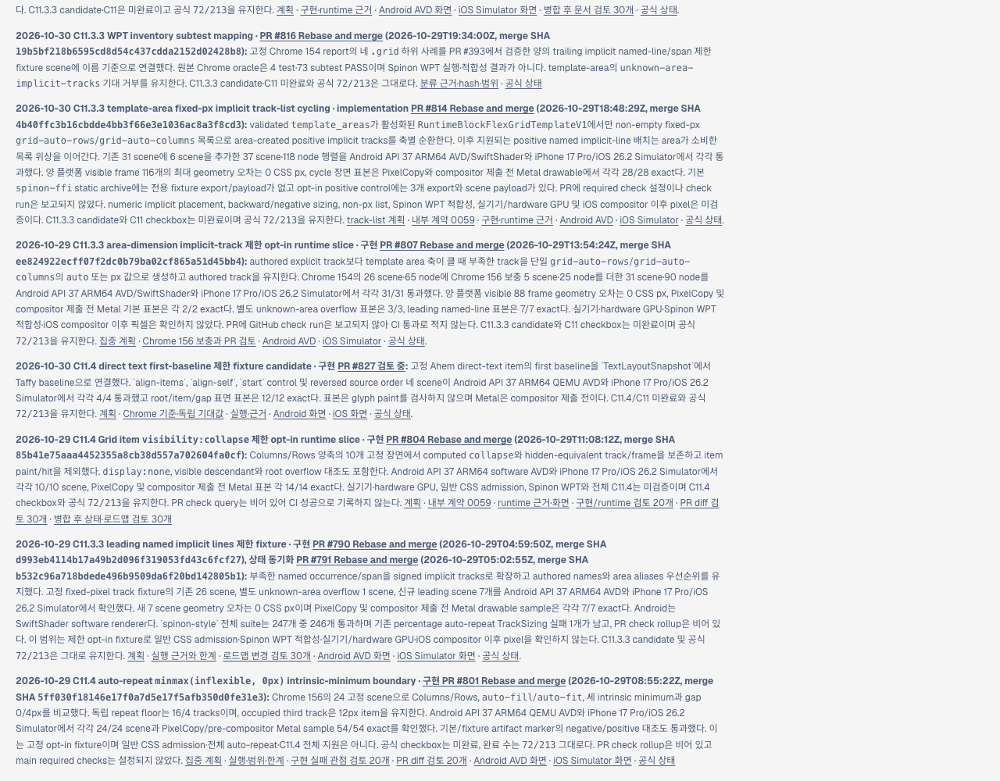
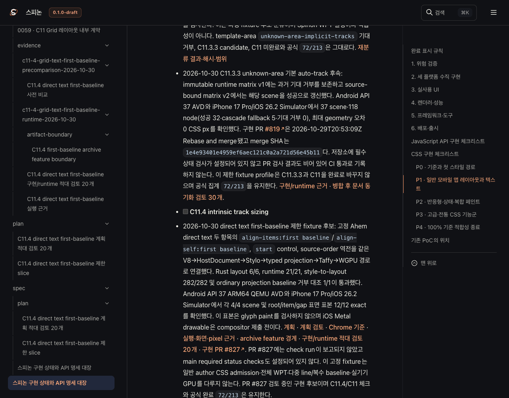

# C11.4 first-baseline PR·로드맵·Tailnet 동기화

## 범위

구현 PR [#827](https://github.com/ohah/spinon/pull/827)의 bounded first-baseline candidate를 공식 상태와 public roadmap에 연결했다. C11.4/C11 체크는 미완료이고 공식 완료 수는 `72/213`이다. 이 동기화는 미리보기 `/spinon/` 경로만 갱신한다.

## 선택 문서 빌드

- RSPress `2.0.22`, source commit `7e2b339080198245bbc08812fac3d7345f2343f5`와 선택 파일 manifest의 SHA-256을 기록했다. 선택 root는 138개 파일·5,986,897 bytes다. [source manifest](./selected-root.json)
- 선택 build는 59개 파일·7,411,747 bytes다. [build/route manifest](./selected-build-verification.json)
- 필수 route에 roadmap, STATUS, 계약 0059, plan, Chrome precomparison, Android/iOS runtime evidence·이미지가 포함됐다. 기존 `404.html`은 복사하지 않았다.

## Tailnet 미리보기

- 기존 listener PID `28040`의 `/Users/yoonhb/Library/Application Support/SpinonPreview`를 그대로 사용했다. 서버를 재시작하거나 종료하지 않았다.
- Preflight는 44 create, 4 replace, 11 same으로 분류했다. 교체 전 4개 파일·2,095,575 bytes를 별도 backup root에 보존했다. [preflight](./tailnet-preflight.json)
- 복사는 48개 파일, backup 4개, delete 0개다. [copy result](./tailnet-copy.json)
- local preview 59/59, backup 4/4, 원격 HTTP 200·SHA-256 일치 59/59를 확인했다. [verify result](./tailnet-verify.json)
- 첫 copy 시도와 첫 verify 시도는 preview server에 연결된 순간적인 localhost established socket 때문에 safety assertion에서 중단됐다. 그 시도에서는 파일 변경을 하지 않았다. `lsof`에서 peer socket이 닫힌 뒤 재실행해 copy와 verify가 통과했다.

## Agent Browser 확인

터미널 브라우저는 사용하지 않았다. Agent Browser에서 roadmap row와 STATUS 페이지를 렌더링해 확인했다. STATUS에서 공식 `72/213`과 unchecked `C11.4 intrinsic track sizing`을 확인했다. PR #827 본문의 두 image element는 모두 `complete=true`였고 Android 이미지 1080×2400, iOS 이미지 1206×2622로 로드됐다.

| Tailnet roadmap | Tailnet STATUS |
|---|---|
|  |  |

PR 이미지 로드 관찰: [Agent Browser JSON](./pr827-agent-browser-images.json) · [화면](./pr827-agent-browser-images.png). Roadmap·STATUS DOM 관찰: [roadmap](./tailnet-roadmap-agent-browser.json) · [STATUS](./tailnet-status-agent-browser.json). Browser close record: [close](./browser-close-agent-browser.json). 종료 뒤 `ps -ax -o pid=,comm=`에서 agent-browser 프로세스가 남지 않았다.

## pass02: PR diff review 포함 최종 동기화

- `PR diff 적대 검토 20개` 문서가 public roadmap 및 STATUS에 연결된 뒤 RSPress 선택 빌드를 다시 만들었다. 선택 source root는 141개 파일·6,006,464 bytes이고 output은 61개 경로·7,467,594 bytes다. [source manifest](./selected-root-pass02.json) · [build/route manifest](./selected-build-verification-pass02.json)
- Preflight는 15 create, 12 replace, 34 same으로 분류했다. 교체 대상 12개·2,263,165 bytes를 pass02 backup root에 보존했다. 복사 27개, backup 12개, 삭제 0개다. [preflight](./tailnet-preflight-pass02.json) · [copy result](./tailnet-copy-pass02.json)
- Local preview 경로 61/61, backup 12/12, Tailnet HTTP 200·SHA-256 61/61을 확인했다. [verify result](./tailnet-verify-pass02.json)
- Agent Browser에서 최신 roadmap candidate row와 STATUS candidate 기록을 확인했다. PR diff review 링크가 연결되고 공식 `72/213` 및 unchecked `C11.4 intrinsic track sizing` 상태가 유지된다. [roadmap DOM](./tailnet-roadmap-dom-pass02.json) · [STATUS DOM](./tailnet-status-dom-pass02.json)
- 후보 행을 보이도록 스크롤한 화면: [roadmap](./tailnet-roadmap-candidate-agent-browser-pass02.png) · [STATUS](./tailnet-status-candidate-agent-browser-pass02.png). 최종 세션 close 뒤 agent-browser 프로세스는 남지 않았다. [process check](./browser-close-agent-browser-final-pass02.json)

## 재현 스크립트

- [선택 root 구성](./prepare-selected-root.mjs)
- [선택 build 보완 및 route 검증](./complete-selected-build.mjs)
- [pass02 선택 root 구성](./prepare-selected-root-pass02.mjs)
- [pass02 선택 build 보완 및 route 검증](./complete-selected-build-pass02.mjs)
- [RSPress 설정](./rspress.config.ts)
- [pass02 RSPress 설정](./rspress-pass02.config.ts)
- [Tailnet preflight/copy/verify](./sync-tailnet.mjs)
- [pass02 Tailnet preflight/copy/verify](./sync-tailnet-pass02.mjs)
- 증거 파일 SHA-256: [manifest](./SHA256SUMS.txt)

동기화는 미리보기 경로만 대상으로 한다. GitHub Pages workflow 및 `gh-pages`는 변경하지 않았다.
