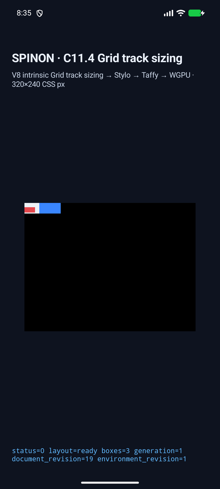
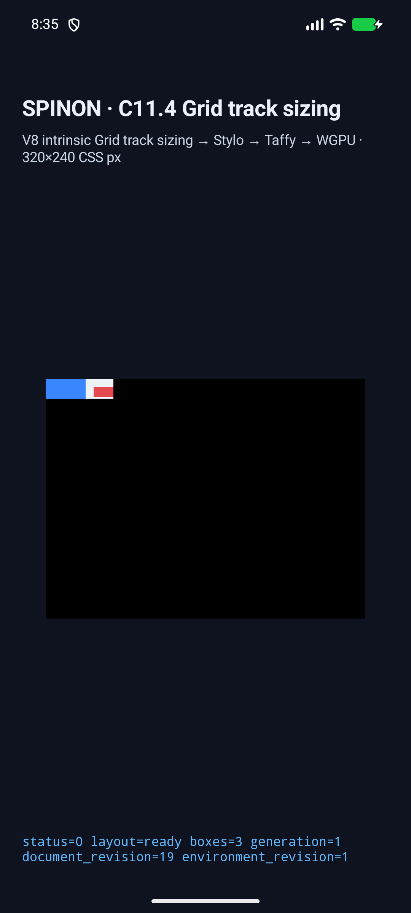
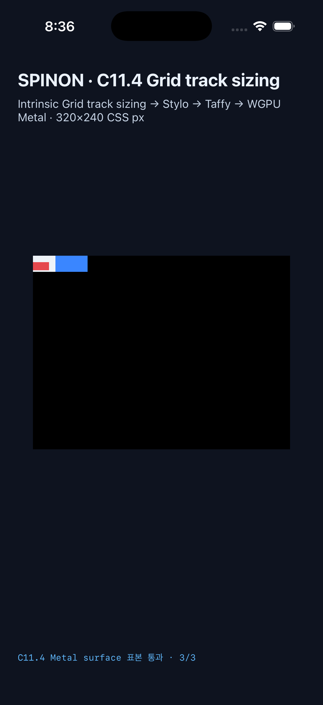
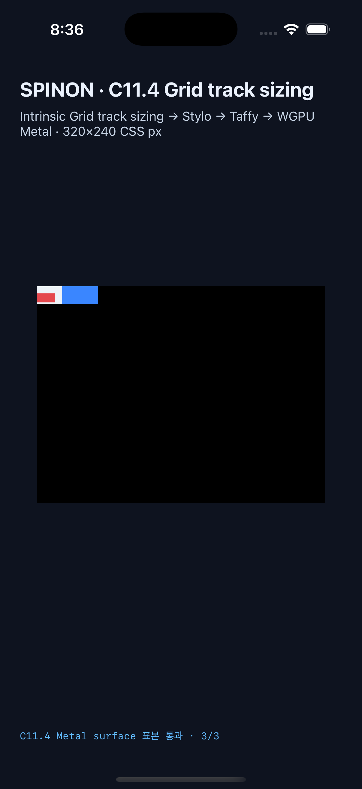
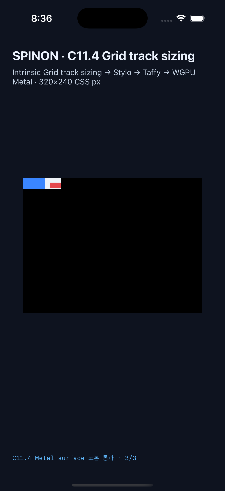

# C11.4 direct text first-baseline 실행 근거

**판정:** 제한된 fixture-test 후보의 두 Simulator 실행이 통과했다. C11.4/C11 완료, 일반 author CSS admission, full CSS Grid 또는 Spinon WPT 적합성을 의미하지 않는다.

## 고정 oracle과 입력

[사전 비교 README](../c11-4-grid-text-first-baseline-precomparison-2026-10-30/README.md)와 독립 기대값 JSON을 구현 전에 고정했다. CSS Grid 2025 CRD §11.5의 baseline shim과 저장소 Ahem metrics(ascent 800/1000)를 적용한다. 일반 순서는 columns `[20,40]px`, gap `8px`, row `20px`, root `68×20px`다. 10px/20px 단일 line baseline은 각각 line top 기준 8px/16px이며 같은 row group에서 두 baseline은 y=16px로 정렬한다. `start` control은 둘 다 y=0이다. Reversed source order는 columns `[40,20]px`로 바뀌지만 baseline은 y=16px에 남는다.

런타임에 등록한 고정 Ahem 파일 `tests/fixtures/resources/c15/Ahem.ttf`의 SHA-256은 `b719ecb31c5b21fc573c03f6421c74ac63c271a5a3ff841e34f9705fb94b8448`이다. 각 Android/iOS trace의 `gridItemTextLayouts`와 intrinsic text source는 `fontRegistryRevision: 1`을 기록한다.

## Android API 37 ARM64 AVD

- Build: `SPINON_ENABLE_C04_RUNTIME_GPU=1 SPINON_ENABLE_C04_RUNTIME_GPU_FIXTURE_TEST=1 SPINON_ENABLE_C11_GRID_METAL_SURFACE_PIXELS_TEST=1 ./tools/build-android-app.sh` — `BUILD SUCCESSFUL`.
- Device: `emulator-5554`, API 37, `arm64-v8a`, QEMU `1`, `sdk_gphone16k_arm64`. APK 설치 SHA-256과 로컬 APK가 일치한다. 자세한 값은 [simulator.json](./android-avd/c114-first-baseline-mvu6l1qt-17df8ba6/simulator.json)에 있다.
- 네 scene 모두 layout/root/item frame, track trace, draw/present 3 box, PixelCopy sample을 통과했다. Sample은 4×3 = **12/12 RGBA exact**다. 각 장면 trace는 11 chunk다. [result.json](./android-avd/c114-first-baseline-mvu6l1qt-17df8ba6/result.json).

| `align-items:first baseline` | `align-items:start` 대조 | `align-self:first baseline` | reversed source order |
|---|---|---|---|
|  |  |  |  |

AVD 실행은 Android 실기기 또는 hardware GPU 결과가 아니다. PixelCopy 표본은 root/item fill과 grid gap 색을 확인하며 text glyph pixels는 확인하지 않는다. Baseline 값은 아래 runtime trace의 line metrics와 Grid item frames에서 확인한다.

## iOS 26.2 Simulator

- Build: `SPINON_ENABLE_C04_RUNTIME_GPU=1 SPINON_ENABLE_C04_RUNTIME_GPU_FIXTURE_TEST=1 SPINON_ENABLE_C11_GRID_METAL_SURFACE_PIXELS_TEST=1 ./tools/build-ios-sim.sh` — `BUILD SUCCEEDED`.
- Device: iPhone 17 Pro (`iPhone18,1`), Simulator iOS 26.2, UDID `ACA7BF91-E2D5-4CF7-909A-08D1AD95FF3D`. Installed executable hash matches the local build. [simulator.json](./ios-simulator/c114-first-baseline-mvu6m6wk-c608999f/simulator.json).
- 네 scene 모두 layout/root/item frame, track trace, draw/present 3 box, Metal drawable sample을 통과했다. Sample은 4×3 = **12/12 RGBA exact**다. Sample은 root/item fill과 grid gap 색을 확인하며 text glyph pixels는 확인하지 않는다. Baseline 값은 runtime trace의 line metrics와 Grid item frames에서 확인한다. Trace는 장면별 21~22 chunk다. Metal observation은 OS compositor 제출 전 drawable 결과다. [result.json](./ios-simulator/c114-first-baseline-mvu6m6wk-c608999f/result.json).

| `align-items:first baseline` | `align-items:start` 대조 | `align-self:first baseline` | reversed source order |
|---|---|---|---|
|  |  |  |  |

## Rust·fixture 경계와 제한

- `spinon-layout` first-baseline tests: 6/6.
- `spinon-runtime` C11.4 text fixture tests: 21/21.
- `spinon-style-to-layout` fixture-feature suite: 282/282. Ordinary track-sizing projection의 baseline reject regression: 1/1.
- `spinon-ffi` first-baseline scene catalog: 1/1.
- `tools/css-reference/fixture-module-boundary.test.mjs`: 23/23.
- Workspace default all-target Clippy `-D warnings`, feature-scoped changed-crate Clippy, rustfmt, capture script syntax 및 `git diff --check`를 확인했다.
- Product/fixture static archive 비교는 [artifact 경계 근거](./artifact-boundary/README.md)에 기록했다. named fixture symbol과 네 scene ID는 product debug archive에서 빠지고 fixture-test positive control에서 확인됐다. 이 비교는 앱 APK/IPA 전체의 fixture 제외를 증명하지 않는다.

지원 입력은 고정된 네 root ID, `RuntimeBlockFlexGridTrackSizingV1`, horizontal-tb/LTR, 두 direct element item, Ahem `XX`, 10px/20px 한 줄 text, zero margin/border/padding으로 제한한다. 다중 line, rich inline descendants, empty text, image/replaced item, multi-row span, `last baseline`, Flex baseline, vertical writing mode, WGPU glyph paint, 임의 author CSS와 전체 CSS Grid/WPT는 검증 범위가 아니다.

## PR 검토

[구현/runtime 적대 검토 20개](./implementation-runtime-review-20.md) · [PR diff 적대 검토 20개](./pr-diff-review-20.md). PR #827에 check run은 보고되지 않았고 main required status checks도 설정되어 있지 않다.
