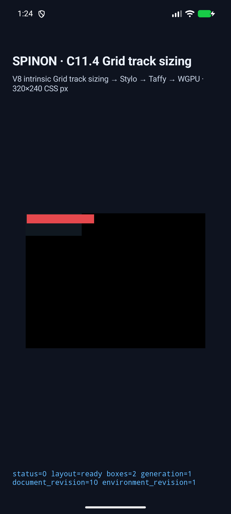
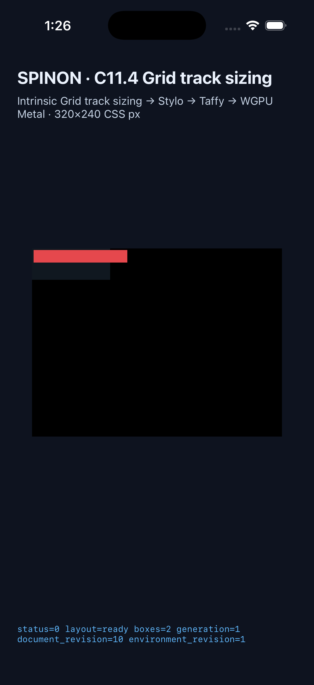

# C11.4 앱 track stage trace · 7-scene simulator matrix

**판정:** Android API 37 ARM64 AVD와 iPhone 17 Pro/iOS 26.2 Simulator에서 C11.4 앱 fixture 7개를 각각 실행했다. 각 scene에서 앱이 root/item frame을 확인하고 Columns·Rows trace를 기록했다. OS 로그 제한에 맞춰 trace JSON을 여러 항목으로 나눠 기록한 뒤 전부 복원해 파싱했다. 같은 scene의 canonical JSON 결과는 두 플랫폼에서 7/7 모두 일치했다. C11.4 전체 Grid 적합성이나 text/image intrinsic contribution의 앱 실행을 뜻하지 않는다.

## 범위

- scene: `auto-fixed-width-item`, `minmax-auto-fixed-width-item`, `fit-content-below-item-size`, `spanning-auto-tracks`, `auto-fill-repeat`, `auto-fit-collapse`, `auto-fill-track-overflow`.
- 매 scene의 응답에 `layoutInputRevision`, 두 축의 stage snapshot과 item contribution을 기록했다. Rust fixture reporter는 trace revision의 HostDocument generation/document/render-tree, style, environment가 완료 runtime key와 같은지 확인하고, intrinsic measurement/input이 있으면 모두 같은 revision인지 검사한다.
- `runtime-stage-summary.json`은 simulator 로그에서 JSON 조각을 복원한 뒤 stage 수·기여 수·revision·SHA-256을 정리한다. 양 플랫폼의 canonical trace JSON은 모든 scene에서 동일하다.
- 이번 7개 fixture는 fixed-size item이다. `gridItemIntrinsicInputs`와 `intrinsicMeasurements`는 비어 있고, text/image source의 intrinsic contribution은 아직 앱 경로에서 확인하지 않았다. 각 장면의 trace contribution은 별도 배열에 기록된다.
- 이 결과는 시뮬레이터에서 Rust runtime/WGPU 경로를 검증한 것이다. 실기기, hardware GPU, OS compositor 이후 결과, Metal drawable/PixelCopy 픽셀 표본은 포함하지 않는다.

## 환경·빌드

- Android: `emulator-5554`, `sdk_gphone16k_arm64`, Android 17/API 37 ARM64 AVD, SwiftShader. 실기기를 사용하지 않았다.
- iOS: iPhone 17 Pro Simulator, iOS 26.2, UDID `ACA7BF91-E2D5-4CF7-909A-08D1AD95FF3D`. 별도로 켜져 있던 iPad Simulator는 사용하지 않았다.
- 두 앱은 `/Users/yoonhb/Documents/workspace/spinon/build/v8-source/v8` 고정 V8 checkout으로 빌드했다.
- Android: `mise exec -- env SPINON_V8_DIR=/Users/yoonhb/Documents/workspace/spinon/build/v8-source/v8 SPINON_ENABLE_C04_RUNTIME_GPU_FIXTURE_TEST=1 SPINON_ANDROID_EMULATOR_SERIAL=emulator-5554 bash tools/build-android-app.sh` — [build log](android-avd/build.log), `BUILD SUCCESSFUL`.
- iOS: `mise exec -- env SPINON_V8_DIR=/Users/yoonhb/Documents/workspace/spinon/build/v8-source/v8 SPINON_ENABLE_C04_RUNTIME_GPU=1 SPINON_ENABLE_C04_RUNTIME_GPU_FIXTURE_TEST=1 SPINON_ENABLE_C11_2_3_GRID_FIXTURE_TEST=1 SPINON_IOS_SIMULATOR_UDID=ACA7BF91-E2D5-4CF7-909A-08D1AD95FF3D bun run build:ios-sim` — [공백 정리 build log](ios-simulator/build.log), `BUILD SUCCEEDED`. 정확한 원본 출력은 [압축 로그](ios-simulator/build.raw.log.gz)에 보존했다. 읽기용 사본에서는 줄 끝 공백과 마지막 빈 줄만 정리했다.

## 실행 결과

| 장면 | Android stages C/R | iOS stages C/R | Contributions C/R | 결과 |
| --- | ---: | ---: | ---: | --- |
| `auto-fixed-width-item` | 6/6 | 6/6 | 3/3 | trace JSON 동일 |
| `minmax-auto-fixed-width-item` | 6/6 | 6/6 | 2/3 | trace JSON 동일 |
| `fit-content-below-item-size` | 6/6 | 6/6 | 3/3 | trace JSON 동일 |
| `spanning-auto-tracks` | 6/6 | 6/6 | 3/3 | trace JSON 동일 |
| `auto-fill-repeat` | 6/2 | 6/2 | 0/0 | trace JSON 동일 |
| `auto-fit-collapse` | 6/2 | 6/2 | 0/0 | trace JSON 동일 |
| `auto-fill-track-overflow` | 6/2 | 6/2 | 0/0 | trace JSON 동일 |

`C/R`은 Columns/Rows를 뜻한다. 각 platform의 `runtime-<scene>.log` 파일에는 실행 ID가 포함된 완전한 trace chunk와 앱의 성공 summary가 있다. Android는 Logcat, iOS는 Simulator unified log에서 가져왔다.

## 화면

두 simulator에서 `auto-fill-track-overflow` scene을 캡처했다. 빨간 item이 100px Grid 바깥으로 확장되는 기존 장면을 보여주며, border stroke 픽셀 자체를 검증하지 않는다.

## 실패 경로 검토

- [앱 stage trace 구현 실패 관점 검토 20개](./implementation-review-20.md)
- [PR #345 변경 적대 검토 30개](./pr-diff-review-30.md)
- [frame assertion 전 trace 보존 후속 simulator 검증](../c11-4-grid-track-sizing-app-trace-failure-path-followup-2026-10-19/README.md)
