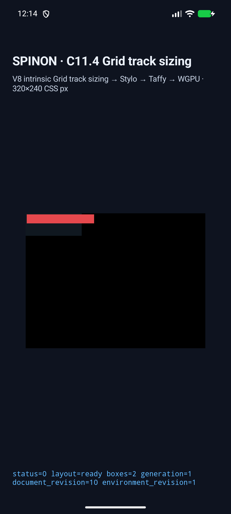
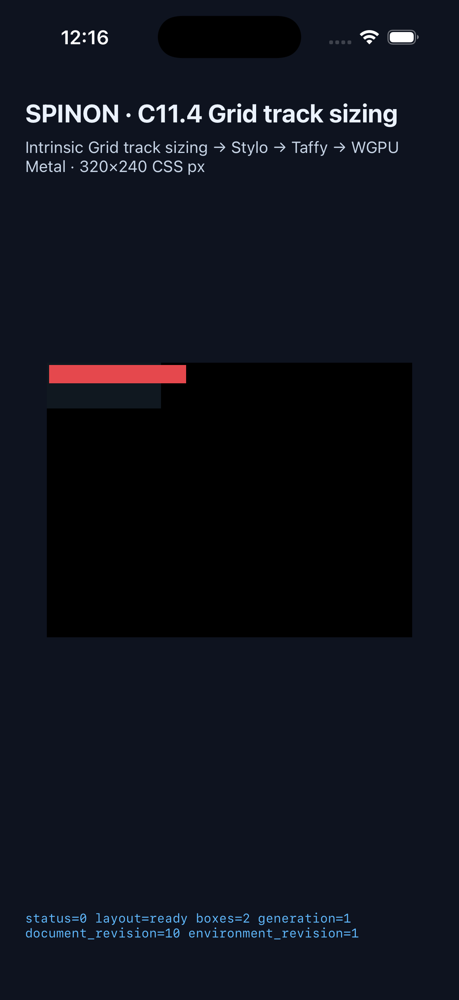

# C11.4 CSS auto-repeat·Grid overflow Simulator 후속

**결과:** CSS `repeat(auto-fill, …)`과 `repeat(auto-fit, …)`가 Stylo cascade부터 앱 layout·WGPU paint까지 이어졌다. Android API 37 ARM64 AVD와 iPhone 17 Pro/iOS 26.2 Simulator에서 세 장면 모두 `status=0`, `layout=ready`, 정확한 root/item frame을 기록했다.

## 입력과 frame

각 Grid는 `100×40 CSS px`, 2px border, `minmax(24px, 1fr)` auto-repeat pattern을 쓴다. item의 시작점은 `(2, 2)`다.

| 장면 | CSS 기대 결과 | Android AVD | iOS Simulator |
| --- | --- | --- | --- |
| `auto-fill-repeat` | item `24×16`; 남는 빈 repeated track 유지 | 통과 | 통과 |
| `auto-fit-collapse` | item `96×16`; 빈 repeated track collapse 후 남은 track 확장 | 통과 | 통과 |
| `auto-fill-track-overflow` | item `120×16`; 100px Grid 우측으로 22px 넘음 | 통과 | 통과 |

Android frame log에는 세 item의 `x=2`와 각각 `width=24/96/120`이 기록됐다. iOS environment log도 같은 root/item frame을 담는다. overflow 장면에서 screenshot의 red item은 grid background 끝보다 Android 58 physical px, iOS 66 physical px 더 오른쪽에 도달했다. 장치 pixel scale로 환산하면 각각 22.095 CSS px, 22 CSS px다. [pixel 측정 JSON](surface-pixel-extents.json) · [측정기](verify_surface_pixels.py).

## 시뮬레이터 화면

### Android API 37 ARM64 AVD

### iPhone 17 Pro · iOS 26.2 Simulator

나머지 auto-fill·auto-fit 캡처: [Android AVD](android-avd/auto-fill-repeat.png) · [Android auto-fit](android-avd/auto-fit-collapse.png) · [iOS auto-fill](ios-simulator/auto-fill-repeat.png) · [iOS auto-fit](ios-simulator/auto-fit-collapse.png).

## 실행 근거

- Android: 고정 API 37 ARM64 AVD `emulator-5554`만 설치·실행했다. real device에는 연결하지 않았다. [build log](android-avd/build.log) · [runtime frames](android-avd/runtime-frames.log) · [scene logs](android-avd/).
- iOS: booted iPhone 17 Pro UUID `ACA7BF91-E2D5-4CF7-909A-08D1AD95FF3D`만 실행했다. 별도로 booted된 iPad Simulator에는 설치하지 않았다. [build log](ios-simulator/build.log) · [runtime frames](ios-simulator/runtime-frames.log) · [scene logs](ios-simulator/).
- pixel 측정은 Pillow 11.3.0으로 screenshot의 정확한 `#101820` Grid background와 `#e5484d` item RGB bounds를 비교한다. CSS border stroke 자체의 pixel color는 판정에 포함하지 않았다. 측정은 item이 root background/frame의 오른쪽 끝을 넘는지와 item width/height가 CSS 기대값에 맞는지를 확인한다.
- Rust 경로는 `cargo test --locked -p spinon-style`, `spinon-style-to-layout`, `spinon-layout` 전체와 고정 Chrome 155 `chrome155_*` matrix로 별도 검증했다. 이 앱 smoke는 그 oracle 비교를 대체하지 않는다.

C11.4의 text/image contribution, 모든 intrinsic sizing stage, 전체 CSS Grid나 WPT 지원은 아직 완료되지 않았다.
