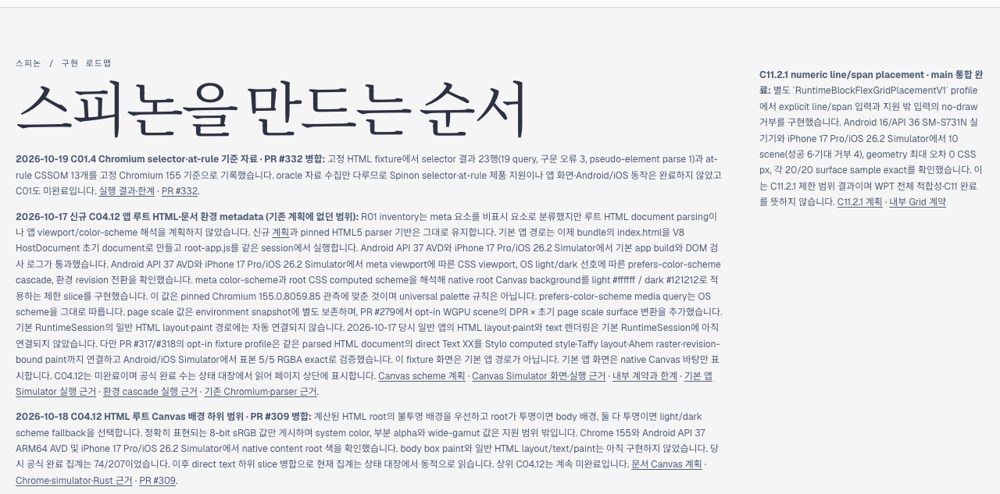
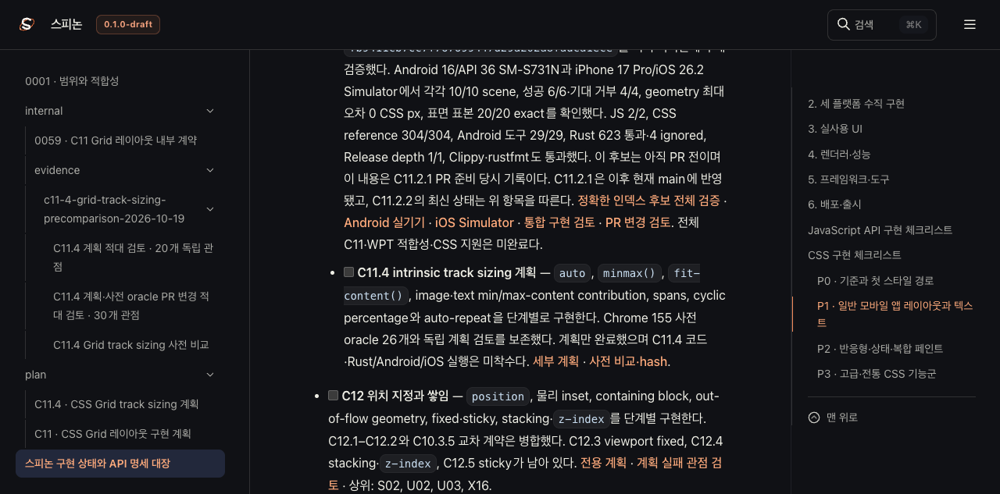
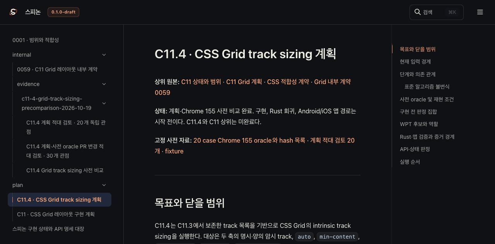
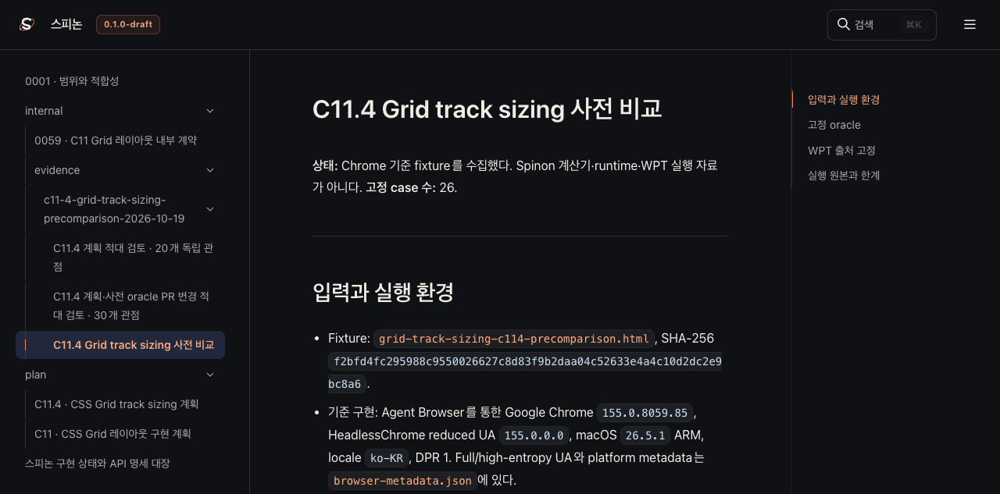

# C11.4 계획 병합 후 Tailnet 로드맵 동기화 · 2026-10-19

PR [#334](https://github.com/ohah/spinon/pull/334)가 `8a0e79a1ba03e1e0e554fb38d4451b197a4252c3`로 Rebase and merge된 뒤 공식 상태 대장과 Tailnet 미리보기를 갱신했다. C11.4 계획은 병합됐지만 구현은 시작 전이다. `spec/STATUS.md`의 C11.4는 unchecked로 남고, C11 전체와 공개 CSS Grid 지원도 미완료다.

## 화면 판정

Agent Browser에서 roadmap의 공식 집계 `212개 표시 · 공식 완료 72/212`를 확인했다. C11.4 계획 추가는 unchecked 세부 작업이므로 완료 수를 늘리지 않는다. `STATUS.html`의 C11.4 checkbox는 unchecked이며 세부 계획과 사전 oracle 링크가 연결된다. 계획 화면에서 Chrome 155 사전 근거와 단계 A를 확인했다. 로드맵에는 별도 C11.4 세부 계획 링크가 없고, 상태 대장에서 계획으로 연결한다. 화면 관찰과 PR 이미지 확인은 [Agent Browser 결과](./browser-verification.json)에 있다.

PR #334의 Chrome oracle 이미지 주소는 작업 branch 대신 병합 전 commit SHA를 사용한다. Agent Browser에서 `complete=true`, `1280×1363`으로 로드됨을 재확인했다. 이 이미지는 Chrome oracle이며 Spinon 앱 결과가 아니다.

## 렌더·동기화

프로젝트 고정 RSPress `2.0.22`로 이번 변경과 연결된 문서만 새 출력 경로에 렌더했다. 선택 렌더는 9 Markdown route와 정적 roadmap을 만들었다. 전체 문서 build는 C06·R05·S04의 기존 dead link와 누락 image에서 실패했으며, 전체 링크·이미지 적합성이나 전체 문서 build 성공으로 확대하지 않는다. 선택 렌더 결과와 로그는 [render-build-result.md](./render-build-result.md), [render-build.log](./render-build.log)에 있다.

Tailnet 동기화 전 45개 대상의 크기·SHA-256을 확인했다. 7개 기존 파일은 외부 backup에 복사한 뒤 backup hash가 원본과 같은지 확인했다. 새 파일 27개를 추가하고, 변경 파일 7개를 원자적으로 교체했으며, 동일한 파일 11개는 건너뛰었다. 삭제는 없었다. 사전 대상·원본·기존 hash는 [preflight](./preflight.json), backup 대조는 [backup 검증](./backup-verification-pass-1.json), 전달 결과는 [copy 검증](./copy-verification-pass-1.json)에 기록했다. 공개 evidence에서는 사용자 경로, Tailnet hostname, backup 절대 경로와 PID를 감췄다.

각 대상 route를 다시 가져와 HTTP 200, byte count, SHA-256을 source와 대조했다. [served 결과](./served-verification-pass-1.json) 45/45가 일치한다. 기존 Tailnet preview listener와 `spinon` tmux 세션은 유지했다. Agent Browser 탭을 닫고 격리 daemon과 browser child process가 끝난 상태를 확인했다([종료 확인](./browser-session-shutdown.json)).

- [계획 PR 변경 적대 검토 30개](../c11-4-grid-track-sizing-precomparison-2026-10-19/pr-delta-review-30.md)
- [증거 파일 SHA-256 목록](./SHA256SUMS)

## 남은 범위

이 동기화는 계획 문서 배포만 확인한다. C11.4 sizing 코드, Rust 회귀, Android API 37 AVD, iOS Simulator, overflow paint, WPT 실행을 검증하지 않는다. 전체 문서 site build·dead-link 검사는 위 제한처럼 미완료다. GitHub Pages 배포는 하지 않았다.
