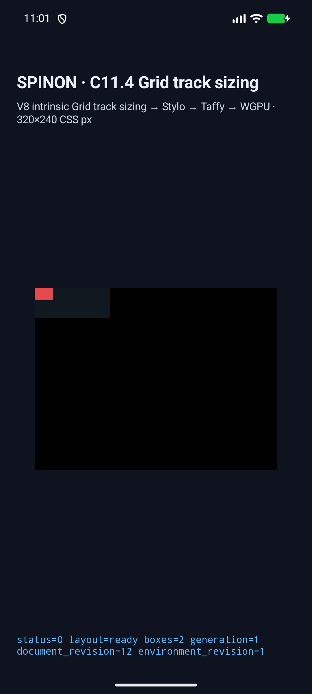
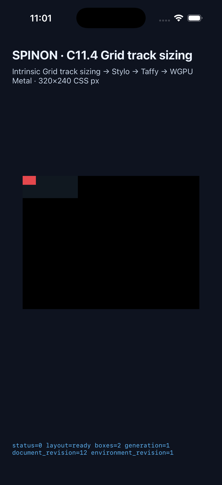

# C11.4 이미지 혼합 intrinsic track 실행 근거

이 기록은 `image-auto-max-mixed-tracks` opt-in fixture의 단계별 trace와 앱 경로를 다룬다. 규범 기대값은 [CSS Grid 2025 CRD 기반 사전 비교](../c11-4-image-auto-max-mixed-track-precomparison-2026-10-26/README.md), 구현 범위는 [child plan](../../../../plan/c11-4-image-auto-max-mixed-track.md)에 고정했다. Simulator 출력에서 기대값을 역산하지 않는다.

## 최신 strict-matcher 재검증 · source `cac4e339`

PR #643의 strict JSON trace 및 intrinsic-input matcher를 포함한 최신 Android/iOS 앱을 다시 빌드하고, 같은 run ID `c114-image-auto-max-20261026T020007Z-cac4e339-final05`로 Android API 37 ARM64 AVD와 iPhone 17 Pro / iOS 26.2 Simulator에서 실행했다. 두 플랫폼의 frame·intrinsic-input·trace·draw/present matcher가 각각 통과했다.

| Gate | 최신 결과 | 근거 |
| --- | --- | --- |
| Android V8 archive | 10 jobs, `1,743/1,743` 완료; SHA-256 `e0288be05fdedd7b5bed945dc446f7ec7dc11454034d0efc3dfe297d32cd7813` | [build log](./runs/c114-image-auto-max-20261026T011348Z-7a7aa224-final02/android-avd/v8-build-final-j10.log) |
| Android 앱 빌드 | `BUILD SUCCESSFUL`, `c04-runtime-gpu-fixture-test=1`; APK SHA-256 `8ce94e5ea7f2671b1adc4dd8f48c8dcc7ca1a78268040b8f5bd3bd4daed1d8fe` | [Gradle build log](./runs/c114-image-auto-max-20261026T020007Z-cac4e339-final05/android-avd/build.log) |
| Android API 37 AVD | `status=0`, `layout=ready`, `boxes=2`; root `100×40`, item `24×16`; intrinsic input·trace·draw/present 통과 | [runtime log](./runs/c114-image-auto-max-20261026T020007Z-cac4e339-final05/android-avd/runtime.log) |
| Android 화면 | 1080×2400 PNG, SHA-256 `75f9a8a3ee0de33ef55b0923486db60c9e08749f814820b68433bc0124c09302` | [최신 source 캡처](./runs/c114-image-auto-max-20261026T020007Z-cac4e339-final05/android-avd/screenshot.png) · [대표 화면](./c11-4-image-auto-max-mixed-track-android-api37-arm64.png) |
| iOS Simulator 앱 빌드 | `BUILD SUCCEEDED`, `c04-runtime-gpu-fixture-test=1`; 실행 파일 SHA-256 `32439c776aaabb5a3e8caa87c87c4e6bb321f1a4c6a775295293789dc19bd04f` | [Xcode build log](./runs/c114-image-auto-max-20261026T020007Z-cac4e339-final05/ios-simulator/build.log) |
| iPhone 17 Pro / iOS 26.2 Simulator | `status=0`, `layout=ready`, `boxes=2`; root `100×40`, item `24×16`; intrinsic input·trace·draw/present 통과 | [runtime log](./runs/c114-image-auto-max-20261026T020007Z-cac4e339-final05/ios-simulator/runtime.log) |
| iOS 화면 | 1206×2622 PNG, SHA-256 `a907274e7f99bd79031e674d1b46c4fd64fcd2c9c3617b47e078c2b287f93bbb` | [최신 source 캡처](./runs/c114-image-auto-max-20261026T020007Z-cac4e339-final05/ios-simulator/screenshot.png) · [대표 화면](./c11-4-image-auto-max-mixed-track-ios-26.2-simulator.png) |
| iOS용 V8 archive | 완료; SHA-256 `7a3e24607ea7b419d3fd858c35c094a566660f9d3112015487fa010d99e99815` | [build log](./runs/c114-image-auto-max-20261026T011348Z-7a7aa224-final02/ios-simulator/v8-build.log) |

첫 build 시도는 isolated worktree 안에서 `depot_tools/gn`과 플랫폼 archive를 찾지 못해 실패했다. 고정 V8 revision `7b50b62cb18f28617959e8452e2cd18195b38bcf`의 checkout은 사용자 main worktree에 있었고 변경 없이 유지됐다. iOS와 Android archive는 공유 checkout의 각 platform output에서 만들었다. Android 6-job 시도는 1,232/2,975 작업 뒤 10-job 재개를 위해 중단했으며, 완료 object를 재사용해 1,743개 작업으로 마쳤다. Android archive는 179M이고 SHA-256은 `e0288be05fdedd7b5bed945dc446f7ec7dc11454034d0efc3dfe297d32cd7813`이다. 최초 실패와 중단 log는 별도로 보존했다.

Android와 iOS의 draw log 모두 `runtime_image_count=0`, `image_draw_count=0`이다. 이 결과는 PNG의 natural `24×16` intrinsic input, Grid frame/track trace, surface presentation을 확인하며 PNG decode·raster paint 또는 pixel equality는 확인하지 않는다. 화면의 빨간 사각형은 fixture의 img background color다.

## trace 판정 기준

CSS Grid §11.4의 `Initialize`에서 intrinsic max track growth limit은 규범상 `+∞`로 초기화된다. Serializer는 모든 non-finite 값을 `None`/JSON `null`로 내보낸다. 따라서 초기 `null`은 projection을 확인할 뿐 내부 값이 `+∞`라는 증거가 아니다. 이 span-1 max-content contribution은 §11.5의 `IntrinsicItemBatch` 뒤에 열 `24px`, 행 `16px`으로 resolve된다.

Taffy `GridTrackVec`은 CSS track과 grid-line slot을 교차 저장하므로 `N` CSS track에 raw entry `2N+1`개가 있다. 각 값은 `baseSize/growthLimit`이다.

| Axis/stage | raw slot | 기대값 |
| --- | --- | --- |
| Columns / Initialize | sentinel, col0, gutter, col1, sentinel | `[0/0, 0/null, 5/5, 17/17, 0/0]` |
| Columns / IntrinsicItemBatch 이후 | 같은 5 slots | `[0/0, 24/24, 5/5, 17/17, 0/0]` |
| Rows / Initialize | sentinel, row0, sentinel | `[0/0, 0/null, 0/0]` |
| Rows / IntrinsicItemBatch 이후 | 같은 3 slots | `[0/0, 16/16, 0/0]` |

양 끝 sentinel은 `gutter=true, collapsed=true`, 내부 실제 5px gutter는 `gutter=true, collapsed=false`다. CSS track은 접히지 않으며 전체 slot의 `infinitelyGrowable=false`를 확인한다. 유한 수 비교 허용 오차는 `0.0001px`다.

## 보존한 이전 실행

- [수정 전 실패 후보 `c114-image-auto-max-20261026T000220Z-040a5360`](./runs/c114-image-auto-max-20261026T000220Z-040a5360/): 두 simulator가 layout/frame과 24×16 PNG intrinsic input은 냈으나 native matcher가 이전 trace 배열을 기대해 실패했다. 통과 근거가 아니다.
- [trace 단계 수정 후 후보 `c114-image-auto-max-20261026T002422Z-040a5360-stagefix01`](./runs/c114-image-auto-max-20261026T002422Z-040a5360-stagefix01/): Android API 37 ARM64 AVD와 iPhone 17 Pro/iOS 26.2 Simulator의 frame·6-stage trace·draw/present matcher가 각각 1/1 통과했다. 이 실행은 strict JSON hardening 전 코드다. source `e4570a04`의 실행이며 최신 `cac4e339` matcher 검증을 대신하지 않는다.
- 이전 후보의 APK SHA-256 `35b114666be4a347225f895cc8e06f579522a345d0572e77e95cce3861df6d54`, iOS 실행 파일 SHA-256 `39c49b4aa5c59bea50a367cc8b2b6f44ee8c56ee8c68f6d5047adba2eab0aa`; 원본 및 화면 hash는 [manifest](./stage-corrected-sha256sums.txt)에 있다.

## 독립 검사와 artifact 경계

- fail-closed source/style/prepare 입력 검사: [기록과 원본 log](./fail-closed-controls/README.md). Runtime focused tests **8 passed**, Clippy와 `cargo fmt --check` 통과. Direct validator error와 `prepare()` 거부를 확인하며 downstream frame/trace/resource 부재를 관측했다고 주장하지 않는다.
- default/product와 opt-in fixture-test `spinon-ffi` release archive 비교: [artifact 경계](./feature-boundary/README.md). 정적 archive 결과이며 APK/IPA 전체 fixture 제외를 증명하지 않는다.
- PR #643 본문의 final05 화면 링크를 Agent Browser에서 확인했다. 두 URL은 immutable evidence commit `9b3101dca186ee55016b2023c9610186b4df9ecb`을 가리키고 Android `1080×2400`, iOS `1206×2622`로 `complete=true` 렌더됐다. 전용 `spinon-pr643-final05-3bd9bb4c052c` session 종료 후 `active=false`, `pid=null`, agent-browser process match 0개다. 남아 있던 `hwpjs-display-cache-20261026` 사용자 session은 건드리지 않았다. [검사 JSON](./pr-image-link-check-2026-10-26.json). 이는 링크 로드 확인이며 PNG paint나 pixel equality 증거가 아니다.

final05 source, V8 revision, app/archive/screenshot SHA-256 목록은 [run manifest](./runs/c114-image-auto-max-20261026T020007Z-cac4e339-final05/source-hashes.json)에 있다.
Xcode `build.log`는 줄 끝 공백만 제거한 읽기용 사본이고, 동일 run의 `build.raw.log.gz`가 원본 출력이다. Simulator device-list의 표 끝 공백도 정리했다.

## 범위 제한

이 slice는 overflow 동작, PNG raster paint/readback, pixel equality, 일반 CSS admission, WPT, 실기기, hardware GPU를 검증하지 않는다. Android/iOS 최신 source 재검증과 merge 검토가 끝나도 전체 C11.4 Stage A/B 또는 상위 완료를 뜻하지 않는다. 공식 완료 수는 `72/213`으로 유지한다.
