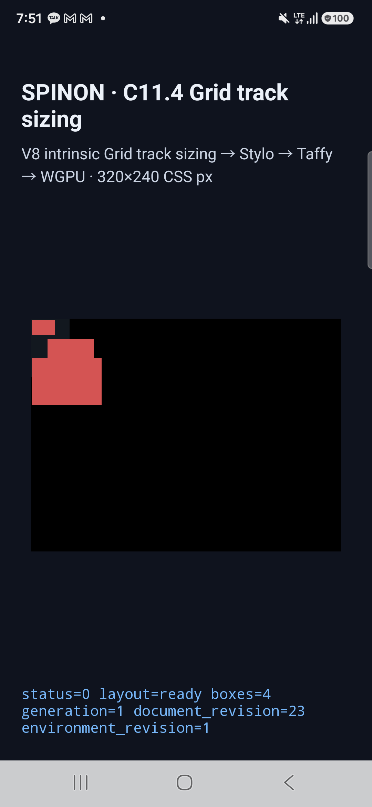

# C11.4 직접 이미지 multi-span contribution 실행 근거

이 자료는 Grid의 두세 열을 차지하는 직접 HTML `img`가 만드는 min-content contribution을 네 장면으로 제한 검증한다. C11.4 전체 완료나 이미지 texel paint를 주장하지 않는다.

## 브라우저 기준

- Agent Browser로 연 macOS ARM의 Chrome `155.0.8059.85`, DPR 1을 사용했다.
- 입력과 입력 hash는 [`grid-track-sizing-c114-image-multispan-precomparison.html`](../../../../tests/fixtures/css/c11/grid-track-sizing-c114-image-multispan-precomparison.html) 및 [사전 비교 기록](../c11-4-image-multispan-precomparison-2026-10-21/README.md)에 있다.
- 네 장면은 같은 24×16 PNG를 decode한다. `height` 16/32/48px와 `width:auto` 조합에서 이미지 frame은 각각 24×16, 48×32, 72×48 CSS px이다.

## 최종 runtime 실행

세 대상에서 네 장면 모두 track trace, 전체 node frame, 출력 제출, native 표면 표본 확인에 통과했다.

| 대상 | 환경 | 실행 근거 | 바이너리 식별 |
| --- | --- | --- | --- |
| Samsung SM-S731N 실기기 | Android 16 / API 36, arm64, Vulkan의 Xclipse 940 | [기기 결과](./android-device-c114-image-multispan-contributions-android-device-20261020T225140556Z-9d615dad/result.json) · [기기 정보](./android-device-c114-image-multispan-contributions-android-device-20261020T225140556Z-9d615dad/device.json) | 빌드 APK와 설치 APK 모두 `b9c803c31ffcfa178388a5b8d134d9372c2d4480162b7d80d5adc2d31a2390e3` |
| Android AVD | API 37, arm64 | [AVD 결과](./android-avd-c114-image-multispan-contributions-android-avd-20261020T225205145Z-ee25ca37/result.json) · [AVD 정보](./android-avd-c114-image-multispan-contributions-android-avd-20261020T225205145Z-ee25ca37/simulator.json) | 빌드 APK와 설치 APK 모두 `b9c803c31ffcfa178388a5b8d134d9372c2d4480162b7d80d5adc2d31a2390e3` |
| iPhone 17 Pro Simulator | iOS 26.2 | [Simulator 결과](./ios-simulator-c114-image-multispan-contributions-ios-simulator-20261020T225351462Z-a6d2bcb0/result.json) · [Simulator 정보](./ios-simulator-c114-image-multispan-contributions-ios-simulator-20261020T225351462Z-a6d2bcb0/simulator.json) | 앱 SHA-256 `80de0a492349a42c86a1e66a630fd1577dd43c4622cab62a38d2442b4c0d6685` |

## 관찰된 기하

| 장면 | 열 크기 | root 기준 item frame (CSS px) |
| --- | --- | --- |
| `image-span2-forward` | `[12, 24, 24, 0]` | (1,1)에 24×16; (13,21)에 48×32 |
| `image-span2-reversed` | `[12, 24, 24, 0]` | 위 두 frame과 같고 DOM 순서만 반대 |
| `image-span2-before-span3` | `[16, 28, 28, 0]` | (1,1)에 24×16; (17,21)에 48×32; (1,41)에 72×48 |
| `image-span3-before-span2` | `[16, 28, 28, 0]` | 위 세 frame과 같고 DOM 순서만 반대 |

각 장면의 root는 40×60이다. Android PixelCopy와 iOS Metal 표면 캡처에서 root 내부, root 외부, 오른쪽으로 넘친 item 배경을 확인했다. 세 이미지 장면에서는 root 아래쪽 표본도 확인했다. 캡처는 각 실행 폴더에 있으며 예시로 [Android 실기기 세 이미지 장면](./android-device-c114-image-multispan-contributions-android-device-20261020T225140556Z-9d615dad/image-span2-before-span3.png), [Android AVD](./android-avd-c114-image-multispan-contributions-android-avd-20261020T225205145Z-ee25ca37/image-span2-before-span3.png), [iOS Simulator](./ios-simulator-c114-image-multispan-contributions-ios-simulator-20261020T225351462Z-a6d2bcb0/image-span2-before-span3.png)을 볼 수 있다.

화면에 보이는 것은 item의 CSS 배경이다. runtime이 이미지 texel을 그리는 기능은 이번 fixture 범위 밖이므로, 결과는 intrinsic sizing 입력·layout·overflow 기하만 검증한다.

## 표면 검증 범위

초기 PixelCopy에서 CSS 녹색 border의 크기는 layout 위치에 반영됐지만 border 색은 Android SurfaceView에 그려지지 않았다. 이 범위는 유지하되 content box 38×58 및 item inset 1px을 보존하기 위해 최종 브라우저와 앱 fixture는 `padding:1px`, border 없음으로 구성했다. native 표면 검사는 root 내부·외부와 넘친 item을 구분한다. border paint는 검증했다고 주장하지 않는다.

실패한 진단 실행도 감사를 위해 이 폴더에 보존했다. 초기 scene index 검사, 지원하지 않는 `align-self`/`justify-self` 값, 첫 border 색 표본 불일치가 포함된다. 최종 성공 근거로는 세 대상의 마지막 `result.json`만 사용한다.

## 검토 기록

- [구현 및 runtime 검토 20개](./implementation-review-20.md)
- [PR diff 적대적 검토 30개](./pr-diff-review-30.md)
- [PR #411](https://github.com/ohah/spinon/pull/411)
