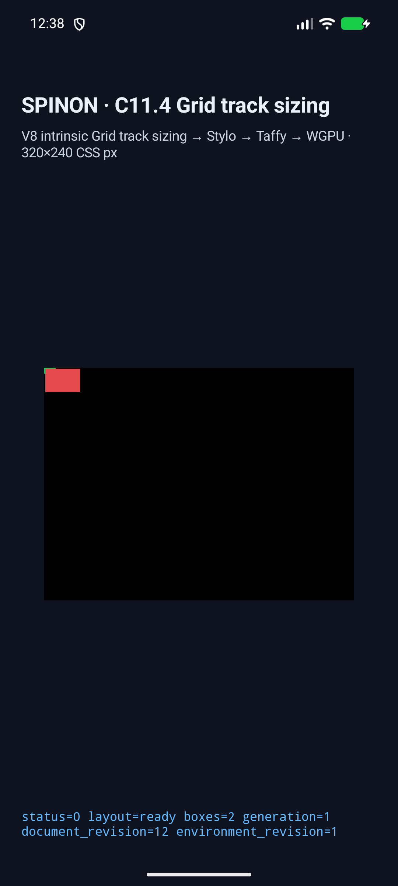
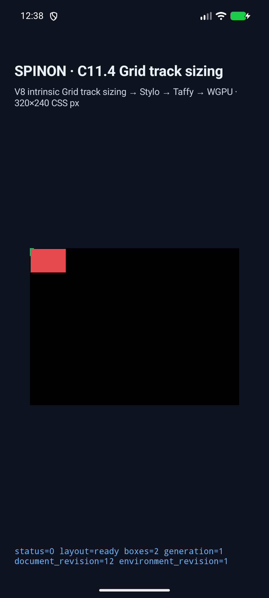
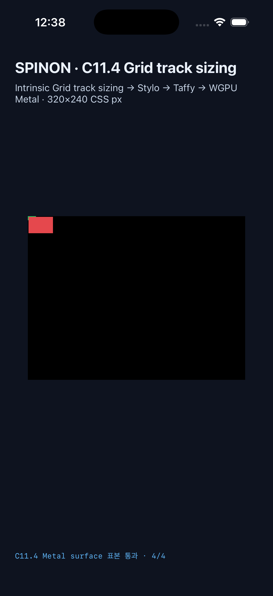
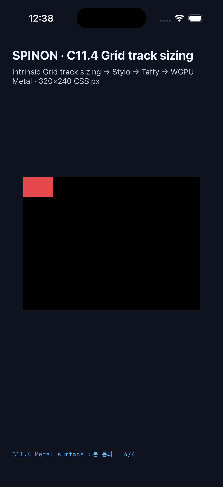

# C11.4 fixed-span size suggestion · 구현과 Simulator 근거

**상태:** 제한 구현 후보. C11.4·C11 완료, 공개 CSS 지원 또는 WPT 적합성 선언이 아니다. PR diff 적대 검토 30개를 완료했으며 PR 생성·required checks·merge와 Tailnet preview 반영은 남아 있다.

## 수정한 규칙

처음 의심한 span gutter 누락은 재현되지 않았다. Taffy `GridTrackVec` span range는 내부 gutter 항목을 이미 한 번 포함한다. 실제 결함은 definite preferred-size suggestion이 author min/max를 거친 직후 반환되어 CSS Grid Level 1 §6.6의 all-fixed grid-area maximum cap을 건너뛴 점이다. 구현은 min/max clamp 뒤에 `sum(fixed max tracks) + sum(internal fixed gutters)` limit을 적용하며, gutter를 다시 더하지 않는다. 기준은 [W3C CSS Grid Level 1 §6.6](https://www.w3.org/TR/2025/CRD-css-grid-1-20250326/#min-size-auto)이다.

한도는 모든 span max sizing function이 finite definite 값인 경우에만 계산한다. `fr`와 `fit-content()` control에는 cap을 만들지 않는다. 합계는 f64로 보존하고 f32 contribution으로 표현할 수 없는 limit은 clamp에서 생략한다. trace에는 `fixed_track_sum`, `fixed_gutter_sum`, `fixed_track_limit`을 각각 기록한다.

## Rust·native 실행

| 검사 | 결과 |
| --- | --- |
| `mise exec -- cargo test --locked -p spinon-layout` | 181 passed, 0 failed |
| `mise exec -- cargo test --locked -p spinon-layout grid_image_ratio -- --nocapture` | 8 passed, 0 failed |
| `mise exec -- cargo test --locked -p spinon-runtime --features c11-4-grid-track-sizing-fixture-test c11_4_image -- --nocapture` | 2 passed, 0 failed |
| `mise exec -- cargo test --locked -p spinon-ffi --features c04-runtime-gpu-fixture-test c11_4::tests::exposes_only_bounded_intrinsic_track_sizing_scenes -- --nocapture` | 1 passed, 0 failed |
| `mise exec -- bun test tools/css-reference/fixture-module-boundary.test.mjs` | 6 passed, 0 failed |
| Android debug APK build | `BUILD SUCCESSFUL` · `android-build.log` (host paths redacted; whitespace normalized) |
| iOS Simulator build | `BUILD SUCCEEDED` · `ios-build.log` (host paths redacted; whitespace normalized) |
| default 및 `c04-runtime-gpu-fixture-test` FFI artifact scan | 기본 `.a`/`.rlib`에는 두 scene ID가 없고 opt-in fixture `.a`/`.rlib`에는 둘 다 있음 |
| `mise exec -- cargo clippy --locked --workspace --all-targets -- -D warnings` | 통과 |
| diff formatting | `cargo fmt --all -- --check`, Bash syntax, Swift parse, `git diff --check` 통과 |

Simulator matrix의 최종 성공 run은 `c114-fg-20261019T153833Z`이다. 스크립트는 Android `spinon_api37_1_compat16k` AVD / API 37 / arm64-v8a와 iPhone 17 Pro / iOS 26.2 Simulator(`ACA7BF91-E2D5-4CF7-909A-08D1AD95FF3D`, model `iPhone18,1`)를 명시적으로 확인하고 다른 대상을 거부한다. 실기기는 연결하지 않았다. 재현 스크립트는 `run-simulator-matrix.sh`이며 원본 로그는 `runs/c114-fg-20261019T153833Z/android-avd/`와 `runs/c114-fg-20261019T153833Z/ios-simulator/`에 있다.

| 장면 | span | expected preferred contribution | expected transferred minimum | item frame |
| --- | --- | ---: | ---: | ---: |
| `fixed-gutter-column-suggestion-clamp` | columns `3px + 3px gutter + 4px` | 10px | row `10 / 1.5 = 6.6667px` | 36×24px |
| `fixed-gutter-row-suggestion-clamp` | rows `3px + 3px gutter + 4px` | 10px | column `10 × 1.5 = 15px` | 54×36px |

두 플랫폼 모두 root/item frame과 trace를 2/2 장면에서 통과했다. 각 scene에서 trace는 fixed track 7px, gutter 3px, limit 10px을 기록했다. 1px grid border는 녹색(`#22c55e`), image의 CSS background box는 빨간색(`#e5484d`)이다. Android PixelCopy와 iOS Metal drawable에서 scene당 border·item 내부·grid 오른쪽 바깥·grid 아래 바깥을 각각 4/4 exact로 표본 확인했다. 이는 viewport 내 grid 경계 바깥 overflow를 확인하며 PNG texel을 그렸다는 뜻은 아니다. iOS 표본은 compositor 제출 전 Metal drawable 값이다.

### Android API 37 AVD · column span

### Android API 37 AVD · row span

### iPhone 17 Pro / iOS 26.2 Simulator · column span

### iPhone 17 Pro / iOS 26.2 Simulator · row span

화면에는 실행 상태 footer가 보인다. screenshot은 시각적 보조 자료이며 exact 색 검사는 위 native readback 로그의 좌표별 결과다.

Rust·Clippy·JS 경계 검사 명령과 기본/opt-in artifact 문자열 scan 결과는 `verification.log`에 보존했다. 전체 RSPress 문서 build는 이 후보 작업 중 repo-wide dead-link backlog(당시 604개 Markdown source로 보고됨) 때문에 실패했으므로 full docs build 통과를 주장하지 않는다. 이 slice의 계획·계약·근거 링크는 selected Tailnet preview에서 따로 확인할 예정이다.

## 실패 관점 검토와 남은 범위

- [구현 적대 검토 20개](implementation-review-20.md)는 계획 검토 표를 재사용하지 않았다. PR 통합·artifact·Simulator·문서 경계는 새 [PR diff 적대 검토 30개](pr-diff-review-30.md)에서 따로 확인했다. 검토 중 재현 스크립트의 대상 기기 guard 누락을 찾아 고친 뒤 실제 AVD/Simulator preflight와 `bash -n`을 재실행했다.
- percentage/calc track·gap, vertical writing mode, implicit placement, dynamic replacement, nested·anonymous·multiple item, auto-repeat 조합, WPT 및 전체 CSS Grid는 검증하지 않았다.
- Android는 API 37 AVD이며 실제 Android 기기·hardware GPU 결과가 아니다. iOS는 Simulator이며 실기기와 compositor 이후 pixel 결과가 아니다.
- C11.4 공식 체크와 완료 수는 변경하지 않았다.

## 파일과 manifest

최종 실행의 run id, source base commit, device metadata, app logs와 캡처는 `runs/c114-fg-20261019T153833Z/` 아래 있다. 상위 `android-build.log`, `ios-build.log`, `verification.log`, `run-simulator-matrix.sh`, 본 README, 구현·PR diff 검토 및 이 성공 run의 파일들은 `SHA256SUMS`에 기록한다. 빌드 로그는 host path와 trailing whitespace를 정규화한 읽기용 사본이다. 앞선 진단 run은 최종 matrix에 포함하지 않는다.
