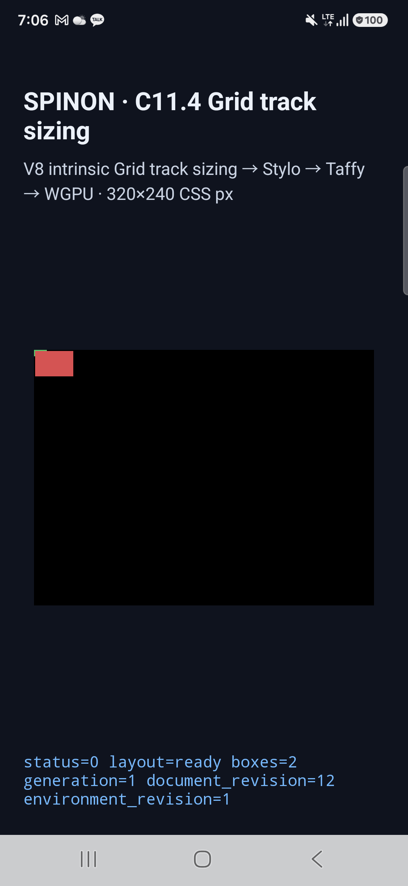
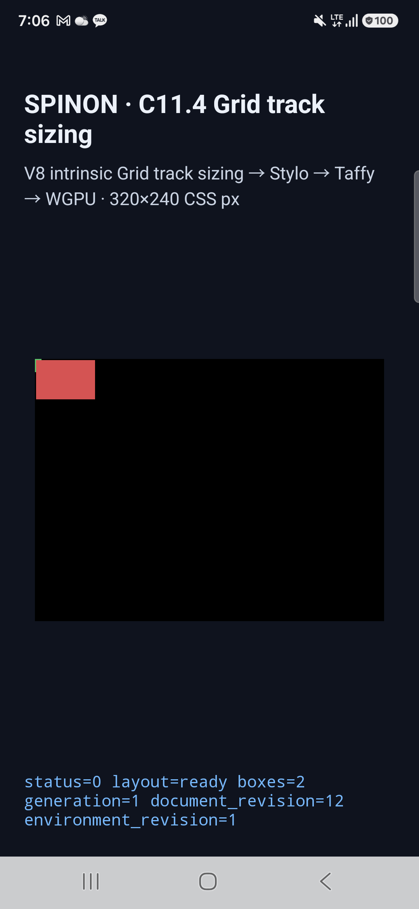

# C11.4 fixed-gutter image ratio · Android 실기기 보충 검증

2026-10-21 KST, 사용자가 연결한 Samsung SM-S731N 실기기에서 PR #357의 fixed-gutter 두 장면을 추가 실행했다. 기존 근거는 Android API 37 AVD와 iOS Simulator였다. 이번 보충 검증은 C11.4 전체 완료나 공개 CSS 지원 범위를 바꾸지 않는다.

## 환경과 실행물

| 항목 | 값 |
| --- | --- |
| 기기 | Samsung SM-S731N · serial `R5KYB06SMPE` |
| Android | 16 · API 36 · arm64-v8a · `qemu=0` |
| 화면 | 1080×2340 · density 450 dpi |
| SurfaceFlinger renderer | Samsung ANGLE · Xclipse 940 · Vulkan 1.3.279 · OpenGL ES 3.2 |
| source HEAD | `34786672f2c805d72ba94022b7074a588e08e768` |
| APK SHA-256 | `700db4024be649037da902c67370587ec80ee543145caee2fb16278bf8e2439c` |
| installed `base.apk` | local APK와 SHA-256 일치 |
| run ID (UTC) | `c114-fg-device-20261020T220621187Z` |

이미 설치된 debug APK와 checkout의 APK가 동일해 재설치를 생략했다. 이 실행은 APK를 새로 빌드하지 않고 동일 SHA-256의 fixture APK를 사용했다. 기기 정보, APK 확인과 실행 JSON은 이 폴더의 `c114-fg-device-20261020T220621187Z/`에 보존했다.

## 실행 결과

| 장면 | 기대 root frame | 기대 image frame | track trace | surface 표본 |
| --- | --- | --- | --- | --- |
| `fixed-gutter-column-suggestion-clamp` | 12×6 CSS px | 36×24 CSS px | fixed track 7px + 내부 gutter 3px = limit 10px | 4/4 exact |
| `fixed-gutter-row-suggestion-clamp` | 6×12 CSS px | 54×36 CSS px | fixed track 7px + 내부 gutter 3px = limit 10px | 4/4 exact |

두 장면 모두 runtime `status=0`, track sizing trace와 draw/present를 확인했다. Android SurfaceView PixelCopy에서 grid border, item 내부, grid 오른쪽 바깥, grid 아래 바깥의 지정 좌표를 확인했고 각 표본의 RGBA가 기대값과 모두 일치했다. 장면 로그는 각각 `runtime-fixed-gutter-column-suggestion-clamp.log`, `runtime-fixed-gutter-row-suggestion-clamp.log`이며 `result.json`에 frame summary, PixelCopy summary, 화면·surface PNG SHA-256이 있다.

원본 파일: [실기기 result JSON](./c114-fg-device-20261020T220621187Z/result.json) · [column 화면 PNG](./c114-fg-device-20261020T220621187Z/screen-fixed-gutter-column-suggestion-clamp.png) · [row 화면 PNG](./c114-fg-device-20261020T220621187Z/screen-fixed-gutter-row-suggestion-clamp.png) · [재현 스크립트](./capture-android-device.mjs).

## 재현과 한계

저장소 루트에서 `node spec/internal/evidence/c11-4-image-ratio-fixed-gutter-physical-android-2026-10-21/capture-android-device.mjs R5KYB06SMPE`를 실행한다. 스크립트는 지정 serial이 실제 연결된 Samsung SM-S731N / API 36 / ARM64인지, AVD가 아닌지, SurfaceFlinger가 Xclipse 940/Vulkan renderer인지 확인한다. APK와 설치 `base.apk` SHA-256을 대조한 후 두 장면의 runtime frame·trace, native PixelCopy 색 표본, 기기 화면과 SurfaceView PNG를 저장한다. 마지막 row scene은 기기에 열어 둔다.

이 검증은 기기 한 대와 고정 fixture APK에 한정된다. PixelCopy 표본은 선택한 SurfaceView 좌표의 색만 검증하며 PNG texel, 화면 합성 이후 최종 픽셀, 다른 Android 기기, iOS 실기기, WPT 또는 전체 CSS Grid 적합성을 증명하지 않는다. C11.4 상태와 공식 완료 수는 그대로 미완료다.
