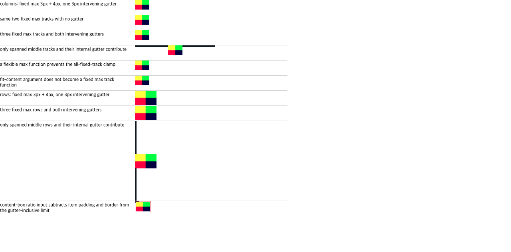

# C11.4 fixed max track span과 gutter의 사전 비교

2026-10-19, direct replaced Grid item의 §6.6 automatic minimum을 위해 Chrome 155 Agent Browser 관찰과 CSS Grid Level 1 표준 기대값을 분리해 기록했다. 이 실행은 계획·oracle 자료이며 Spinon 구현, Android/iOS Simulator, WPT, 제품 기능 검증이 아니다.

## 기준과 재현

- 표준: [CSS Grid Layout Module Level 1 · 2025-03-26 CRD §6.6](https://www.w3.org/TR/2025/CRD-css-grid-1-20250326/#min-size-auto). fixed max track만 span하는 경우 suggestion과 transferred-size source input을 max track functions의 합과 내부 fixed gutters의 합으로 제한한다.
- Browser: Google Chrome `155.0.8059.85`, Agent Browser `0.31.1`, macOS `26.5.1` ARM64, DPR 1, `innerWidth×innerHeight` `1280×633`.
- Fixture: [grid-track-sizing-c114-image-ratio-fixed-gutter.html](https://github.com/ohah/spinon/blob/main/tests/fixtures/css/c11/grid-track-sizing-c114-image-ratio-fixed-gutter.html). 모든 image는 decode 완료 후 수집했다. Natural dimensions는 `24×16`; fixed preferred size는 `36px`; authored ratio는 `3/2`이다.
- 주요 기록: [관찰 JSON](https://github.com/ohah/spinon/blob/main/spec/internal/evidence/c11-4-image-ratio-fixed-gutter-precomparison-2026-10-19/chrome155-agent-browser-observation.json), [Agent Browser 원출력](https://github.com/ohah/spinon/blob/main/spec/internal/evidence/c11-4-image-ratio-fixed-gutter-precomparison-2026-10-19/chrome155-agent-browser-observation.raw.json), [SHA-256](https://github.com/ohah/spinon/blob/main/spec/internal/evidence/c11-4-image-ratio-fixed-gutter-precomparison-2026-10-19/SHA256SUMS).

## 관찰과 표준 기대값

Chrome은 두/세 track, gutter 0/3px, row/column 및 외부 unspanned track 유무와 관계없이 row-transfer 장면에 row `24px`, column-transfer 장면에 column `54px`를 관찰했다. 이는 §6.6에서 고정 track span max-size로 제한한 기대와 다르다. Chrome 결과를 규범적 정답으로 취급하지 않고 상호 운용 차이로 기록한다.

| 장면 | fixed max tracks | 내부 gutter | §6.6 limit | ratio 기대값 | Chrome item/track 관찰 |
| --- | --- | ---: | ---: | ---: | --- |
| column two tracks | `3px + 4px` | `3px` | `10px` | row `6.666667px` | columns `29px 4px`, item `36×24px`, row `24px` |
| column two tracks | `3px + 4px` | `0px` | `7px` | row `4.666667px` | columns `32px 4px`, item `36×24px`, row `24px` |
| column three tracks | `3px + 4px + 5px` | `3px × 2` | `18px` | row `12px` | columns `21px 4px 5px`, item `36×24px`, row `24px` |
| middle column span | `3px + 4px` | `3px` inside span | `10px` | row `6.666667px` | columns `80px 29px 4px 90px`, item `36×24px`, row `24px` |
| row two tracks | `3px + 4px` | `3px` | `10px` | column `15px` | rows `29px 4px`, item `54×36px`, column `54px` |
| row three tracks | `3px + 4px + 5px` | `3px × 2` | `18px` | column `27px` | rows `21px 4px 5px`, item `54×36px`, column `54px` |
| middle row span | `3px + 4px` | `3px` inside span | `10px` | column `15px` | rows `80px 29px 4px 90px`, item `54×36px`, column `54px` |
| content-box image | border-box max `10px`, content max `6px` | `3px` | `6px` transfer input | content height `4px` + edges `4px` = row `8px` | columns `33px 4px`, outer item `40×28px`, row `28px` |
| flexible / fit-content controls | not all fixed max functions | `3px` | no all-fixed limit | row `24px` | columns `29px 4px`, row `24px` |

The result table uses the CSS computed track strings and `getBoundingClientRect()` from Chrome. Some used tracks exceed their authored fixed max because the image contribution affects sizing; these are the observed used sizes, not inputs to the §6.6 expected cap. The standard expected limit is calculated from the fixed max sizing functions and the gutters inside the item span. `window.c114ImageRatioFixedGutterReady` awaited all image decodes before collection, and the JSON records the natural size and source URL for each scene.

## Hashes

The [SHA-256 manifest](https://github.com/ohah/spinon/blob/main/spec/internal/evidence/c11-4-image-ratio-fixed-gutter-precomparison-2026-10-19/SHA256SUMS) covers the fixture, normalized JSON, raw Agent Browser output, screenshot, plan review and separate PR diff review. The screenshot shows a visible rendered page; it does not prove Spinon behavior or pixel output from either mobile simulator.
