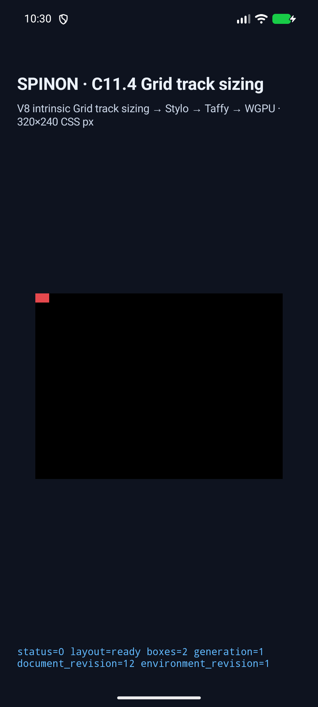
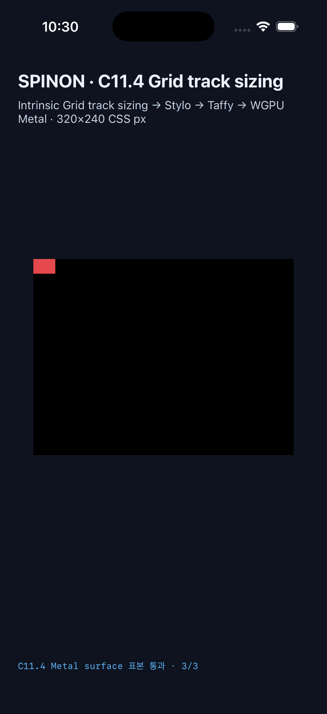

# C11.4 이미지 비율 전이 입력의 고정 트랙 제한

2026-10-19, 직접 HTML `img` Grid 항목의 automatic minimum에서 aspect-ratio로 반대 축에 전달하는 크기 입력을 고정 max track 합계로 제한하는 두 방향의 후보 구현을 검증했다. 범위는 `RuntimeBlockFlexGridTrackSizingV1` fixture에 한정한다. C11.4 전체나 이미지 픽셀 렌더링의 완료 근거가 아니다.

## 비교 기준과 Chrome 관찰

현재 공개된 [CSS Grid Layout Module Level 1 §6.6](https://www.w3.org/TR/css-grid-1/#min-size-auto)은 항목이 해당 축에서 fixed max track sizing function만 span하면, 그 축의 size suggestion과 반대 축 transferred size suggestion에 넣는 입력을 고정 max track 합계와 고정 gutter 합계 이하로 제한한다고 적고 있다. 이 기준은 2025-03-26 Candidate Recommendation Draft에 있다. 문서 자체가 작업 중인 초안이므로 아래 구현과 Chrome 차이는 상호 운용 차이로 기록하며, 여기서 Chrome 결함으로 확정하지 않는다.

Chrome 155는 Agent Browser에서 같은 CSS fixture와 24×16 PNG를 실행했다. 두 신규 장면 모두 aspect ratio는 `1.5 / 1`이었다.

| 장면 | CRD에서 도출한 반대 축 입력·track 기대값 | Chrome 155 실제 track | Chrome item frame |
| --- | --- | --- | --- |
| `row-transfer-input-capped-by-fixed-column-span` | 고정 column 8px가 width 입력을 제한해 row track `8 / 1.5 = 5.333333px` | columns 8px, rows 12px | 18×12px |
| `column-transfer-input-capped-by-fixed-row-span` | 고정 row 8px가 height 입력을 제한해 column track `8 × 1.5 = 12px` | columns 27px, rows 8px | 27×18px |

고정 Chrome 155 관찰 원본은 `chrome155-agent-browser-observation.raw.json`, `chrome155-image-ratio-span.png`에 있다. CSS 입력은 `tests/fixtures/css/c11/grid-track-sizing-c114-image-ratio-span.html`이다. Chrome 결과와 CRD에서 도출한 기대값이 다르므로 앱 기대값은 CRD 규칙과 track trace를 기준으로 판정했다.

## 구현 후보

- `CompactTaffyStyle`이 Taffy `is_replaced()`를 구현하지 않아 authored aspect ratio의 transferred size suggestion이 사라지던 경로를 연결했다.
- Vendored Taffy Grid automatic minimum 계산은 반대 축의 spanned fixed max track limit를 계산한 뒤 ratio 변환 전에 입력을 제한한다. content-box 항목은 border-box track limit에서 padding과 border를 빼고 0 이상으로 제한한다.
- Android/iOS trace 검증기는 aspect ratio가 있는 장면의 `Columns → Rows → Columns` 재측정 순서를 검사한다.
- 각 신규 앱 장면은 320×240 CSS px view에서 item frame과 track contribution trace를 검사한다.

## iOS·Android Simulator 실행

최종 실행은 `c114-span-20261019T132948Z`다. 고정 V8 source는 원본 workspace `/Users/yoonhb/Documents/workspace/spinon/build/v8-source/v8`에서 읽어 빌드에 사용했다. Android 대상은 API 37 ARM64 AVD `emulator-5554`이며 SwiftShader/OpenGL ES를 사용했다. iOS 대상은 iPhone 17 Pro, iOS 26.2 Simulator이며 Metal을 사용했다. 실기기를 연결하지 않았다. 부팅되어 있던 iPad Simulator는 사용하지 않았다.

두 플랫폼에서 9개 C11.4 image-ratio scene의 앱 assertion이 모두 통과했다. 각 실행의 root/item frame, intrinsic input revision, track stage와 contribution을 확인했다. 신규 장면의 핵심 결과는 다음과 같다.

| 장면 | Simulator Columns → Rows trace | item frame | 표면 표본 |
| --- | --- | --- | --- |
| row transfer | 18px → 5.3333335px | 18×12px | grid 안 `(4,2)`, 오른쪽 바깥 `(12,2)`, 아래 바깥 `(4,8)` 모두 RGBA `229,72,77,255` · Android 3/3, iOS 3/3 |
| column transfer | 12px → 18px → 12px | 27×18px | grid 안 `(2,2)`, 오른쪽 바깥 `(8,2)`, 아래 바깥 `(2,12)` 모두 RGBA `229,72,77,255` · Android 3/3, iOS 3/3 |

표면 표본은 CSS background로 칠한 item box의 가시적인 overflow를 확인한다. decoded PNG texel의 paint, OS compositor 이후 픽셀, 실제 기기 GPU 결과는 확인하지 않았다. 최종 Android/iOS runtime log와 18개 screenshot은 `runs/c114-span-20261019T132948Z/`에 있다.

| Android API 37 AVD · row transfer | iPhone 17 Pro · column transfer |
| --- | --- |
|  |  |

`run-simulator-matrix.sh`는 지정된 Android AVD와 iPhone Simulator만 설치·실행하며 자신이 실행한 앱만 종료한다. Agent Browser는 이번 Simulator 실행에서 시작하지 않았다. 이전 Chrome 관찰 뒤 사용한 Agent Browser session은 종료되어 있었다.

## 검사와 해석 범위

- `cargo test --locked -p spinon-layout grid_image_ratio_oracle_tests -- --nocapture`: 6/6 통과.
- `cargo test --locked -p spinon-runtime --features c11-4-grid-track-sizing-fixture-test image_matrix_has_unique_ids_and_bounded_geometry`: 1/1 통과.
- `cargo test --locked -p spinon-ffi --features c04-runtime-gpu-fixture-test exposes_only_bounded_intrinsic_track_sizing_scenes`: 1/1 통과.
- `CARGO_INCREMENTAL=0 cargo test --locked --workspace`: 통과. 원본 로그는 `rust-workspace-test.raw.log.gz`.
- `cargo clippy --locked --workspace --all-targets -- -D warnings`, `cargo fmt --all -- --check`, `git diff --check`: 통과. 원본은 `clippy.raw.log.gz`.
- `mise exec -- bun run test:js`: 2/2 통과. `mise exec -- bun run test:benchmark:r05-physical-touch`: 29/29 통과.
- `mise exec -- node --test tools/css-reference/fixture-module-boundary.test.mjs`: 6/6 통과. C04 GPU 제품 feature와 opt-in fixture-test feature 및 C11.4 runtime fixture 의존성을 분리 검사하도록 기준을 갱신했다.
- 저장소 전체 `mise exec -- bun run test`는 아직 통과하지 않는다. CSS reference의 C04 surface viewport, C11.3.2 named-line route, C13.3 tap fixture route, iOS tap arbitration source-pattern 검사 네 건이 현재 source와 맞지 않아 실패했다. 이 변경은 해당 동작 경로를 수정하지 않는다. 전체 출력은 `full-test.raw.log.gz`에 남겼다.
- `mise exec -- bun run docs:build`도 현재 실패한다. RSPress가 603개 문서 경로에서 plan·fixture·evidence dead link를 보고했다. 이번 evidence README 자체는 오류 목록에 나오지 않으며, 전체 빌드 원본은 `docs-build.raw.log.gz`다. 문서 사이트는 배포하지 않았다.
- 최종 Simulator matrix: Android 9/9, iOS 9/9; 두 신규 장면 표면 표본은 플랫폼별 3/3.
- Android/iOS build log는 `android-build-final.raw.log.gz`, `ios-build-pixel-fixture.raw.log.gz`다. simulator/build stdout과 device-list text는 원본 공백을 보존해 `.gz`로 저장했다.

초기 진단 실행은 `runs/`에 그대로 보존했다. 앱 verifier가 기존 두-pass만 허용하거나 신규 sample ID를 색상·scene allowlist에 연결하지 않아 중단된 실행이며 최종 결과로 세지 않았다. 최종 run-id는 `c114-span-20261019T132948Z`다.

이 변경은 두 단일 fixed max track case의 cross-axis transfer clamp와 Simulator overflow 표면만 확인한다. 여러 고정 track과 gutter를 함께 span하는 비율 case, 다른 writing mode와 min/max 조합, WPT, 전체 CSS Grid 자동 최소 동작은 별도 범위다. C11.4와 C11은 계속 미완료다.

이번 변경에 대한 [구현 실패 관점 검토 20개](./implementation-review-20.md)와 [PR diff 검토 30개](./pr-diff-review-30.md)를 별도로 남겼다. 검토에서 지적한 multi-track/gutter·writing-mode·percentage/calc·cross-cap content-box 조합은 후속 관문이다.
