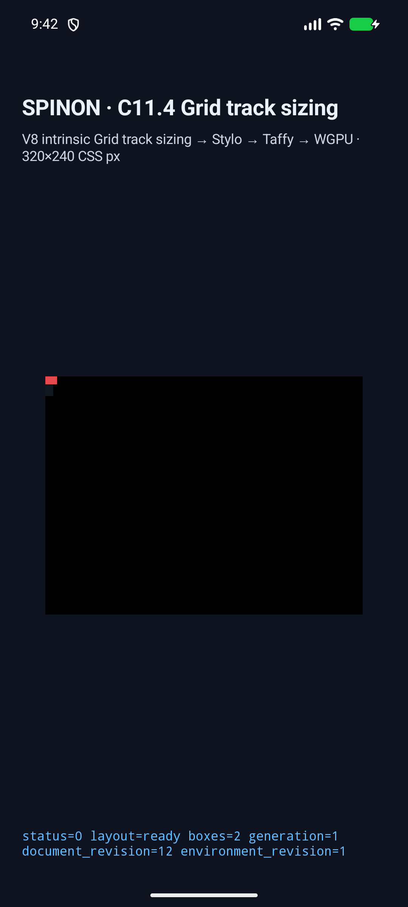
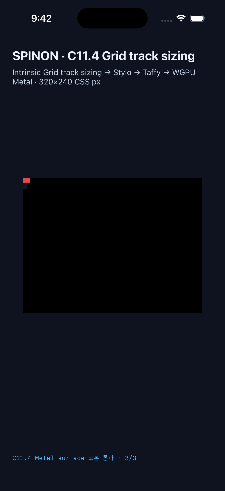

# C11.4 image ratio transfer simulator matrix

2026-10-19, Android API 37 ARM64 AVD and iPhone 17 Pro / iOS 26.2 Simulator each ran the same seven V8-authored direct-image scenes through Stylo, Taffy, WGPU, and the platform surface. The AVD used SwiftShader/OpenGL ES; the iOS Simulator used Metal. No physical device was used.

## Scene comparison

All seven runtime frame assertions passed on both simulators and match the Chrome 155 CSS-pixel oracle. The exact trace and frame comparisons are in [comparison.json](./comparison.json); the app logs are under [run `c114-ratio-20261019T124204Z`](./runs/c114-ratio-20261019T124204Z/).

| Scene | Chrome grid / item CSS px | Android AVD | iOS Simulator | Boundary exercised |
| --- | --- | --- | --- | --- |
| `column-auto-natural-ratio` | `8×20 / 12×8` | pass | pass | Natural 3:2 ratio transfers 8px height to a 12px column; item crosses the 8px grid edge. |
| `column-target-max-width-clamp` | `8×20 / 9×8` | pass | pass | Target `max-width:9px` caps the transferred suggestion. |
| `row-target-max-height-clamp` | `20×4 / 12×6` | pass | pass | Target `max-height:6px` caps row sizing; item crosses the 4px grid edge. |
| `column-opposite-min-over-max` | `8×20 / 18×12` | pass | pass | Opposite-axis `min-height:12px` wins over `max-height:4px` before ratio transfer. |
| `column-border-box-transfer` | `8×20 / 12×8` | pass | pass | Border-box ratio with 1px padding and 1px border on each side. |
| `column-content-box-transfer` | `8×20 / 16×12` | pass | pass | Content-box ratio adds padding and border after conversion. |
| `column-target-min-width-clamp` | `8×20 / 18×8` | pass | pass | Target `min-width:18px` applies while the definite 8px height remains unchanged. |

Android logs include both node frames per scene. The iOS fixture asserts the reported root and item frames and track trace before emitting its successful summary. The target-min-width scene takes three sizing passes (`Columns → Rows → Columns`); the verifier checks all three.

## Overflow surface samples

The `column-auto-natural-ratio` scene places an 8×20px grid at `(0,0)` and a 12×8px item at `(0,0)`. Both surfaces returned exact RGBA values for an item point, the point at x=10px beyond the grid's right edge, and a root-background control. The x=10px point is outside the grid's right border at x=8px and remains inside the 320px render viewport.

| Platform surface | Inside item | Beyond grid edge | Background control |
| --- | --- | --- | --- |
| Android PixelCopy, 840×630 at 2.625× | `(5,4) → 229,72,77,255` exact | `(10,4) → 229,72,77,255` exact | `(6,15) → 16,24,32,255` exact |
| iOS Metal drawable, 960×720 at 3× | `(5,4) → 229,72,77,255` exact | `(10,4) → 229,72,77,255` exact | `(6,15) → 16,24,32,255` exact |

The other six scenes have frame, trace, and screenshot checks; simulator color readback was performed for the overflow scene above. PixelCopy and Metal drawable reads do not establish post-compositor or physical-display pixels.

## Captures

The red item is intentionally only 12×8 CSS px in the tall simulator view. The pixel-readback logs provide the exact coordinates and colors, including the point outside the grid border.

| Android API 37 AVD | iPhone 17 Pro / iOS 26.2 Simulator |
| --- | --- |
|  |  |

Screenshots for all seven scenes are stored in the corresponding `android-avd/` and `ios-simulator/` run folders. The full Chrome comparison is [chrome155-image-ratio-transfer.png](../c11-4-image-ratio-transfer-2026-10-19/chrome/chrome155-image-ratio-transfer.png), with the 27 fixed observations in [chrome155-observation.json](../c11-4-image-ratio-transfer-2026-10-19/chrome/chrome155-observation.json).

## Reproduction and limits

`run-simulator-matrix.sh` installs the opt-in fixture build on `emulator-5554` and the fixed iPhone Simulator UDID, runs each scene, captures screenshots and logs, and terminates only the app processes it launched. The final run completed with 7/7 scenes on each platform; the fixture apps were no longer running afterward. The existing iPad Simulator app was left untouched.

Final build logs are [Android](./android-build-ratio-matrix-verified.log) and [iOS](./ios-build-ratio-matrix-verified.log). They used the pinned V8 revision from the existing main checkout as a read-only build dependency.

The final Rust validation ran `mise exec -- cargo test --locked --workspace --all-targets --quiet` (1,121 passed, 0 failed, 4 ignored across 16 test targets), `mise exec -- cargo clippy --locked --workspace --all-targets -- -D warnings`, `mise exec -- cargo fmt --all -- --check`, and `git diff --check`; each command exited successfully. The test output is [rust-workspace-test.log](./rust-workspace-test.log), and the Clippy/rustfmt logs are [Clippy](./rust-workspace-clippy.log) and [rustfmt](./rustfmt-check.log).

All simulator evidence files are covered by [SHA256SUMS.txt](./SHA256SUMS.txt); verify from the repository root with `shasum -a 256 -c spec/internal/evidence/c11-4-image-ratio-transfer-simulator-2026-10-19/SHA256SUMS.txt`.

Earlier run folders are retained for diagnosis. `c114-ratio-20261019T123855Z` exposed a verifier assumption that every Grid trace has exactly two passes. The target-min-width scene correctly emitted a third Columns pass; the Android/iOS verifiers were updated to check the full three-pass sequence and the final seven-scene run passed. This evidence covers the opt-in fixture, the listed image cases, and these simulator configurations. It does not establish general CSS Grid support, WPT conformance, physical-device rendering, GPU hardware behavior, or pixels after the OS compositor. C11.4 and C11 remain incomplete.
