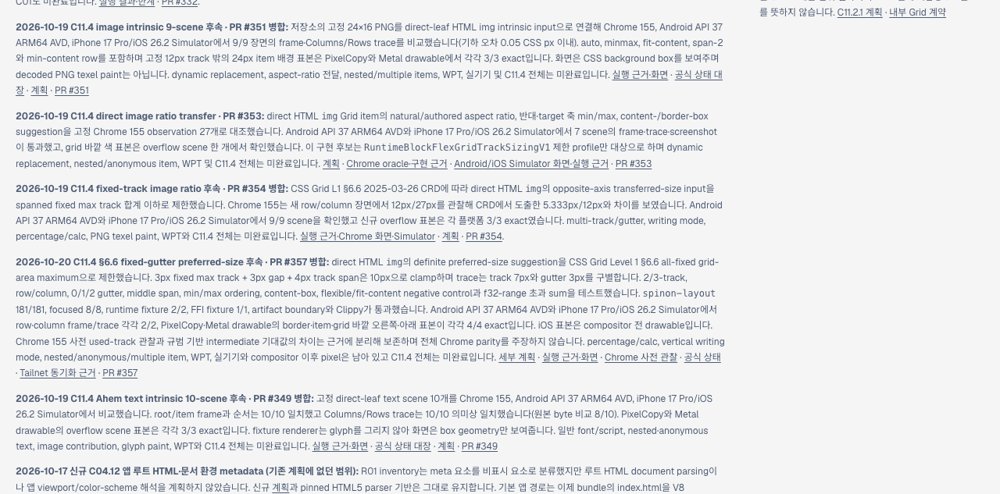
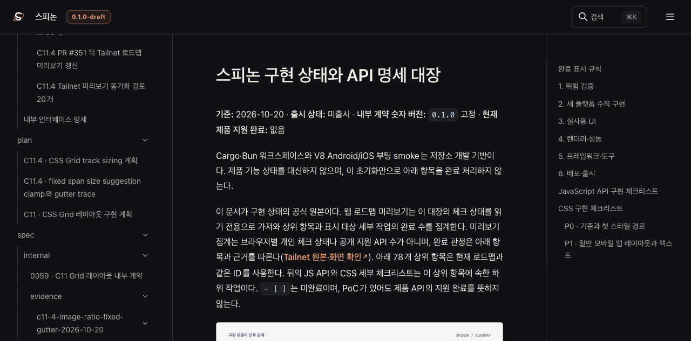
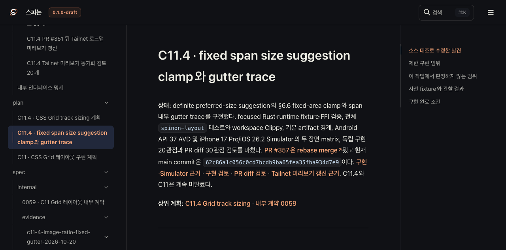
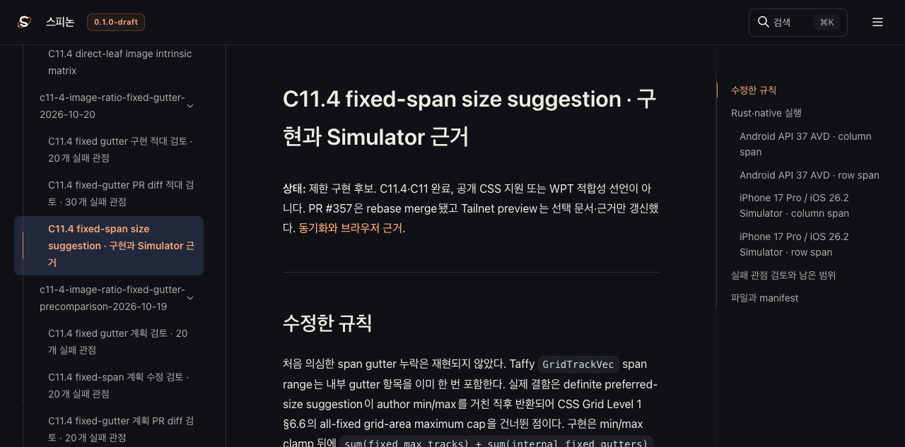
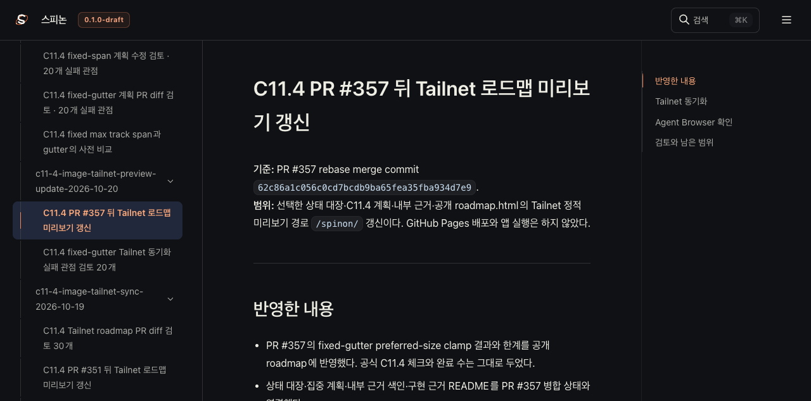

# C11.4 PR #357 뒤 Tailnet 로드맵 미리보기 갱신

**기준:** PR #357 rebase merge commit `62c86a1c056c0cd7bcdb9ba65fea35fba934d7e9`. 
**범위:** 선택한 상태 대장·C11.4 계획·내부 근거·공개 roadmap.html의 Tailnet 정적 미리보기 경로 `/spinon/` 갱신이다. GitHub Pages 배포와 앱 실행은 하지 않았다.

## 반영한 내용

- PR #357의 fixed-gutter preferred-size clamp 결과와 한계를 공개 roadmap에 반영했다. 공식 C11.4 체크와 완료 수는 그대로 두었다.
- 상태 대장·집중 계획·내부 근거 색인·구현 근거 README를 PR #357 병합 상태와 연결했다.
- `@rspress/core` 2.0.22 선택 root 빌드에 계획, 0059 계약, Chrome 사전 관찰, 구현·Simulator 근거 및 필요한 이미지 자산을 포함했다. Rspress 버전과 lockfile은 바꾸지 않았다.
- 상태 대장을 Tailnet root `STATUS.html`로 제공할 때 계획·fixture·tool 상대 링크가 `/spinon/` 밖으로 나가는 문제가 있어 staging adapter에서 141개를 변환했다. 선택된 C11 계획은 같은 `/spinon/` 안의 페이지로, 그 밖의 저장소 경로는 GitHub `main`으로 연결한다. 소스 `spec/STATUS.md`의 원래 상대 링크는 유지한다.

## Tailnet 동기화

| 실행 | 선택 파일 | 생성 | 교체 | 동일 | 기존 파일 backup | HTTP 200·byte·SHA 일치 |
| --- | ---: | ---: | ---: | ---: | ---: | ---: |
| pass6 초기 반영 | 274 | 106 | 28 | 140 | 28/28 | 274/274 |
| pass7 링크 수정 | 274 | 30 | 30 | 214 | 30/30 | 274/274 |
| pass8 최종 site 반영 | 290 | 45 | 31 | 214 | 31/31 | 290/290 |

pass6·pass7에서는 삭제가 없었다. pass8 첫 복사에서 staging source와 sanitized site output을 혼동해 Markdown source를 Tailnet에 복사했다. Browser가 비어 있는 새 근거 페이지를 찾아 즉시 원인을 확인했다. 첫 실행 기록은 별도 보존했고, 올바른 `build/spinon/c11-4-image-tailnet-site-pass8`을 source로 다시 preflight·복사했다. 후속 실행부터는 sync helper가 `c11-4-image-tailnet-site-${pass}`만 허용한다. 잘못 추가된 source-only 파일 중 정정 site output과 겹치지 않는 231개를 다시 확인했으며, 그중 서버가 열고 있지 않은 230개는 실행별 복구 backup을 검증한 뒤 제거했다. 나머지 하나는 기존 Tailnet 서버 PID 1191이 열고 있어 유지했다. 이는 기존 site 파일이 아니라 잘못 추가된 중복 Simulator log이며, 서버를 중지하지 않았다.

pass8 최종 preflight는 sanitized site 290개를 대상으로 생성 45·교체 31·동일 214개를 기록했다. 삭제는 없고, 교체 전 backup 31/31 및 Tailnet HTTP 200·byte·SHA 290/290이 일치했다. 사전 비교·복사·백업·제공 해시는 [pass8 preflight](./preflight-pass8.json), [pass8 copy·backup](./copy-and-backup-pass8.json), [pass8 HTTP 검증](./served-verification-pass8.json), [정정 source 정리](./cleanup-wrong-staging-root-pass8.json)에 남겼다. 처음 staging source를 잘못 고른 기록은 [초기 preflight](./preflight-pass8-wrong-staging-root.json)과 [초기 복사 기록](./copy-and-backup-pass8-wrong-staging-root.json)에서 확인할 수 있다.

pass6 Agent Browser 검토는 STATUS 상대 링크 141개가 `/spinon/` 밖을 가리키는 것을 발견했다. pass7에서 이를 고친 뒤 pass8 staging adapter가 선택된 Markdown 전체의 상대 링크를 재작성하도록 넓혔다. 최종 Browser 확인에서는 빌드된 34개 HTML route가 모두 200이고, 모든 route의 same-origin out-of-base 링크가 0개다. 상태 대장·내부 색인·집중 계획·구현 근거의 실제 표시와 링크를 확인했다. [pass8 route 결과](./browser-check-pass8.json)에 전체 route 확인값을 기록했다.

## Agent Browser 확인

[pass8 route·이미지 관찰값](./browser-check-pass8.json)과 다섯 페이지 캡처를 남긴다. 캡처는 Tailnet 문서 화면이며 Android/iOS 앱 화면이 아니다. 브라우저 세션 종료 뒤 전용 Agent Browser daemon과 Chrome이 사라지고, 사전에 있던 PID 74457은 유지됐다([종료 확인](./browser-close-pass8.json)).

Tailnet 구현 근거 페이지의 Android AVD 2장(각 1080×2400)과 iOS Simulator 2장(각 1206×2622), 총 4개 이미지가 모두 로드됐다. 병합 PR #357 본문에서 main raw URL을 사용하는 네 장의 Android/iOS Simulator 이미지도 모두 실제 크기로 로드되는 것을 별도로 확인했다.

## 검토와 남은 범위

- [Tailnet 동기화 20관점 검토](./sync-review-20.md)
- [선택 입력 SHA-256 목록](./SHA256SUMS-preview-inputs.txt)
- 선택 문서 빌드만 수행했다. 전체 문서 사이트 build, WPT, Android/iOS 앱 실행은 이번 문서 PR에서 주장하지 않는다.
- C11.4 전체 intrinsic sizing, percentage/calc, auto-repeat, text/image 조합, WPT 및 실기기 동작은 남아 있다. 이 미리보기 갱신은 C11.4 구현 완료를 뜻하지 않는다.
