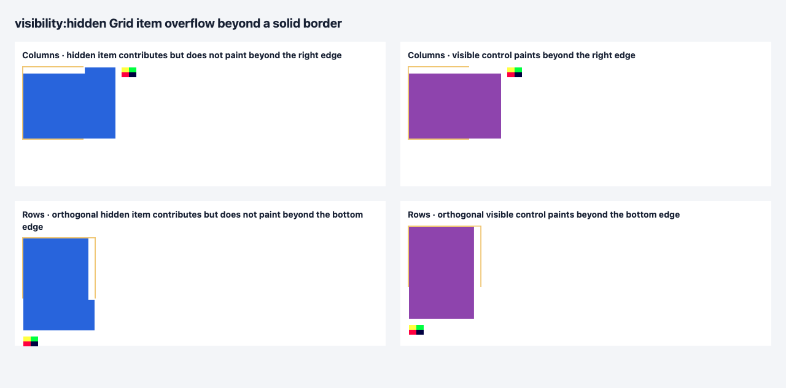

# C11.4 visibility-hidden border overflow · Chrome 156 사전 비교

## 실행 조건

- Fixture: [고정 HTML](https://github.com/ohah/spinon/blob/main/tests/fixtures/css/c11/grid-mixed-flex-visibility-hidden-border-overflow-c114-precomparison.html), SHA-256 `bf69f4297013a17b6694dca5626d9c98488a0f10bcb7692aec69f06d05720f26`.
- Browser: Agent Browser가 실행한 HeadlessChrome `156.0.0.0`; viewport `1280×633` CSS px, DPR 1.
- Font asset: Ahem TTF SHA-256 `b719ecb31c5b21fc573c03f6421c74ac63c271a5a3ff841e34f9705fb94b8448`.
- PNG asset: `24×16`, SHA-256 `5d8c9509a0fec2288f02611a8ccc22a23a90033d1a96b894b439525398bce4a2`.
- Captured Agent Browser screenshot, `1280×633`, SHA-256 `59ac9e5783142727781df1855b932c232eb99305a294a611de27f94cdae60a79`.

Agent Browser에서 fixture를 열고 `document.fonts.ready` 및 image decode 이후 observation을 읽었다. 페이지 관측과 화면 캡처 뒤 browser를 닫았으며 session 목록은 `No active sessions`, 프로세스 검색에서 `agent-browser` 항목이 없음을 확인했다. Terminal Browser는 사용하지 않았다.

## 관측과 독립 판정

네 장면 모두 computed `overflow:visible`, PNG natural size `24×16`, hidden/visible span `display:block`, client rect 1개가 나왔다. Hidden span은 `visibility:hidden`, visible control은 `visible`이다. Columns used tracks는 `150px 40px 0px`와 `116px`, Rows는 `116px`와 `150px 40px 0px`였다. 두 축에서 A와 span의 root-local frame은 각각 `(2,2,150,116)` 및 `(2,2,116,150)`이다.

독립 규범 계산은 [expected.json](https://github.com/ohah/spinon/blob/main/spec/internal/evidence/c11-4-mixed-flex-visibility-hidden-border-overflow-precomparison-2026-10-28/expected.json)에, browser CSSOM/frame/root 좌표는 [chrome156-observation.json](https://github.com/ohah/spinon/blob/main/spec/internal/evidence/c11-4-mixed-flex-visibility-hidden-border-overflow-precomparison-2026-10-28/chrome156-observation.json)에 분리했다. Target axis content `96px`에서 fixed track `40px`과 두 `10px` gap을 빼면 `36px`이 남는다. Hidden 15자 Ahem text의 min-content base `150px`이 첫 1fr track을 유지시키고, 마지막 2fr track은 min `0px`으로 제한된다. 따라서 hidden/control 양쪽의 기대 target tracks는 `[150,40,0]px`이며 첫 item은 root-local 경계 100px을 52px 넘는다.

## 화면 표본

[sample-pixels.json](https://github.com/ohah/spinon/blob/main/spec/internal/evidence/c11-4-mixed-flex-visibility-hidden-border-overflow-precomparison-2026-10-28/sample-pixels.json)은 8개 표본의 root-local CSS 좌표, screenshot raster 좌표와 실제 RGB를 기록한다. Border pixel은 첫 item에 덮이지 않는 왼쪽/위쪽 변에서 `#f0c674`와 일치했다. Root-local `(120,60)` 또는 `(60,120)`은 root border box 밖 20px 지점이며 hidden에서 underlying A의 `#2864dc`, visible control에서 겹친 span의 `#8e44ad`가 나왔다. 오른쪽/아래쪽 border pixel은 overflowing item과 겹치는 구간이 있으므로 border 확인용 표본으로 쓰지 않았다.

CSS 2.1은 hidden box가 그려지지 않으면서 layout에 영향을 유지한다고 정의한다([§11.2](https://www.w3.org/TR/2011/REC-CSS2-20110607/visufx.html#visibility)). CSS Overflow 3의 `visible`은 grid container에서도 바깥에 위치한 content를 렌더링한다([§3.1](https://www.w3.org/TR/css-overflow-3/#overflow-properties)). Track 계산 기준은 CSS Grid 2025 CRD의 §11.4와 §11.7.1이다([W3C](https://www.w3.org/TR/2025/CRD-css-grid-1-20250326/#algo-flex-tracks)).

## 한계

이 자료는 Chrome oracle과 고정 fixture만 증명한다. Spinon runtime, Android/iOS, 전체 표면 동등성, clipping·scrolling, 하드웨어 GPU 및 일반 CSS admission은 검증하지 않았다. 오른쪽/아래 edge가 일부 덮이는 합성 색도 주장하지 않는다. 계획·구현 관문은 [후속 계획](https://github.com/ohah/spinon/blob/main/plan/c11-4-visibility-hidden-border-overflow.md)에 있다.
