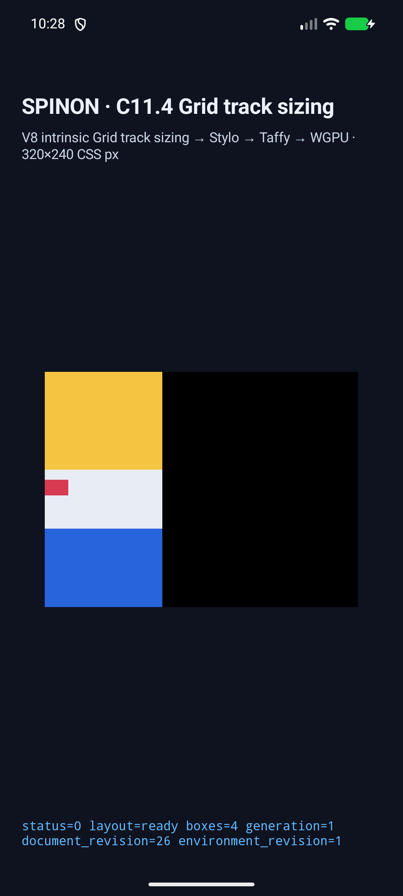
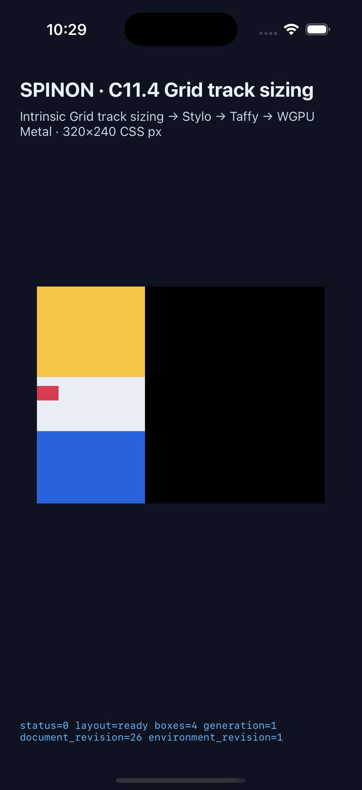
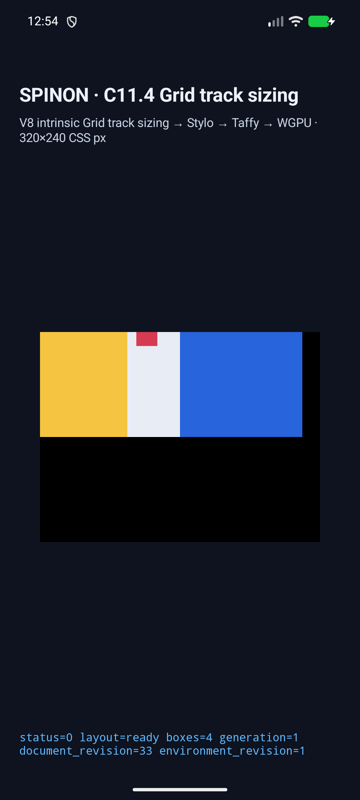

# C11.4 mixed intrinsic/flexible/fixed 런타임 근거

## 범위와 판정

`minmax(min-content, 1fr) 40px minmax(0px, 2fr)`가 실제 intrinsic text contribution으로 첫 track을 freeze한 뒤 flexible neighbor에 남은 공간을 재분배하는 고정 fixture다. Columns와 Rows, freeze/no-freeze/equality 경계, 역순 source order를 각각 실행했다. CSS 기대값과 실행 입력은 [사전 비교 자료](../c11-4-mixed-intrinsic-flex-fixed-precomparison-2026-10-28/README.md)와 [expected.json](../c11-4-mixed-intrinsic-flex-fixed-precomparison-2026-10-28/expected.json)에 고정했다.

두 플랫폼 모두 8/8 scene이 `status=passed`, 4개 frame, 최종 presentation으로 끝났다. Freeze 장면 track base는 `[100, 40, 140] CSS px`, no-freeze/equality 장면은 `[80, 40, 160] CSS px`이며 모든 경우 remaining free space는 0px이다. 이미지 frame은 natural size `24×16 CSS px`다. 역순 scene도 같은 track 분배를 유지한다.

## 실행 환경과 출처

| 대상 | 실행 환경 | Run ID | 앱 SHA-256 |
| --- | --- | --- | --- |
| Android | API 37 ARM64 `spinon_api37_1_compat16k`, 16 KB page, `emulator-5554`, 1080×2400 | `c114-mixed-intrinsic-flex-fixed-android-avd-20261028T012823935Z-815905bf` | `b0b682843ba8bed3e6e28aa47c08aa67b002a9e71737e4effb1362272564b6d0` |
| iOS | iPhone 17 Pro (`iPhone18,1`), iOS 26.2 Simulator, 1206×2622 | `c114-mixed-intrinsic-flex-fixed-ios-simulator-20261028T012904007Z-0e25206c` | `a3e9cb8776bf0bdcdb0778980ef00d46231c07638eb01221c3db0c6ff2ed9f` |

각 manifest는 source commit `2fb8f706487acb898a206cc3ecf38a594ab5ba15`, tracked diff SHA-256 `63dc70a7a2db2217d9199f67e83c11e9d7ccb191e6c53bdcaf342dd4974e5d7f`, source file set SHA-256 `d4fc9477d737c91e1d18174e6b191217e3085f3f4d00be60e8f58a79af8600b1`을 기록한다. 빌드는 고정 V8 revision `7b50b62cb18f28617959e8452e2cd18195b38bcf`를 사용했다.

## scene 화면

아래 화면은 런타임 frame과 presentation을 확인하기 위한 대표 freeze scene이다. 이미지 표시와 CSS frame은 근거에 포함하지만 화면 픽셀 전체가 플랫폼 간 동일하다는 주장은 하지 않는다.

| Android API 37 AVD | iPhone 17 Pro / iOS 26.2 Simulator |
| --- | --- |
|  |  |

추가 대표 화면: [Android column-freeze](./runs/c114-mixed-intrinsic-flex-fixed-android-avd-20261028T012823935Z-815905bf/android-column-freeze.png) · [iOS column-freeze](./runs/c114-mixed-intrinsic-flex-fixed-ios-simulator-20261028T012904007Z-0e25206c/ios-column-freeze.png).

## `display:none` hidden item 후속

2026-10-28 후속 run은 기존 8개 scene에 `column-hidden`, `row-hidden`을 추가해 두 플랫폼에서 각각 10/10 scene을 통과했다. 15-character direct `<span>`이 첫 track에 `display:none`으로 놓일 때 그 text가 intrinsic sizing input과 track contribution에서 빠지고, 보이는 text/image sibling만 `[100, 40, 140] CSS px` tracks를 만든다. 두 축 모두 remaining free space는 0px이다. 미등록 scene, visible-control, C11.2.1 충돌 profile 경로는 양쪽 앱에서 거부됐다.

hidden scene은 보이는 root/item box가 4개이고 draw/presentation도 네 box를 확인한다. 내부 `node_frames_css_px`에는 추가로 hidden node의 0×0 bookkeeping frame이 있어 frame record는 5개다. 이 내부 frame은 CSS box 생성이나 paint를 뜻하지 않는다.

| 대상 | 실행 환경 | Run ID | 앱 SHA-256 | hidden frame records |
| --- | --- | --- | --- | --- |
| Android | API 37 ARM64 16 KB AVD `emulator-5554`, 1080×2400 | `c114-mixed-intrinsic-flex-fixed-android-avd-20261028T035340076Z-8be33a99` | `3b90206b7eff096ffe9bc1b0522568355bca47799d708f30d61778a8bdd392a2` | 5: root + 3 visible + 0×0 hidden bookkeeping |
| iOS | iPhone 17 Pro / iOS 26.2 Simulator, 1206×2622 | `c114-mixed-intrinsic-flex-fixed-ios-simulator-20261028T035420142Z-8d77bf8f` | `336647e0d52ff0c83e4cb51a730994f7c1b0ee2ae0c3610796c841c1a27efe25` | 5: root + 3 visible + 0×0 hidden bookkeeping |

두 실행은 고정 V8 `7b50b62cb18f28617959e8452e2cd18195b38bcf`, source commit `d73f71c950ae4ba64d27ebfd0c70f6e81475ec8c`, tracked diff SHA-256 `be56dc1ede073d53bc749aa73951526db415636c2061f5e6da8ca36da3b2889a`를 기록한다. [hidden-item 통합 검증 JSON](matrix-verification-hidden-2026-10-28.json)은 20 scene, screenshot 크기·해시, frames, tracks, trace와 presentation을 검사하고 서로 다른 11개 negative-control mutation을 모두 거부한다.

| Android API 37 AVD: `column-hidden` | iPhone 17 Pro / iOS 26.2 Simulator: `row-hidden` |
| --- | --- |
|  |  |

## 기계 검증과 재현

[`matrix-verification.json`](matrix-verification.json)은 두 manifest, 16 scene, frame 및 track trace, screenshot 크기·해시, 앱 presentation을 다시 검사했다. matcher의 자체 negative control 8개(중복 JSON 키, 누락 축, 누락 `ExpandFlexibleTracks`, 비유한 track 값, 잘못된 source order, 잘못된 image natural size, 잘못된 min-content, 잘못된 frame)도 모두 예상대로 거부됐다. 두 플랫폼 실행에서 미등록 scene과 충돌하는 C11.2.1 profile도 각각 거부됐다.

PR 병합 뒤 macOS ARM64 기본·opt-in `spinon-ffi` release static archive의 fixture 심볼·payload 경계도 비교했다. 상세 해시와 검색 결과는 [아티팩트 경계 기록](artifact-boundary.md)에 있다. 이 검사는 Android APK/iOS IPA 전체 bundle을 대상으로 하지 않았다.

```sh
mise exec -- node spec/internal/evidence/c11-4-mixed-intrinsic-flex-fixed-runtime-2026-10-28/capture-mixed-intrinsic-flex-fixed-runtime.mjs android-avd emulator-5554
mise exec -- node spec/internal/evidence/c11-4-mixed-intrinsic-flex-fixed-runtime-2026-10-28/capture-mixed-intrinsic-flex-fixed-runtime.mjs ios-simulator 9DCCE836-7659-4914-B6C1-13F54BFFA9DB
python3 tools/css-reference/c11-4-mixed-intrinsic-flex-fixed-runtime/verify.py --self-test \
  --android-run-dir spec/internal/evidence/c11-4-mixed-intrinsic-flex-fixed-runtime-2026-10-28/runs/c114-mixed-intrinsic-flex-fixed-android-avd-20261028T012823935Z-815905bf \
  --ios-run-dir spec/internal/evidence/c11-4-mixed-intrinsic-flex-fixed-runtime-2026-10-28/runs/c114-mixed-intrinsic-flex-fixed-ios-simulator-20261028T012904007Z-0e25206c
python3 tools/css-reference/c11-4-mixed-intrinsic-flex-fixed-runtime/verify.py --self-test \
  --android-run-dir spec/internal/evidence/c11-4-mixed-intrinsic-flex-fixed-runtime-2026-10-28/runs/c114-mixed-intrinsic-flex-fixed-android-avd-20261028T035340076Z-8be33a99 \
  --ios-run-dir spec/internal/evidence/c11-4-mixed-intrinsic-flex-fixed-runtime-2026-10-28/runs/c114-mixed-intrinsic-flex-fixed-ios-simulator-20261028T035420142Z-8d77bf8f
```

## 검증하지 않은 범위

실기기, hardware GPU, 경계 바깥 pixel overflow·clip, 임의 CSS/DOM 및 글꼴, WPT 전체 적합성은 이 고정 fixture에서 검증하지 않았다. C11.4 전체 기능과 공식 완료 checkbox는 미완료이며 공식 집계 `72/213`도 바꾸지 않는다.

기존 8-scene mixed-track slice의 구현 실패 관점은 [20개 검토](implementation-review-20.md), 그 변경분은 [30개 검토](pr-delta-review-30.md)에 기록했다. 이번 hidden-item 구현은 별도로 [runtime 구현 20관점](hidden-item-implementation-runtime-review-20.md)과 [구현 PR diff 30관점](hidden-item-pr-diff-review-30.md)에서 검토했다.
