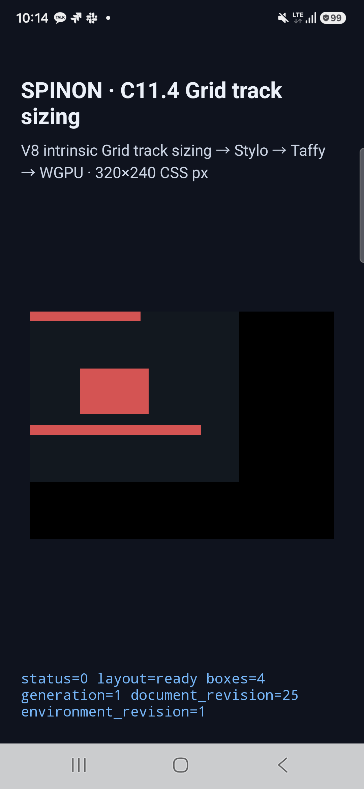
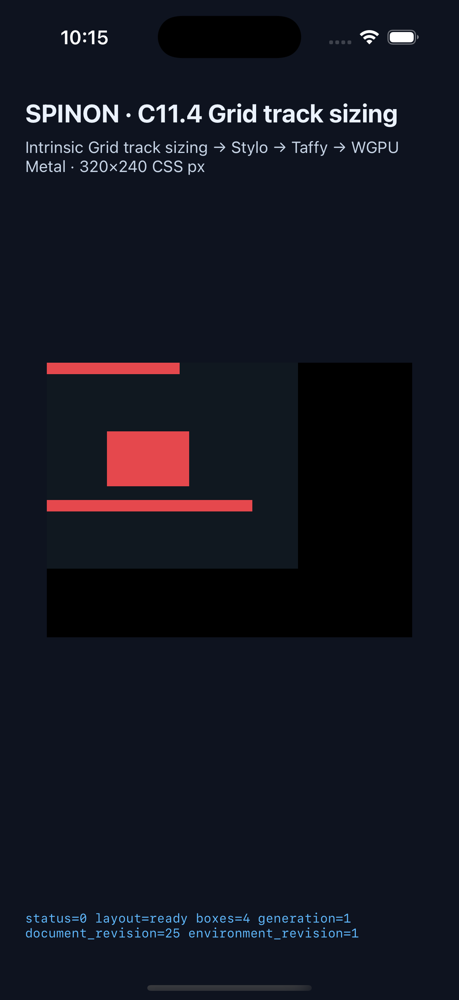

# C11.4 mixed text/image multi-span 실행 근거

## 범위와 판정

하나의 고정 `220×180px` Grid에서 direct-leaf Ahem text와 PNG ``가 같은 intrinsic-input 목록과 한 번의 span sizing 계산에 들어오는 네 장면을 실행했다. DOM 순서가 다른 span-2 두 item, 이어지는 span-3 text의 앞뒤 배치를 각각 비교한다. 네 장면은 모두 Android API 37 AVD, Samsung Android 16 실기기, iPhone 17 Pro/iOS 26.2 Simulator에서 `layout=ready`, 예상 box/frame/track/trace, draw/present를 통과했다.

| 장면 | 열 크기(CSS px) | 대표 item frame | trace |
| --- | --- | --- | --- |
| `mixed-text-image-span2-forward` | `[25, 36, 36, 0]` | text `61×20`; image `(25,60) 72×48` | span `[2]` |
| `mixed-text-image-span2-reversed` | `[25, 36, 36, 0]` | DOM 순서는 image → text, frame은 동일 | span `[2]` |
| `mixed-text-image-span2-before-span3` | `[158/3, 191/3, 191/3, 0]` | text `116.333×10`; image `(52.667,60) 72×48`; text `180×10` | span `[2,3]` |
| `mixed-text-image-span3-before-span2` | `[158/3, 191/3, 191/3, 0]` | span-3 text가 DOM 앞에 오며 frame는 이전 장면과 동일 | span `[2,3]` |

모든 실행은 각 scene의 text/replaced source kind, node ID, `sourceOrder`, intrinsic revision, contribution stage와 root-relative frame을 검사했다. 물리 기기의 local APK와 설치된 `base.apk` SHA-256이 일치한다. 각 플랫폼의 원본 로그·JSON·화면은 아래 디렉터리에 있다.

## Android API 37 AVD

- AVD: `spinon_api37_0_applied_txn`, ARM64, Android API 37, SwiftShader Vulkan/GLES.
- AVD는 별도 포트 `5558`에서 이번 검증에만 띄운 뒤 종료했다.
- [실행 결과와 화면](./android-avd-c114-mixed-multispan-contributions-android-avd-20261021T012008516Z-48eb7db1/)

## Android 실기기

- Samsung `SM-S731N`, Android 16/API 36, ARM64, 실제 디스플레이 `1080×2340`, density `450`, Xclipse 940 via ANGLE/Vulkan.
- 대상 serial: `R5KYB06SMPE`.
- local APK와 설치 APK SHA-256: `54d48ea6e2b4eacfe573175747f6185eaa5e86a193ad0f275c0cc1b409634e78`.
- 네 장면 모두 Android runtime summary, 예상 frame/track/contribution, trace complete, `drawPresented=true`를 통과했다.
- [실기기 실행 결과와 화면](./android-device-c114-mixed-multispan-contributions-android-device-20261021T011433675Z-578d1d92/)

## iOS Simulator

- iPhone 17 Pro, iOS 26.2 Simulator, UDID `ACA7BF91-E2D5-4CF7-909A-08D1AD95FF3D`.
- 실행 binary SHA-256: `c1c7c57b7ca394e1de3c940078ab53fdd95e52c8582a9ea29cb7db0708f35d2e`.
- 네 장면 모두 Android와 같은 기대 frame/track/source order를 통과했고 draw/present 및 trace chunk 검사가 통과했다.
- [Simulator 실행 결과와 화면](./ios-simulator-c114-mixed-multispan-contributions-ios-simulator-20261021T011541219Z-904b6842/)

## 구현 검증

- `mise exec -- cargo fmt --all -- --check` 통과.
- `mise exec -- cargo test --locked -p spinon-runtime --features c11-4-grid-track-sizing-fixture-test c11_grid_tests -- --nocapture`: 10/10 통과.
- C11.4 FFI mixed scene 및 bounded-scene gate focused tests 각각 통과.
- `mise exec -- cargo clippy --locked --workspace --all-targets -- -D warnings` 통과.
- capture runner `node --check` 및 fixture-boundary/iOS build-flag tests 19/19 통과.
- `mise exec -- env SPINON_ENABLE_C04_RUNTIME_GPU=1 SPINON_ENABLE_C04_RUNTIME_GPU_FIXTURE_TEST=1 bun run build:android` 및 `... bun run build:ios-sim` 성공.
- [runtime 구현 실패 관점 검토 20개](./implementation-review-20.md)와 [PR diff 검토 20개](./pr-diff-review-20.md)를 별도로 마쳤다.

기본 `spinon-ffi` static archive의 raw bytes/`strings` 검사에서 C11.4 혼합 FFI symbol 이름, scene/error 문자열, 고정 PNG payload(97 bytes)를 찾지 못했다. `c04-runtime-gpu-fixture-test` positive-control archive에는 모두 들어갔다. Xcode `nm`은 Rust LLVM 22 object의 attribute kind를 읽지 못해 진단을 냈으므로, archive raw-byte와 `strings`의 제외/포함을 대조했다. 이는 static archive 검사이며 APK/iOS 제품 번들의 최종 크기나 release 산출물 검증을 뜻하지 않는다.

첫 Android 실행은 app-side C11.4 scene allowlist가 새 ID를 거부해 `SPINON_C114_GRID_ARGUMENT_ERROR`로 멈췄다. 네 scene의 허용 목록과 기대값을 Android/iOS harness에 추가한 뒤 다시 실행했다. [초기 실패 로그](./android-device-c114-mixed-multispan-contributions-android-device-20261021T010355908Z-da49e977/runtime-mixed-text-image-span2-forward.log)와 최종 성공 실행은 별도로 보존했다.

## 한계

이 실행은 네 고정 scene의 native layout frame, track trace, draw/present 근거다. PixelCopy 색 표본, PNG texel painting, iOS compositor 이후 pixel, 임의 CSS, nested/anonymous item, async image replacement, WPT 또는 전체 C11.4/CSS Grid 지원은 검증하지 않았다. C11.4 checkbox와 공식 완료 수는 미완료로 유지한다.
