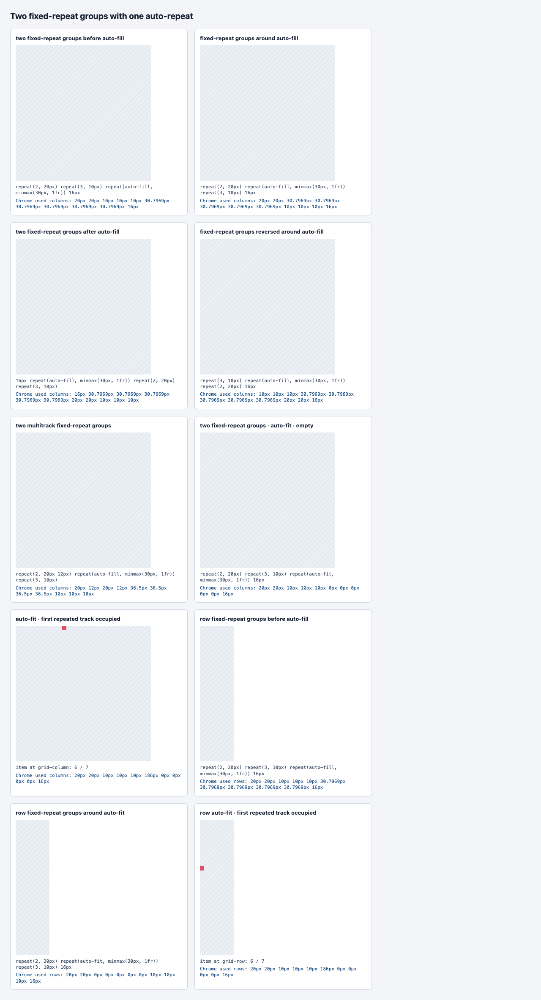

# C11.4 two fixed-repeat groups + auto-repeat Chrome 156 precomparison

**Phase:** plan-only. No Spinon runtime was changed or executed for this observation.

## Capture

- Fixture: `tests/fixtures/css/c11/grid-multiple-fixed-repeat-auto-repeat-c114-precomparison.html`
- Browser: Agent Browser 0.31.1, HeadlessChrome 156.0.0.0, macOS 26.5.1 ARM64
- Viewport: 1280×633 CSS px, DPR 1
- Observation JSON: `chrome156-observation.json`
- Screen:

- Pinned normative text: [CSS Grid 2025 CRD §7.2.3.1–§7.2.3.2](https://www.w3.org/TR/2025/CRD-css-grid-1-20250326/#repeat-notation)

## Results

The 10 CSSOM observations preserve each fixed-repeat group in authored order. In the base cases two groups contribute 40px and 30px, the ordinary neighbor contributes 16px, and five 8px gutters are needed before the repeated fragment. The independent minimum formula is `86 + 30n + 8(5+n) = 126 + 38n`; at 320px, five repetitions fit at 316px while six require 354px. Chrome serializes each resulting 1fr track as 30.7969px.

The multitrack group control contributes 64px from `repeat(2, 20px 12px)` and 30px from `repeat(3, 10px)`. Seven fixed tracks make the minimum formula `94 + 30n + 8(6+n) = 142 + 38n`; four repetitions fit and five do not, producing 36.5px tracks.

The empty auto-fit controls still calculate five repetitions and then serialize all five tracks at 0px. With the first repeated track occupied, Chrome reports a 186px used repeated track and places the item at x=110px for columns and y=110px for rows. These are browser observations and independent plan inputs, not Spinon product results.

## SHA-256

Recorded after capture; regenerate if any input, observation or screenshot changes.

| Artifact | SHA-256 |
| --- | --- |
| `tests/fixtures/css/c11/grid-multiple-fixed-repeat-auto-repeat-c114-precomparison.html` | `1f7d7a99baab8a261bd2937b39ac96379c167cf6acd0ec8a3e9adab21d962f6f` |
| `chrome156-observation.json` | `25d3ff3382082661c41ce84d02dbe146fb08834edd6dcb57f698bcf386083fcf` |
| `chrome156-full-page.png` | `2029d3e72e1ff29dd80575a0d5c366af53bc818aeb8b38b2c66420ac6f053ca0` |
