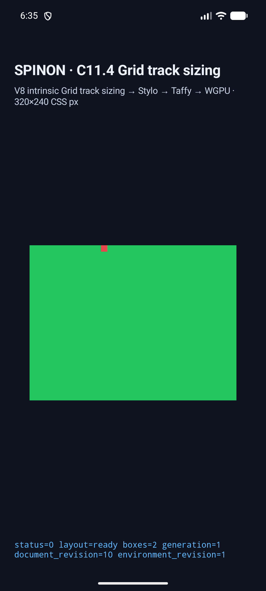
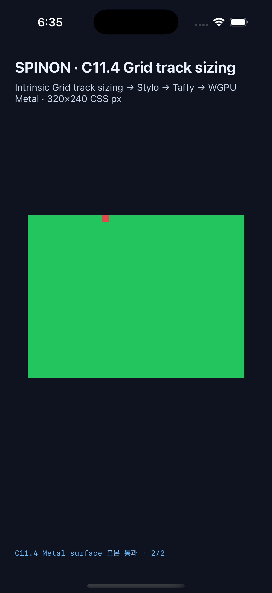

# C11.4 fixed-repeat 두 그룹 제한 구현 실행 근거 · 2026-10-24

이 slice는 한 grid track list에서 **integer fixed-repeat 두 그룹과 auto-repeat 한 개**를 결합하는 제한 profile이다. 한 번에 한 축만 변환한다. 두 fixed group의 각 pattern은 1–2개의 computed finite nonnegative `LengthPx` track이고 count는 양수다. authored order, auto-repeat 경계, auto-fill 반복 수, auto-fit collapse와 10,000개 expanded descriptor 한도를 검사한다. named line, 세 번째 fixed group, 다른 unsupported grammar는 계속 거부한다. 일반 CSS admission이나 C11.4 전체 완료를 뜻하지 않는다. 변경된 내부 계약의 숫자 버전은 [`0059`](../../0059-c11-grid-layout.md#c114-fixed-repeat-두-그룹--auto-repeat-제한-runtime-slice)이며 `0.1.0`을 유지한다.

계획과 독립 산술·Chrome 기준은 [계획](https://github.com/ohah/spinon/blob/main/plan/c11-4-multiple-fixed-repeat-groups.md), [Chrome 156 사전 비교](../c11-4-multiple-fixed-repeat-groups-precomparison-2026-10-24/README.md), fixture `tests/fixtures/css/c11/grid-multiple-fixed-repeat-auto-repeat-c114-precomparison.html`에 기록돼 있다. 320px 축에서 fixed/ordinary breadth와 8px gap으로 계산한 auto-repeat 수는 기본 장면 5회, multitrack control 4회다. 다섯 1fr tracks의 독립 계산값은 30.8px이고 Chrome serialization은 30.7969px다.

## 코드 검사와 archive 경계

- `cargo test --locked -p spinon-style fixed_repeat`: 11 passed, 0 failed. 두 fixed group의 prefix/split/suffix/reversed 순서, multitrack pattern, row axis, third-group rejection, 10,000 descriptor 경계, allocation failure/recovery를 포함한다. 로그: `style-fixed-repeat-tests.log`.
- `cargo test --locked -p spinon-ffi --features c04-runtime-gpu-fixture-test multiple_fixed_repeat_group_matrix_has_ten_bounded_unique_scenes`: 1 passed. 로그: `ffi-fixture-scene-tests.log`.
- fixture source/module boundary: 11 passed. 로그: `fixture-module-boundary.log`.
- `cargo fmt --all -- --check` 및 변경 crate scoped Clippy(`spinon-style`, `spinon-ffi`, fixture feature, `-D warnings`) 통과. 로그: `rustfmt-check.log`, `scoped-clippy.log`.
- macOS ARM64 debug `spinon-ffi` static archive의 기본 build에는 scene payload marker와 C11.4 fixture ABI가 없고 `c04-runtime-gpu-fixture-test` positive control에는 둘 다 있다. 로그: `fixture-artifact-boundary.log`. 이것은 release APK/IPA 전체 exclusion 또는 최종 앱 크기 검증이 아니다.

## Android API 37 ARM64 AVD

최종 재빌드 후 `emulator-5558`에서 `android-avd-c114-multiple-fixed-repeat-groups-android-avd-20261024T093457407Z-7887b737/result.json`과 `simulator.json`에 기록된 10/10 scene이 통과했다. track trace, root/item CSS frame, generation/revision, draw/present를 확인했다. 10개 scene의 PixelCopy matrix summary는 모두 `matched`; root 내부와 두 occupied auto-fit item의 RGBA 표본은 **12/12 exact**다. 사용 장면은 columns 320×320 root와 rows 80×320 root를 번갈아 쓴다.

이 AVD는 ANGLE/SwiftShader software rendering 경로다. Android 실기기나 hardware GPU 결과로 확대하지 않는다.

## iOS Simulator

iPhone 17 Pro, iOS 26.2 Simulator에서 `ios-simulator-c114-multiple-fixed-repeat-groups-ios-simulator-20261024T093526474Z-973baa9a/result.json`과 `simulator.json`에 기록된 10/10 scene이 통과했다. 모든 scene에서 track trace, node frame, revision과 draw/present를 확인했다. Metal drawable 표본은 **12/12 exact**이고 OS compositor 제출 전이다. app SHA-256은 `b95e1022b8dd48ec2c7ae042de5f2a186420a00f5fc8084e1feb44f3d74dbd72`다. build log: `ios-build-with-pixels.log`.

## 기준·완료 상태·남은 범위

소스 revision은 `1d5fad7185669f276e62fe905ae5350fb781ac68`이며 두 simulator metadata의 dirty-source SHA-256은 `3e6fbf3926cd788485598d19d5ce7dcaf61f25c1fc3ae03b3607ee7b3eda4b7b`로 같다. capture는 Rust fixture JSON, Stylo adapter, Android/iOS validators 및 scene-boundary test를 포함한다.

C11.4 상위 공식 checkbox는 그대로 미완료이고 완료 집계는 **72/213**이다. 이 변경은 내부 opt-in fixture를 통한 좁은 구현 slice다. 세 번째 fixed-repeat, named-line metadata merge, 일반 CSS admission, WPT, Android 실기기/hardware GPU, iOS compositor 이후 pixels 및 전체 C11.4는 미검증·미완료다.

## Tailnet 로드맵 미리보기

Rspress `2.0.22` 고정 실행 파일로 선택 문서 빌드를 만들고 HTML 페이지와 원시 evidence asset을 포함한 107개 route를 `https://macstudio.tailed42f2.ts.net/spinon/` 미리보기에 동기화했다. 각 route의 로컬·원격 SHA-256과 HTTP 200을 확인했고, 교체된 문서 4개는 이전 파일을 별도 백업에서 같은 SHA-256으로 확인했다. 삭제는 없었다. JSON 보고서는 `selected-build-verification-pass02.json`, `tailnet-preflight-pass02.json`, `tailnet-copy-pass02.json`, `tailnet-verify-pass02.json`이며 선택 문서 빌드 log는 `selected-docs-build-pass03.log`다.

Agent Browser 0.31.1 / Chrome 156에서 로드맵은 213 checkbox 중 72 checked를 세 번 확인했고 DOM에 이번 두-group slice 기록이 표시됐다. 같은 브라우저에서 내부 계약 0059의 current 두-group heading과 `0.1.0`, 계획 페이지의 `72/213`와 계약 링크도 확인했다. 검증 세션을 닫은 뒤 Agent Browser/Chrome 프로세스는 남지 않았다. DOM 확인 JSON: `agent-browser-verification-pass03.json`.

## PR 병합 후 상태·Tailnet 미리보기 동기화 · 2026-10-24

구현 PR [#594](https://github.com/ohah/spinon/pull/594)은 2026-10-24 10:14:36 UTC Rebase and merge로 병합됐다. main merge SHA는 `1339874a04b2bc9866ce6eb6e0172e26dddf56ef`다. PR check rollup은 비었고 main required status check은 설정되지 않았다. `plan/`, `spec/STATUS.md`, 내부 계약 0059 및 공개 roadmap에 병합 결과를 반영했으며 C11.4 상위 checkbox와 공식 `72/213`은 유지했다. 두 fixed-repeat 그룹은 C11.4 intrinsic track sizing 전체를 완료하지 않는다.

Rspress `2.0.22`로 병합 SHA가 포함된 선택 문서 빌드를 만들었다. 기존 dead-link 문제가 있는 전체 문서 대신 이 slice의 문서/evidence에 한정한 build이며, 이 선택 config에서는 dead-link 검사가 비활성화됐다. build log는 `selected-docs-build-pass04.log`다. 선택 route 107개(89개 raw assets, 18개 generated docs pages)의 로컬 hash manifest는 `selected-build-verification-pass04.json`이다.

Tailnet Serve는 `BackendState=Running`, self `100.64.53.81` online이고 `https://macstudio.tailed42f2.ts.net/spinon/roadmap.html`은 HTTP 200과 `Cache-Control: no-cache`를 반환했다. pass04 preflight는 22개 교체, 85개 동일, 0개 신규, 삭제 0개를 예상했다. 22개 교체 경로는 모두 `lsof`로 열려 있지 않은 것을 확인한 뒤 임시 파일과 atomic rename으로 반영했다. 교체 전 파일 22개는 `SpinonPreviewBackups/c11-4-multiple-fixed-repeat-groups-2026-10-24/pass04` 아래 보존했다. 최종 검증은 선택 route 107/107 로컬 SHA-256, backup 22/22 SHA-256, 원격 HTTP 200/hash 107/107을 통과했고 삭제는 없었다. `sync-tailnet-pass04.mjs`와 JSON 보고서 `tailnet-preflight-pass04.json`, `tailnet-copy-pass04.json`, `tailnet-verify-pass04.json`에 절차와 결과를 보존한다.

Agent Browser 0.31.1 / Chrome 156을 새 세션으로 열어 roadmap, 계획, STATUS, 계약 0059를 확인했다. 로드맵 checkbox는 213개 중 72개 checked였고 네 페이지에 PR #594와 merge SHA가 표시됐다. 계약은 `0.1.0`을 유지했다. 확인 뒤 세션을 닫았고 Agent Browser/Chrome 프로세스는 남지 않았다. `agent-browser-verification-pass04.json`에 DOM 판정을 보존한다. [병합 후 roadmap sync PR diff review 30회](./post-merge-roadmap-sync-pr-diff-review-30.md).
