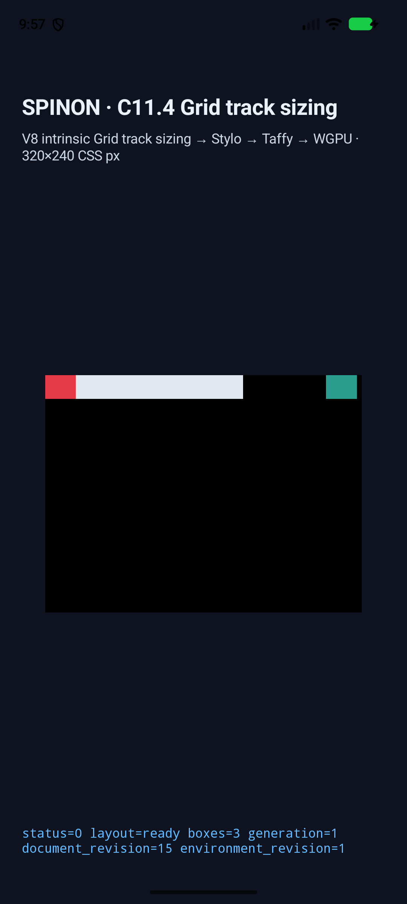
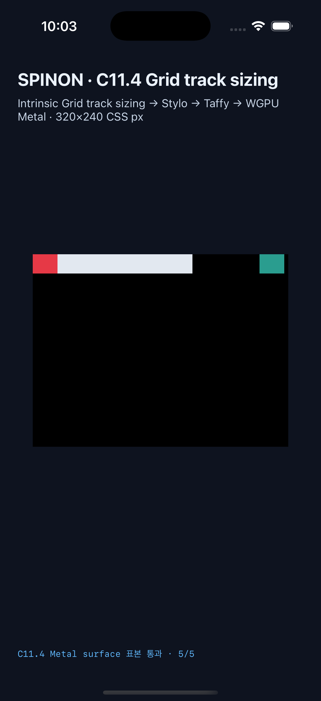
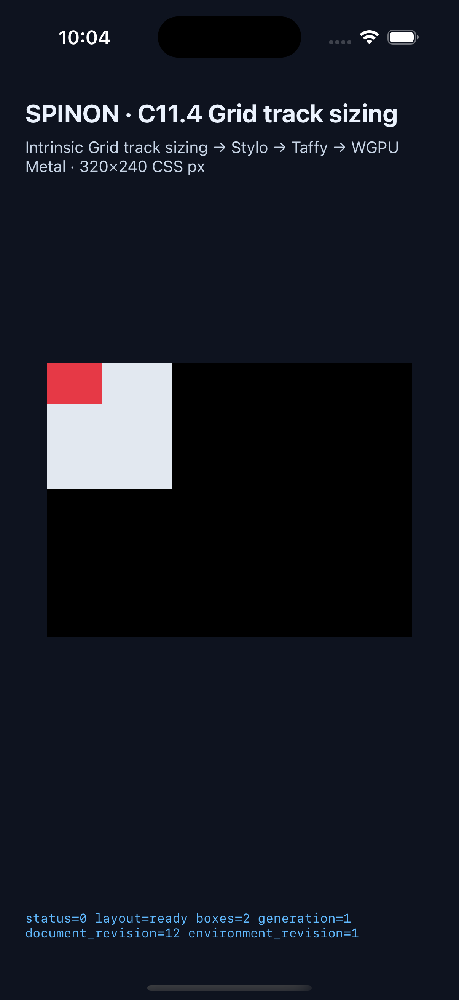

# C11.4 Negative implicit track sizing evidence

These simulator captures exercise negative and positive implicit Grid tracks,
track-list cycling, intrinsic track contributions, auto placement, auto-repeat
boundaries, auto-fit collapsing, root overflow, and the rendered sample matrix.

## 2026-10-20 typed implicit track follow-up: 138 scenes per platform

The 14 typed auto-track scenes extend the previously recorded 124-scene matrix.
The current Android API 37 ARM64 AVD and iPhone 17 Pro/iOS 26.2 Simulator runs
passed every scene, emitted a complete track-sizing trace and presented draw for
each scene, and saved one screenshot per scene.

| Platform | Run | Device | Scenes | Trace chunks | Draw/present | Surface samples |
| --- | --- | --- | ---: | ---: | --- | --- |
| Android | [`android-avd-c114-negative-implicit-android-avd-20261020T125416760Z-ef57f92f`](https://github.com/ohah/spinon/tree/main/spec/internal/evidence/c11-4-negative-implicit-track-sizing-2026-10-20/android-avd-c114-negative-implicit-android-avd-20261020T125416760Z-ef57f92f) | API 37 ARM64 AVD, `sdk_gphone16k_arm64` | 138 | 867 | 138/138 | 5 scenes, 24/24 exact |
| iOS | [`ios-simulator-c114-negative-implicit-ios-simulator-20261020T130111829Z-d5866712`](https://github.com/ohah/spinon/tree/main/spec/internal/evidence/c11-4-negative-implicit-track-sizing-2026-10-20/ios-simulator-c114-negative-implicit-ios-simulator-20261020T130111829Z-d5866712) | iPhone 17 Pro, iOS 26.2 | 138 | 1,659 | 138/138 | 5 scenes, 24/24 exact |

The shared scene IDs, 960 frame scalars, 1,019 used-track sizes, and auto-fit
collapse states were compared across platforms. Frame and track size maximum
difference was 0 CSS px. Four overflow scenes used five samples each; the
existing `auto-fill-overflow-neighbors` case used four. Full details are in
[`cross-platform-comparison-20261020.json`](https://github.com/ohah/spinon/blob/main/spec/internal/evidence/c11-4-negative-implicit-track-sizing-2026-10-20/cross-platform-comparison-20261020.json).
The Android manifest records APK SHA-256
`40fcb1ddcde64c14bb9ef550cf4d81438a85beed5349fa14565b891c2ece0605`; the iOS
app SHA-256 is `90fe143b34984efdce4f6390726491a7537cc8ed71f3802e45cac1bf27765395`.
The typed implicit track sizing change has a separate [20-perspective
implementation review](./auto-repeat-typed-implementation-review-20.md).
Its final PR diff has a separate [30-perspective review](./auto-repeat-typed-pr-diff-review-30.md).
Trailing horizontal whitespace was removed from `.log` files in these two run
directories; recorded values and log content are unchanged.

The captured surface cases are `auto-fill-overflow-neighbors` (4/4),
`columns-fill-negative-positive-cycle` (5/5),
`columns-negative-fixed-root-overflow` (5/5),
`implicit-min-content-overflow-border` (5/5), and
`rows-negative-fixed-root-overflow` (5/5). The edge sample reads the root
background; it does not measure CSS border stroke.

## C11.4 auto-repeat and negative-line implementation matrix

The 124-scene combined matrix preserves the previous 106 runtime cases and adds
the 18 auto-repeat/negative-line cases. Both current simulator runs passed every
scene, emitted a presented draw marker for every scene, and saved a screenshot
per scene.

| Platform | Run | Device | Scenes | Trace chunks | Draw/present | Overflow surface samples |
| --- | --- | --- | ---: | ---: | --- | --- |
| Android | [`android-avd-c114-negative-implicit-android-avd-20261020T095145525Z-5509ee32`](https://github.com/ohah/spinon/tree/main/spec/internal/evidence/c11-4-negative-implicit-track-sizing-2026-10-20/android-avd-c114-negative-implicit-android-avd-20261020T095145525Z-5509ee32) | API 37 ARM64, `sdk_gphone16k_arm64` | 124 | 676 | 124/124 | 3 scenes, 5/5 each |
| iOS | [`ios-simulator-c114-negative-implicit-ios-simulator-20261020T095512614Z-dbf401be`](https://github.com/ohah/spinon/tree/main/spec/internal/evidence/c11-4-negative-implicit-track-sizing-2026-10-20/ios-simulator-c114-negative-implicit-ios-simulator-20261020T095512614Z-dbf401be) | iPhone 17 Pro, iOS 26.2 | 124 | 1,284 | 124/124 | 3 scenes, 5/5 each |

Both runs needed no superseded host retries. The two fixed-root negative-track
overflow scenes and `columns-fill-negative-positive-cycle` each record exact
five-sample surface readback. Those samples cover root interior, the root edge,
root exterior, the overflow item, and the tail after that item.
The iOS app must be built with
`SPINON_ENABLE_C11_GRID_METAL_SURFACE_PIXELS_TEST=1` in addition to the runtime
GPU fixture flags so the Metal readback route is present.

## Previous 106-scene baseline simulator runs

| Platform | Run | Device | Scenes | Trace chunks | Draw/present | Pixel sample matrix |
| --- | --- | --- | ---: | ---: | --- | --- |
| Android | [`android-avd-c114-negative-implicit-android-avd-20261020T071538016Z-47d39cb4`](https://github.com/ohah/spinon/tree/main/spec/internal/evidence/c11-4-negative-implicit-track-sizing-2026-10-20/android-avd-c114-negative-implicit-android-avd-20261020T071538016Z-47d39cb4) | API 37, `sdk_gphone16k_arm64` | 106 | 544 | 106/106 | matched |
| iOS | [`ios-simulator-c114-negative-implicit-ios-simulator-20261020T071834448Z-c69e61d9`](https://github.com/ohah/spinon/tree/main/spec/internal/evidence/c11-4-negative-implicit-track-sizing-2026-10-20/ios-simulator-c114-negative-implicit-ios-simulator-20261020T071834448Z-c69e61d9) | iPhone 17 Pro, iOS 26.2 | 106 | 1,033 | 106/106 | matched |

Each run directory contains `simulator.json`, `result.json`, per-scene runtime
logs, and screenshots. `result.json` records every scene's layout summary,
track sizes, trace chunk count, and draw/present result. The Android and iOS
`runtime-auto-fill-overflow-neighbors.log` files contain the corresponding
`SPINON_C114_GRID_PIXEL_MATRIX_SUMMARY status=matched` and
`SPINON_C114_METAL_PIXEL_SUMMARY status=matched` markers.
Five Android scene logs had only trailing horizontal whitespace removed to
keep the committed evidence diff clean; log records and values are unchanged.

The simulator manifests record the built artifacts:

- Android APK SHA-256: `1ee4e9a6334c1d444b403d1eb61f0fa54b7baa8b897ccd374bc71a588ae2960d`
- iOS app SHA-256: `ec4212666b2e5d8bf27f2e0c37c46cb69bb1acc215ae806459bfb193f13c2492`

The Android run used emulator serial `emulator-5554`. The iOS run used
Simulator UDID `ACA7BF91-E2D5-4CF7-909A-08D1AD95FF3D`.

## Typed implicit follow-up local checks

- `mise exec -- cargo fmt --all -- --check` — passed.
- `mise exec -- cargo test --locked --workspace --quiet` — 1,182 passed, 0 failed, 4 ignored.
- `mise exec -- cargo test --locked -p spinon-runtime --features c11-4-grid-track-sizing-fixture-test` — 209 passed, 0 failed, 3 ignored (190 unit tests and 19 integration tests passed).
- `mise exec -- cargo clippy --locked --workspace --all-targets -- -D warnings` — passed.
- `mise exec -- node --test tools/css-reference/fixture-module-boundary.test.mjs` — 6 passed.
- `mise exec -- node --check tools/css-reference/capture-c11-4-auto-repeat-neighbors-simulator.mjs` — passed.
- Default `spinon-ffi` static library did not contain either C11.4 fixture FFI symbol; building with `c04-runtime-gpu-fixture-test` included both symbols.
- Android build passed with `SPINON_ENABLE_C04_RUNTIME_GPU=1` and `SPINON_ENABLE_C04_RUNTIME_GPU_FIXTURE_TEST=1`.
- iOS Simulator build passed with those flags plus `SPINON_ENABLE_C11_GRID_METAL_SURFACE_PIXELS_TEST=1`.
- `git diff --check` — passed.
- `mise exec -- bun run docs:build` — failed because the repository has hundreds of existing dead-link groups across evidence pages. The new plan and JSON references use GitHub links; the added sections introduce no new dead-link report. Full output is in the ignored build log `build/c114-typed-implicit-docs-build-rerun-20261020.log`.

## Previous 124-scene run local checks

- `mise exec -- cargo fmt --all -- --check` — passed.
- `mise exec -- cargo test --locked --workspace` — 1,178 passed, 0 failed, 4 ignored across 26 targets.
- `mise exec -- cargo clippy --locked --workspace --all-targets -- -D warnings` — passed.
- `mise exec -- cargo test --locked -p spinon-ffi --features c04-runtime-gpu-fixture-test exposes_only_bounded_intrinsic_track_sizing_scenes` — passed.
- `mise exec -- node --test tools/css-reference/fixture-module-boundary.test.mjs` — 6 passed.
- `mise exec -- node --check tools/css-reference/capture-c11-4-auto-repeat-neighbors-simulator.mjs` — passed.
- Default release `spinon-ffi` static library did not contain the new fixture marker `columns-fill-one-leading`; rebuilding with `c04-runtime-gpu-fixture-test` did contain it.
- CSS Reference 전체 실행은 563개 중 559개 통과, 4개 실패다. 실패는 C04 viewport Swift 정규식 1개, C11.3.2 Android/iOS route 정규식 1개, 현재 기준선에 해당 구현이 없는 C13.3 iOS route 검사 2개다. 저장소 현재 기준 커밋에도 같은 검사 불일치가 있어 이 C11.4 변경으로 인한 회귀로 보지 않는다. 전체 출력은 작업 실행 로그 `build/c114-css-reference-with-shared-deps.log`에 있다.
- signed extent cap은 9,999·10,000 track 허용, 10,001 거부의 checked-arithmetic 단위 시험으로 확인한다. 전체 Taffy trace에는 별도 100,000 track-state budget이 있어 9,999-track layout도 trace allocation error로 fail-closed할 수 있다. 따라서 cap boundary test는 10,000-track 전체 layout 성공을 뜻하지 않는다.

## Representative runtime screens

## Evidence limits

The current 138-scene run samples five overflow cases: four cases have five
samples each and `auto-fill-overflow-neighbors` has four. All 24 samples matched
exactly on both platforms. The root-edge sample reads the root background; CSS
border stroke is not implemented on this path and is not tested. The Android
AVD uses software rendering, and iOS Metal values precede OS compositor
submission. These captures do not establish physical-device, hardware GPU,
compositor-after pixel, or full CSS Grid conformance.

The earlier 124-scene run sampled three overflow cases with five samples each.
Those records remain in the older run directories and are summarized above.

The earlier negative-track review is in
[implementation-review-20.md](./implementation-review-20.md). The current
auto-repeat delta has a separate
[20-perspective implementation review](./auto-repeat-implementation-review-20.md).
The typed implicit sizing follow-up has its own
[20-perspective implementation review](./auto-repeat-typed-implementation-review-20.md).
Its PR diff review is [recorded separately in 30 perspectives](./auto-repeat-typed-pr-diff-review-30.md).
The prior 106-scene PR review is in [pr-diff-review-30.md](./pr-diff-review-30.md);
the current implementation PR diff has its own
[30-perspective review](./implementation-pr-diff-review-30.md).
