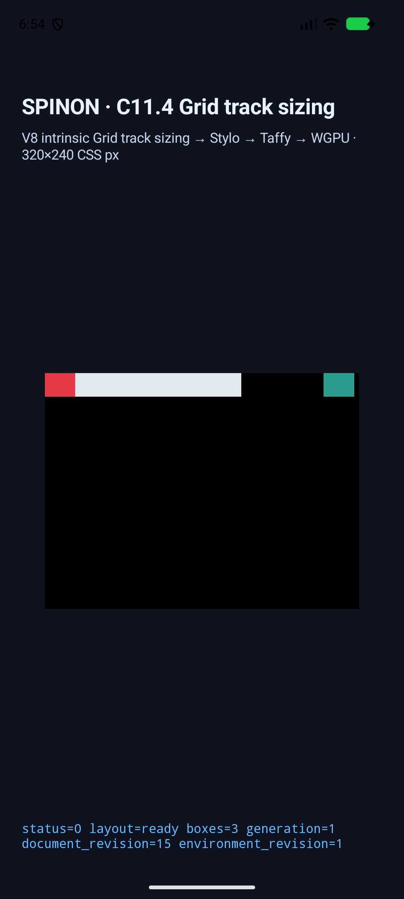
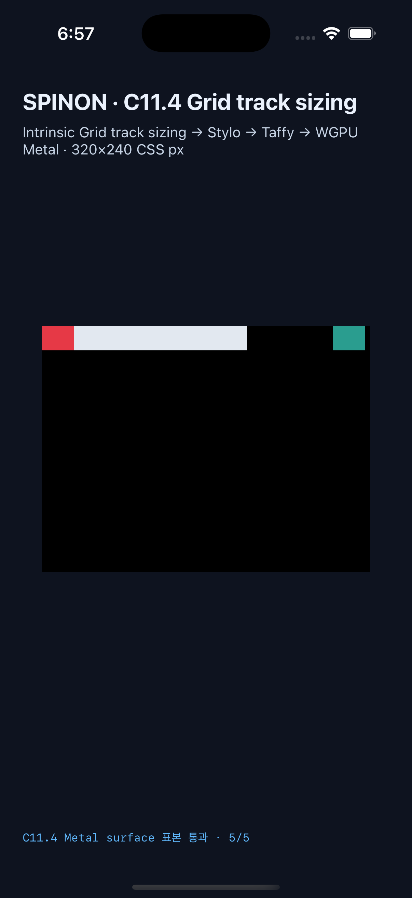

# C11.4 Negative implicit track sizing evidence

These simulator captures exercise negative and positive implicit Grid tracks,
track-list cycling, intrinsic track contributions, auto placement, auto-repeat
boundaries, auto-fit collapsing, root overflow, and the rendered sample matrix.

## C11.4 auto-repeat and negative-line implementation matrix

The 124-scene combined matrix preserves the previous 106 runtime cases and adds
the 18 auto-repeat/negative-line cases. Both current simulator runs passed every
scene, emitted a presented draw marker for every scene, and saved a screenshot
per scene.

| Platform | Run | Device | Scenes | Trace chunks | Draw/present | Overflow surface samples |
| --- | --- | --- | ---: | ---: | --- | --- |
| Android | [`android-avd-c114-negative-implicit-android-avd-20261020T095145525Z-5509ee32`](android-avd-c114-negative-implicit-android-avd-20261020T095145525Z-5509ee32/) | API 37 ARM64, `sdk_gphone16k_arm64` | 124 | 676 | 124/124 | 3 scenes, 5/5 each |
| iOS | [`ios-simulator-c114-negative-implicit-ios-simulator-20261020T095512614Z-dbf401be`](ios-simulator-c114-negative-implicit-ios-simulator-20261020T095512614Z-dbf401be/) | iPhone 17 Pro, iOS 26.2 | 124 | 1,284 | 124/124 | 3 scenes, 5/5 each |

Both runs needed no superseded host retries. The two fixed-root negative-track
overflow scenes and `columns-fill-negative-positive-cycle` each record exact
five-sample surface readback. Those samples cover root interior, the root edge,
root exterior, the overflow item, and the tail after that item.
The iOS app must be built with
`SPINON_ENABLE_C11_GRID_METAL_SURFACE_PIXELS_TEST=1` in addition to the runtime
GPU fixture flags so the Metal readback route is present.

## Previous 106-scene baseline simulator runs

| Platform | Run | Device | Scenes | Trace chunks | Draw/present | Pixel sample matrix |
| --- | --- | --- | ---: | ---: | --- | --- |
| Android | [`android-avd-c114-negative-implicit-android-avd-20261020T071538016Z-47d39cb4`](android-avd-c114-negative-implicit-android-avd-20261020T071538016Z-47d39cb4/) | API 37, `sdk_gphone16k_arm64` | 106 | 544 | 106/106 | matched |
| iOS | [`ios-simulator-c114-negative-implicit-ios-simulator-20261020T071834448Z-c69e61d9`](ios-simulator-c114-negative-implicit-ios-simulator-20261020T071834448Z-c69e61d9/) | iPhone 17 Pro, iOS 26.2 | 106 | 1,033 | 106/106 | matched |

Each run directory contains `simulator.json`, `result.json`, per-scene runtime
logs, and screenshots. `result.json` records every scene's layout summary,
track sizes, trace chunk count, and draw/present result. The Android and iOS
`runtime-auto-fill-overflow-neighbors.log` files contain the corresponding
`SPINON_C114_GRID_PIXEL_MATRIX_SUMMARY status=matched` and
`SPINON_C114_METAL_PIXEL_SUMMARY status=matched` markers.
Five Android scene logs had only trailing horizontal whitespace removed to
keep the committed evidence diff clean; log records and values are unchanged.

The simulator manifests record the built artifacts:

- Android APK SHA-256: `1ee4e9a6334c1d444b403d1eb61f0fa54b7baa8b897ccd374bc71a588ae2960d`
- iOS app SHA-256: `ec4212666b2e5d8bf27f2e0c37c46cb69bb1acc215ae806459bfb193f13c2492`

The Android run used emulator serial `emulator-5554`. The iOS run used
Simulator UDID `ACA7BF91-E2D5-4CF7-909A-08D1AD95FF3D`.

## Local checks

- `mise exec -- cargo fmt --all -- --check` — passed.
- `mise exec -- cargo test --locked --workspace` — 1,178 passed, 0 failed, 4 ignored across 26 targets.
- `mise exec -- cargo clippy --locked --workspace --all-targets -- -D warnings` — passed.
- `mise exec -- cargo test --locked -p spinon-ffi --features c04-runtime-gpu-fixture-test exposes_only_bounded_intrinsic_track_sizing_scenes` — passed.
- `mise exec -- node --test tools/css-reference/fixture-module-boundary.test.mjs` — 6 passed.
- `mise exec -- node --check tools/css-reference/capture-c11-4-auto-repeat-neighbors-simulator.mjs` — passed.
- Default release `spinon-ffi` static library did not contain the new fixture marker `columns-fill-one-leading`; rebuilding with `c04-runtime-gpu-fixture-test` did contain it.
- CSS Reference 전체 실행은 563개 중 559개 통과, 4개 실패다. 실패는 C04 viewport Swift 정규식 1개, C11.3.2 Android/iOS route 정규식 1개, 현재 기준선에 해당 구현이 없는 C13.3 iOS route 검사 2개다. 저장소 현재 기준 커밋에도 같은 검사 불일치가 있어 이 C11.4 변경으로 인한 회귀로 보지 않는다. 전체 출력은 작업 실행 로그 `build/c114-css-reference-with-shared-deps.log`에 있다.
- signed extent cap은 9,999·10,000 track 허용, 10,001 거부의 checked-arithmetic 단위 시험으로 확인한다. 전체 Taffy trace에는 별도 100,000 track-state budget이 있어 9,999-track layout도 trace allocation error로 fail-closed할 수 있다. 따라서 cap boundary test는 10,000-track 전체 layout 성공을 뜻하지 않는다.

## Representative runtime screens

## Evidence limits

The two fixed-root overflow scenes assert layout frames and sample the root
interior background, root-edge background, overflow item, and overflow tail.
These five samples per scene matched exactly on Android PixelCopy and the iOS
Simulator Metal drawable. The edge sample reads the root background; CSS border
stroke is not implemented on this path and is not tested. The Android AVD uses
software rendering, and the iOS samples precede OS compositor submission. These
captures do not establish physical-device, hardware GPU, compositor, or full
CSS Grid conformance.

The earlier negative-track review is in
[implementation-review-20.md](./implementation-review-20.md). The current
auto-repeat delta has a separate
[20-perspective implementation review](./auto-repeat-implementation-review-20.md).
The prior 106-scene PR review is in [pr-diff-review-30.md](./pr-diff-review-30.md);
the current implementation PR diff has its own
[30-perspective review](./implementation-pr-diff-review-30.md).
