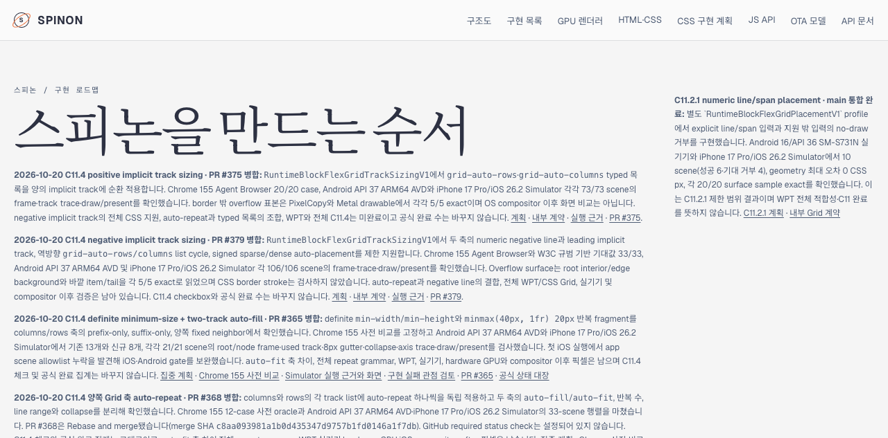
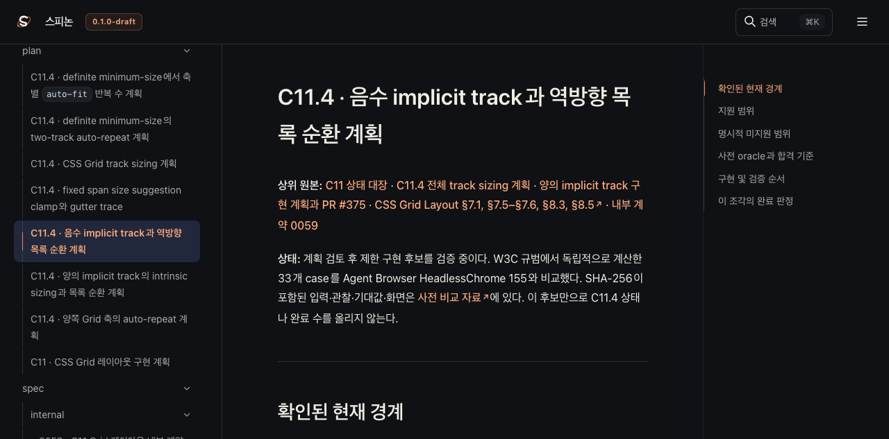
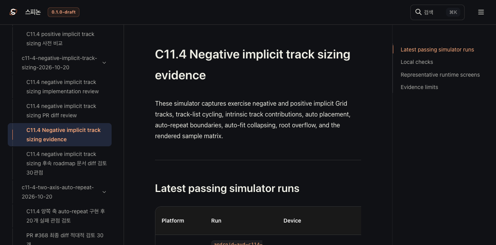

# C11.4 negative implicit Grid Tailnet roadmap 동기화

**기준 커밋:** 문서 PR [#380](https://github.com/ohah/spinon/pull/380) merge SHA `f0a00bf501f5764f7d5c7da672403aaeadd7fb63`. 
**범위:** 선택한 Rspress source를 Tailscale 정적 preview `/spinon/`에 갱신했다. GitHub Pages는 배포하지 않았고 앱이나 실기기를 실행하지 않았다.

## 반영 내용

- [PR #379](https://github.com/ohah/spinon/pull/379)의 제한 negative-line slice를 roadmap, 공식 상태, C11.4 계획과 내부 계약 route에서 확인할 수 있게 했다.
- public roadmap의 PR #379 문단은 제한 signed placement, 플랫폼 결과, surface 한계, 미완료 조합을 표시한다. C11.4 checkbox는 미완료로 유지되고 공식 수는 **72/212**다.
- Agent Browser에서 0059 계약 fragment `#c114-negative-implicit-track-sizing`이 실제 heading에 도달하는지 확인했다.
- 실행 근거 README에서 Android와 iOS Simulator overflow 이미지를 불러왔다. 링크 대상은 저장소의 검증된 final run이며 preview에는 대표 PNG 두 장만 복사했다. 전체 미추적 재시도 파일은 복사하지 않았다.

## 선택 빌드

Rspress `2.0.22` 고정 workspace 패키지를 사용했다. 최초 실행 때 이 worktree에는 `node_modules`가 없어 Rspress 실행 파일을 찾지 못했다. lockfile을 바꾸지 않고 `mise exec -- bun install --frozen-lockfile --filter @spinon/docs`로 문서 패키지만 연결한 뒤 `packages/docs`에서 선택 Rspress 설정으로 빌드했다. 성공 log는 [selected build](./selected-build-pass19.log)에, 초기 실행 오류는 [첫 시도](./selected-build-initial-failure-pass19.log)와 [루트 실행 시도](./selected-build-root-command-failure-pass19.log)에 보존했다.

selected root는 142개 source/destination mapping, staging file 3,434개다. input SHA manifest는 중복 없는 81개 source의 tracked file 1,447개를 기록한다. source directory에 섞여 있던 미추적 capture 223개는 staging과 manifest에서 제외했다. 빌드 sanitizer가 generated JS 한 파일에서 host path를 정리했고 최종 site의 text asset에서 남은 host/worktree path는 0개다. 요약은 [root preparation](./prepare-root-pass19.json), [input manifest](./SHA256SUMS-preview-inputs-pass19.txt), [1,447개 input hash 확인](./input-manifest-verification-pass19.json), [sanitizer](./sanitize-pass19.json)에 있다.

## Preview copy와 제공 확인

정적 root는 `~/Library/Application Support/SpinonPreview`; 교체 전 복사본은 `SpinonPreviewBackups/c11-4-negative-tailnet-sync-2026-10-20/pass19`에 보존했다.

| pass19 항목 | 결과 |
| --- | ---: |
| 제공 파일 / source bytes | 2,841 / 116,242,015 |
| 생성 / 교체 / 동일 | 131 / 103 / 2,607 |
| 삭제 | 없음 |
| 생성·원자 교체 후 검증 | 234/234 |
| 교체 전 backup 검증 | 103/103 |
| Tailnet HTTP 200·bytes·SHA-256 | 2,841/2,841 일치 |

사전 대조, 열린 파일, copy/backup과 전체 served hash 결과는 [preflight](./preflight-pass19.json), [open handles](./open-handles-before-copy-pass19.json), [copy and backup](./copy-and-backup-pass19.json), [served verification](./served-verification-pass19.json)에 있다. `lsof`에서 Tailnet server PID 1191이 교체 대상 HTML 5개를 열고 있었다. 기존 파일을 backup하고 hash를 확인한 뒤 같은 디렉터리 temporary file을 원자적으로 rename했다. preview server, 공유 tmux와 기존 Agent Browser process는 종료하지 않았다.

## Agent Browser 확인

격리 session `spinon-c114-roadmap-pass19`에서 public roadmap, STATUS, 계획, 내부 계약 fragment, 근거 페이지와 30관점 문서 검토를 열었다. roadmap counter는 **212개 표시 · 공식 완료 72/212**이고 61/212가 아니다. STATUS의 C11.4 checkbox는 unchecked다. contract fragment는 `anchor_found=true`, review table은 30행이다. 두 실행 화면 이미지 모두 `complete=true`이며 Android 1080×2400, iPhone 1206×2622로 로드됐다.

Agent Browser 격리 session을 닫은 뒤 `active=false`, `pid=null`, session/profile process match 0을 확인했다. 기존 공유 Agent Browser PID 67317과 preview server PID 1191은 유지했다. session 결과는 [browser close](./browser-close-pass19.json)에 있다. 추가 DOM 결과: [roadmap](./browser-roadmap-pass19.json), [counter](./browser-roadmap-count-pass19.json), [STATUS](./browser-status-pass19.json), [plan](./browser-plan-pass19.json), [contract fragment](./browser-contract-pass19.json), [evidence image loads](./browser-evidence-pass19.json), [30-row review](./browser-review-pass19.json).

## 남은 범위

이 sync는 C11.4 구현 범위·공식 완료 수·GitHub Pages 상태를 변경하지 않는다. auto-repeat과 negative line의 결합, WPT 전체, 실기기/hardware GPU와 iOS compositor 이후 픽셀은 검증하지 않았다.
