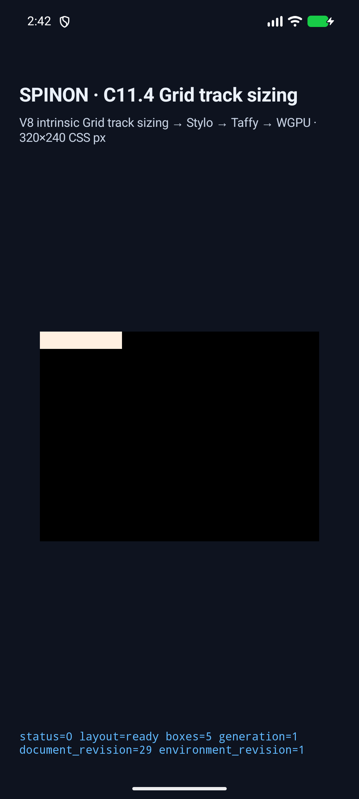
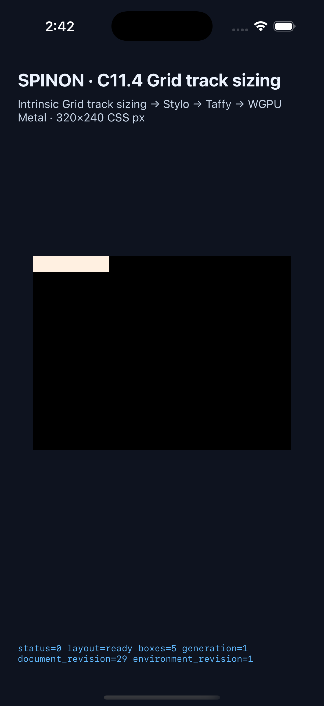

# C11.4 depth-three anonymous text + image runtime 근거

## 실행 범위

고정 HTML Grid tree의 마지막 Grid에서 anonymous Ahem text `XX XXXXXXX`와 natural-size PNG가 동시에 intrinsic contribution을 제공하는 네 scene을 구현했다. 기존 depth-one·two·three inline-text scene 열 개를 회귀 control로 더해 각 simulator에서 14/14 scene을 실행했다. 기준 기대값은 [Chrome 156 사전 비교와 독립 규범 계산](../c11-4-nested-depth-three-anonymous-image-precomparison-2026-10-22/README.md)에 연결했다.

### 최종 Android 실행

[Android API 37 ARM64 AVD 결과·로그·화면](https://github.com/ohah/spinon/blob/main/spec/internal/evidence/c11-4-depth-three-anonymous-image-final-runtime-2026-10-22/android-avd-c114-nested-depth-three-anonymous-image-regressions-android-avd-20261021T174208766Z-e42aa021/result.json) · [시뮬레이터 정보와 소스 revision](https://github.com/ohah/spinon/blob/main/spec/internal/evidence/c11-4-depth-three-anonymous-image-final-runtime-2026-10-22/android-avd-c114-nested-depth-three-anonymous-image-regressions-android-avd-20261021T174208766Z-e42aa021/simulator.json) · [설치 APK 검증](https://github.com/ohah/spinon/blob/main/spec/internal/evidence/c11-4-depth-three-anonymous-image-final-runtime-2026-10-22/android-avd-c114-nested-depth-three-anonymous-image-regressions-android-avd-20261021T174208766Z-e42aa021/installed-apk-verification.json).

- 기기: `emulator-5558`, `sdk_gphone64_arm64`, Android API 37, `arm64-v8a`; 실기기는 연결·사용하지 않았다.
- 네 신규 장면과 회귀 control 모두 frame, Columns/Rows final track, inner direct-item intrinsic source, track contribution trace 및 draw/present 검사를 통과했다. 14개 모두 `drawPresented=true`, `supersededRetries=0`이다.
- 로컬 APK와 설치된 APK SHA-256이 `a24378dfdef8949c9fcc7efa00208a0327a8b9d288239c866ffd1d4a4b277005`로 일치한다.

### 최종 iOS 실행

[iPhone 17 Pro/iOS 26.2 Simulator 결과·로그·화면](https://github.com/ohah/spinon/blob/main/spec/internal/evidence/c11-4-depth-three-anonymous-image-final-runtime-2026-10-22/ios-simulator-c114-nested-depth-three-anonymous-image-regressions-ios-simulator-20261021T174208766Z-6653bd89/result.json) · [시뮬레이터 정보와 소스 revision](https://github.com/ohah/spinon/blob/main/spec/internal/evidence/c11-4-depth-three-anonymous-image-final-runtime-2026-10-22/ios-simulator-c114-nested-depth-three-anonymous-image-regressions-ios-simulator-20261021T174208766Z-6653bd89/simulator.json).

- 기기: iPhone 17 Pro, runtime `iOS-26-2`, UDID `ACA7BF91-E2D5-4CF7-909A-08D1AD95FF3D`; 실기기는 사용하지 않았다.
- 같은 14개 검사를 모두 통과했고 `drawPresented=true`, `supersededRetries=0`이다.
- 앱 실행 파일 SHA-256: `13296c1bd961e04d65b336d040dfb996c64f1a0afce47d7bf2e14eadb50f0de5`.

두 manifest의 `sourceRevision.commit`은 구현 커밋 `3346d9b30d57ec7ba9d291ad2af6a47c2fc93611`, tree는 `00ce23c7b500f03bd0481e0b7de7b6176572b766`이며 캡처 당시 dirty path는 없다. Android/iOS build는 `C04 runtime GPU=1`, `C04 runtime GPU fixture-test=1`로 만들었고 그 밖의 C11.2.3/C13/C14/C15/C18/C19 fixture-test define은 껐다.
최종 14-scene run 파일과 PNG SHA-256 목록은 [capture group manifest](https://github.com/ohah/spinon/blob/main/spec/internal/evidence/c11-4-depth-three-anonymous-image-final-runtime-2026-10-22/SHA256SUMS)에 있다.
캡처 `.log`에서 각 line 끝의 horizontal whitespace만 제거했다. 이벤트 본문과 JSON trace payload는 바꾸지 않았고 manifest는 정규화한 파일을 대상으로 생성했다.
PR #462에 넣은 Android/iOS PNG URL은 [Agent Browser](https://github.com/ohah/spinon/blob/main/spec/internal/evidence/c11-4-nested-depth-three-anonymous-image-runtime-2026-10-22/agent-browser-pr-462-image-check.json)에서 각각 1080×2400과 1206×2622로 decode됐고 `complete=true`였다.

## 새 네 scene의 기대·실행값

| sizing | source order | 각 Grid frame | inner Columns / Rows | text item | image item |
| --- | --- | --- | --- | --- | --- |
| min-content | text → image | `94×20px` | `[70,24] / [20]` | `(0,0) 70×20` | `(70,0) 24×16` |
| min-content | image → text | `94×20px` | `[24,70] / [20]` | `(24,0) 70×20` | `(0,0) 24×16` |
| max-content | text → image | `124×16px` | `[100,24] / [16]` | `(0,0) 100×10` | `(100,0) 24×16` |
| max-content | image → text | `124×16px` | `[24,100] / [16]` | `(24,0) 100×10` | `(0,0) 24×16` |

각 바깥 Grid는 한 child의 크기를 세 부모 경계를 따라 전달한다. 각 신규 run 결과에는 four direct text/image inputs의 source order와 intrinsic revision, 네 Grid frame, 양 축 track이 기록돼 있다. `result.json`의 top-level `tracks`는 root track이며 capture verifier는 각 Grid trace와 innermost 두 Columns track을 별도로 확인했다.

### 화면

화면은 simulator 앱에서 scene이 ready 상태로 제출된 근거다. text glyph 및 PNG texel의 paint가 보인다는 뜻은 아니며, geometry와 intrinsic contribution의 판정은 위 JSON·runtime log·track trace를 기준으로 한다.

## 빌드·코드 검사

- `mise exec -- cargo fmt --all -- --check` 통과.
- Runtime nested-depth topology 회귀 2/2, 신규 네 조합 scene-matrix test 1/1, FFI source matrix test 1/1 통과.
- `mise exec -- cargo clippy --locked -p spinon-runtime -p spinon-ffi --all-targets --features spinon-ffi/c04-runtime-gpu-fixture-test -- -D warnings` 통과.
- `mise exec -- bun test tools/css-reference/fixture-module-boundary.test.mjs`: 6/6 통과. `mise exec -- node --check tools/css-reference/capture-c11-4-auto-repeat-neighbors-simulator.mjs` 및 `git diff --check` 통과.
- Android debug APK와 iOS Simulator app은 위 C04 fixture-test flag로 각각 빌드 성공했다. Android 빌드는 고정 NDK `27.1.12297006`을 사용했다.
- 기본 FFI static archive SHA-256은 `db4092dc501facaff8e9cf96465e8375c4c3c31bd8aea25eb574e03208702de9`이며 네 scene ID가 없다. `c04-runtime-gpu-fixture-test` positive-control archive SHA-256은 `0b55565dc222beba295f93ee507ab7c86d0423f31c1ba8c893bef79f8fa52f1f`이며 네 ID와 fixture 문자열이 들어 있다. static archive 검사로 최종 앱의 release 크기를 주장하지 않는다.

개발 중 첫 앱 실행은 새 scene allowlist 누락으로 거부됐다. allowlist 추가 뒤 제한 cascade가 받지 않는 `justify-items:start`/`align-content:start`/`justify-content:start` declaration은 제거했고, capture verifier의 span 전용 mixed-input assertion도 별도 marker로 분리했다. 최종 구현은 fixed layout 기대값을 유지하며 양 플랫폼 14/14를 통과했다. 위의 fail-closed style guard 및 scene matrix 테스트는 독립 review에서 추가 보강한 뒤 이 최종 실행에 포함했다.

## 남은 범위

이 결과는 four fixed scene과 depth regression controls만 다룬다. 임의 nested Grid, subgrid, span·다중 row/column, inline descendant 조합, whitespace/comment/display-none edge matrix, authored image dimensions/aspect-ratio transfer, glyph·PNG texel pixel parity, border/overflow surface, Android 실기기, iOS compositor 이후 pixels, WPT 및 전체 CSS Grid 적합성을 검증하지 않는다. 공식 C11.4 checkbox는 미완료이며 `72/213` 집계는 유지한다.
