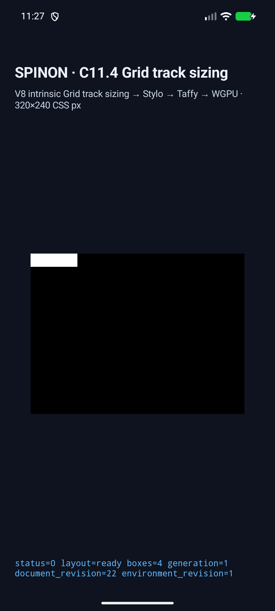
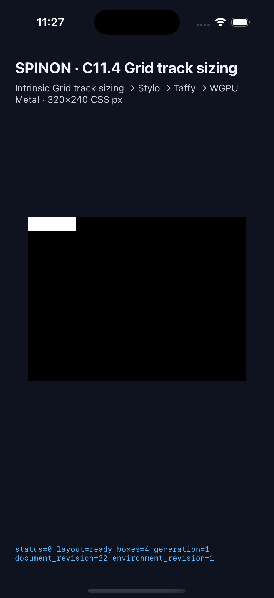

# C11.4 두 단계 nested Grid intrinsic runtime 근거

## 범위와 독립 기대값

계획 [두 단계 nested Grid inline-axis intrinsic contribution](../../../../plan/c11-4-nested-grid-depth-two.md)의 고정 fixture 네 개를 `c11-4-grid-track-sizing-fixture-test` opt-in 경로에 연결했다. 각 scene은 direct Ahem leaf `XX XXXXXXX`, `10px/10px` metrics, 한 개 column/row와 0 gap을 사용한다. CSS Grid 2025 CRD의 Grid container sizing 규칙과 Ahem advance에서 독립 계산한 `min-content=70px`, `max-content=100px`가 판정값이다.

| Scene | Grid chain | 각 Grid의 frame 및 Columns/Rows | leaf text frame |
| --- | --- | --- | --- |
| `nested-depth-one-min-content` | root → inner | `70×20px`; `[70]` / `[20]` | `70×20px` |
| `nested-depth-two-min-content` | root → middle → inner | `70×20px`; `[70]` / `[20]` | `70×20px` |
| `nested-depth-one-max-content` | root → inner | `100×10px`; `[100]` / `[10]` | `100×10px` |
| `nested-depth-two-max-content` | root → middle → inner | `100×10px`; `[100]` / `[10]` | `100×10px` |

두 플랫폼에서 root/middle/inner의 각 Columns·Rows trace, 각 parent의 `MinContent` 또는 `MaxContent` child contribution, inner Grid의 leaf-text contribution, Ahem intrinsic source와 revision 1을 검사한다.

## Android API 37 ARM64 AVD

`emulator-5558` (`sdk_gphone64_arm64`, API 37, ARM64, Android 17 image)에서 네 scene 모두 통과했다. 사용한 실행 디렉터리는 [Android run](./android-avd-c114-nested-grid-depth-two-android-avd-20261021T142709176Z-f1ee21a4/)이며 trace chunk 수는 순서대로 9, 12, 9, 13이다. 각 scene은 `layout=ready`, 예상 box 수와 frame/track, `drawPresented=true`, superseded retry 0을 기록했다. 설치 APK와 빌드 APK SHA-256은 `9478d5330721b8df5e15f076f8a797e7240d5b64b573930965999a2fc4485807`로 일치한다.

- [전체 결과](./android-avd-c114-nested-grid-depth-two-android-avd-20261021T142709176Z-f1ee21a4/result.json) · [AVD metadata](./android-avd-c114-nested-grid-depth-two-android-avd-20261021T142709176Z-f1ee21a4/simulator.json) · [APK hash 확인](./android-avd-c114-nested-grid-depth-two-android-avd-20261021T142709176Z-f1ee21a4/installed-apk-verification.json)
- [depth-two min-content 화면](./android-avd-c114-nested-grid-depth-two-android-avd-20261021T142709176Z-f1ee21a4/nested-depth-two-min-content.png) · [depth-two max-content 화면](./android-avd-c114-nested-grid-depth-two-android-avd-20261021T142709176Z-f1ee21a4/nested-depth-two-max-content.png)

## iOS Simulator

iPhone 17 Pro / iOS 26.2 Simulator (`ACA7BF91-E2D5-4CF7-909A-08D1AD95FF3D`)에서 네 scene 모두 통과했다. 사용한 실행 디렉터리는 [iOS run](./ios-simulator-c114-nested-grid-depth-two-ios-simulator-20261021T142718496Z-45a9af47/)이며 trace chunk 수는 순서대로 17, 24, 18, 25이다. 각 scene은 `layout=ready`, 예상 box 수와 frame/track, `drawPresented=true`, superseded retry 0을 기록했다. 앱 산출물 SHA-256은 `1d801d8d54c498a185f20d3696ffcd2b2f6d69a13200f33770465c2f34b213aa`이다.

- [전체 결과](./ios-simulator-c114-nested-grid-depth-two-ios-simulator-20261021T142718496Z-45a9af47/result.json) · [Simulator metadata](./ios-simulator-c114-nested-grid-depth-two-ios-simulator-20261021T142718496Z-45a9af47/simulator.json)
- [depth-two min-content 화면](./ios-simulator-c114-nested-grid-depth-two-ios-simulator-20261021T142718496Z-45a9af47/nested-depth-two-min-content.png) · [depth-two max-content 화면](./ios-simulator-c114-nested-grid-depth-two-ios-simulator-20261021T142718496Z-45a9af47/nested-depth-two-max-content.png)

대표 실행 화면:

## 코드와 artifact 경계

- [Runtime focused test](./runtime-focused-test-final.log), [projection regression](./projection-focused-test-final.log), [FFI allowlist test](./ffi-focused-test-final.log), [related implicit-row regression](./nested-implicit-row-regression-test.log), [Rust format](./cargo-fmt-final.log), [capture runner Node syntax](./capture-runner-node-check-final.log), [188-scene capture list](./capture-runner-scene-list-final.json), [workspace Clippy](./workspace-clippy-final.log), [fixture-feature Clippy](./fixture-clippy-final.log)
- [Android fixture app build](./android-build-final.log), [iOS Simulator fixture app build](./ios-simulator-build-final.log)
- 기본 제품 feature `c04-runtime-gpu` archive의 [scene marker 확인](./default-artifact-markers.txt)에서 네 scene ID가 모두 빠졌다. opt-in `c04-runtime-gpu-fixture-test` positive control archive는 [네 marker 모두](./fixture-artifact-markers.txt)를 포함한다. archive SHA-256은 [기본](./default-artifact-sha256.txt), [fixture opt-in](./fixture-artifact-sha256.txt)에 기록했다. 큰 archive 사본은 보관하지 않는다. 이 결과는 Rust static archive 경계에 한정되고 최종 Android/iOS release bundle 전체의 크기나 제외 증거로 확장하지 않는다.

Fixture-feature Clippy 첫 실행에서 이 feature 조합이 함께 컴파일하는 기존 implicit-row helper의 인자 수 lint가 드러났다. 입력 기대값을 구조체로 묶고 새 FFI fixture의 불필요한 `format!`도 단순 문자열로 바꾼 뒤 [fixture-feature Clippy](./fixture-clippy-final.log)와 [implicit-row regression](./nested-implicit-row-regression-test.log)을 다시 통과시켰다. 초기 실패 로그는 [첫 Clippy 결과](./fixture-clippy-initial-failure.log)와 [두 번째 결과](./fixture-clippy-second-failure.log)에 보존했다.

[구현 실패 관점 검토 20개](./implementation-review-20.md), [PR diff 검토 30개](./pr-diff-review-30.md), 실행 결과의 [representative screenshot hash](./SHA256SUMS.txt)를 연결했다.

첫 Android 실행은 앱의 scene argument allowlist에 새 ID가 없어 거부됐다. allowlist를 갱신해 재빌드한 뒤 두 번째 실행에서 FFI CSS subset이 지원하지 않는 `writing-mode` 선언이 거부됐다. 고정 HTML에서 이 선언을 없애고 Rust 입력 검사를 갱신한 뒤 최종 AVD run을 다시 실행해 네 장면 모두 통과했다. 초기 실행 로그는 같은 evidence 디렉터리에 남겨 두었다.

## PR 본문 화면과 병합

PR [#450](https://github.com/ohah/spinon/pull/450)은 2026-10-21 14:38:40 UTC Rebase and merge됐고 merge SHA는 `80837bbe03542eb55ebc983964c72fd925454d28`다. 병합 당시 PR check rollup은 비었으며 `gh api`는 main required status checks가 설정되어 있지 않다고 반환했다. PR 본문은 대표 Android/iOS 화면을 이 merge SHA의 immutable GitHub raw URL로 표시한다. 병합 후 Agent Browser에서 두 이미지가 모두 로드되어 원본 크기 Android 1080×2400, iOS 1206×2622를 반환함을 확인했다. [Agent Browser PR 본문 이미지 로드 기록](./pr-body-image-verification-agent-browser.json)에 결과를 남겼다. 병합 결과를 기록한 문서 PR의 [diff 실패 관점 검토 30개](./postmerge-docs-pr-review-30.md)도 연결한다. 이 브라우저 검증은 screenshot의 기존 한계(geometry/trace/draw-present만 확인)를 넓히지 않는다.

## 한계

이 fixture는 정확히 네 고정 scene만 허용한다. arbitrary HTML/CSS, 임의 nesting depth, depth 3+, subgrid, CSS cascade admission, WPT, Android physical device와 hardware GPU는 확인하지 않았다. 앱 screenshot은 box/runtime surface 관찰이며 Ahem glyph texel equality를 증명하지 않는다. iOS의 `drawPresented`는 host draw/present 경로를 확인하며 OS compositor 이후 pixel을 증명하지 않는다. C11.4 checkbox와 공식 완료 집계 `72/213`은 유지한다.
