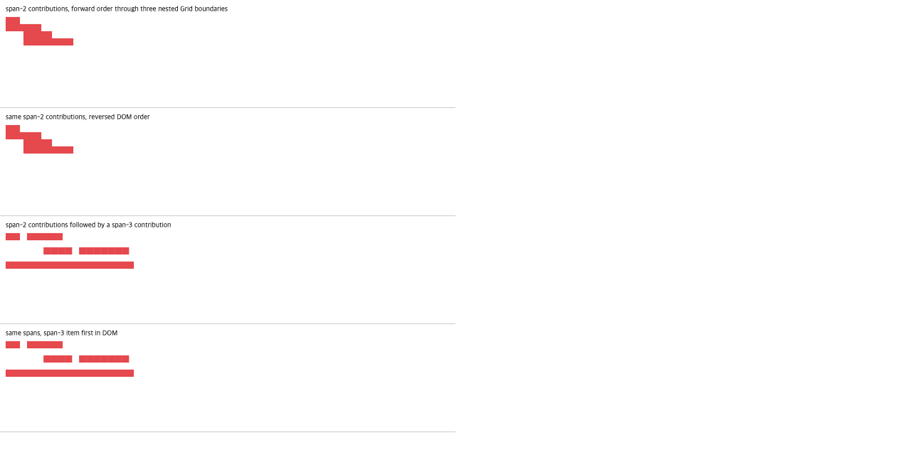

# C11.4 depth-three nested Grid text multi-span 사전 비교

## 고정 입력과 실행 환경

재현 입력은 `tests/fixtures/css/c11/grid-track-sizing-c114-nested-grid-multispan-precomparison.html`이다. 네 Grid가 `root → middle → branch → inner`로 연결된다. 바깥 세 Grid는 `width:min-content`, `height:60px`, 단일 min-content column과 60px row를 사용한다. inner Grid도 `width:min-content`, `height:60px`이며 네 min-content column과 세 20px row를 가진다. 모든 gutter와 box edge는 0px다.

Ahem 10px/10px direct-leaf text는 `XX XXXXX`(50px min-content), `XXXX XXXXXXX`(70px), 18개의 `X`(180px)다. 두 겹치는 span-2 item을 forward/reversed DOM 순서로 실행하고, span-3 item을 더한 scene도 두 순서로 실행한다. Agent Browser 0.31.1의 Chrome Headless 156(`HeadlessChrome/156.0.0.0` user-agent), DPR 1, viewport 1280×633에서 고정 입력을 열었다. Ahem이 준비된 뒤 각 Grid의 computed track과 모든 item/Grid frame을 읽었다.

## 독립 규범 기대값

기대값은 Chrome 관측에 맞춰 만들지 않고 [CSS Grid 2025 CRD §11.5.1](https://www.w3.org/TR/2025/CRD-css-grid-1-20250326/#algo-spanning-items)의 span 길이별 계획 증가 규칙에서 계산했다. span-2 최소 기여 50px과 70px은 inner Columns `[25,35,35,0]`을 만든다. 폭 합과 세 단계의 단일-track ancestor contribution은 95px이다. span-3 item의 180px 최소 기여는 첫 세 track의 현재 합 95px에서 85px을 분배하므로 이상적인 inner Columns `[160/3,190/3,190/3,0]`, 각 nested Grid width 180px가 된다.

| scene pair | 독립 inner Columns | 세 ancestor Columns | Chrome inner Columns |
| --- | --- | --- | --- |
| `nested-text-span2-forward` / `nested-text-span2-reversed` | `[25,35,35,0]` | 각 `[95]` | `[25,35,35,0]` |
| `nested-text-span2-before-span3` / `nested-text-span3-before-span2` | `[160/3,190/3,190/3,0]` | 각 `[180]` | `[53.328125,63.328125,63.34375,0]` |

Chrome의 Grid/item frame, computed style, Ahem 준비 상태와 환경은 `chrome156-observation.json`에, 독립 계산은 `spec-derived-expectations.json`에 분리했다. 분수 규범 기대값과 Chrome CSSOM의 1/64px quantization은 같은 숫자로 취급하지 않는다. 아래 화면은 Agent Browser에서 보인 네 고정 scene이다.

## 판정 경계

이 자료는 사전 oracle이다. Spinon layout/runtime, Android/iOS 앱, surface sampling, WPT, 일반 CSS 지원 또는 glyph pixel equality를 검증하지 않았다. 해당 구현 PR은 계획 PR이 병합된 뒤 별도 브랜치에서 진행한다. C11.4 checkbox와 공식 `72/213` 집계는 그대로 둔다.

SHA-256 목록은 `SHA256SUMS.txt`다.
