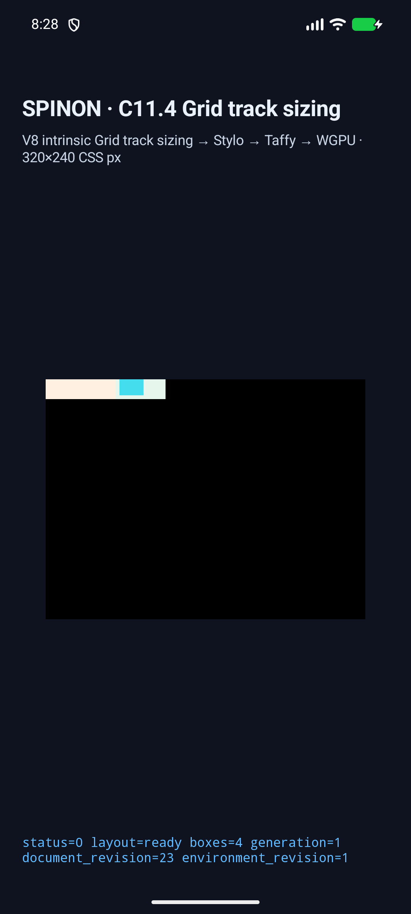
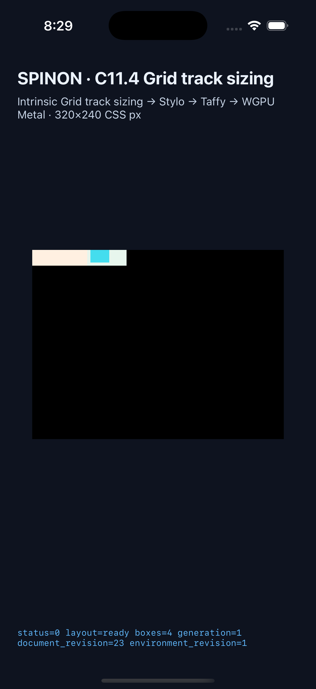

# Nested Grid text + replaced item 실행 근거

## 판정 범위

고정된 한 단계 nested Grid에서 Ahem text leaf와 natural-size HTML PNG `` leaf를 한 layout request로 처리하는 C11.4 opt-in fixture 세 장면을 실행했다. Android API 37 ARM64 AVD와 iPhone 17 Pro / iOS 26.2 Simulator에서 frame, track trace, intrinsic contribution, scene gate, draw/present를 각 3/3 통과했다. 이 결과는 일반 nested Grid 또는 C11.4 전체 지원 완료 판정이 아니다.

구현 전 입력, 계산, HeadlessChrome 156 geometry, hash와 최종 `justify-items:normal` 보정은 [사전 비교](../c11-4-nested-grid-replaced-item-precomparison-2026-10-21/README.md)에 둔다. 별도 계획 실패 관점 20개는 [plan-review-20.md](../c11-4-nested-grid-replaced-item-precomparison-2026-10-21/plan-review-20.md)에 있다.

구현/runtime 실패 관점 검토 20개와 별도로 [PR diff 교차 파일 실패 관점 검토 20개](./pr-diff-review-20.md)를 마쳤다.

## 장면 결과

| 장면 | Outer frame / columns | Nested frame / columns | Text frame | Image frame | Parent contribution |
| --- | --- | --- | --- | --- | --- |
| `nested-grid-text-image-span-two` | `98×20`; `47/47px` | `98×20`; `70/24px` | `70×20` | `(74,0) 24×16` | `MinContent=98px`, span 2 |
| `nested-grid-text-image-one-track` | `102×20`; `98/0px` | `(0,28) 98×20`; `70/24px` | `(0,28) 70×20` | `(74,28) 24×16` | `MinContent=98px`, span 1 |
| `nested-grid-text-image-definite-flex-control` | `120×20`; `58/58px` | `(0,56) 120×20`; `70/24px` | `(0,56) 70×20` | `(74,56) 24×16` | `Minimum=0px`, span 2 |

Rust direct-layout test, runtime trace and both app reports agree on these values. The direct text and image intrinsic inputs belong to nested Grid node 2; the parent contribution belongs to nested Grid item node 2. The outer contribution trace does not mislabel the nested Grid as a text/image leaf. The image natural size is 24×16 CSS px and the layout output carries intrinsic revision 1.

Android reports 11, 11 and 14 track-trace chunks across the scenes, with `drawPresented=true` each time. iOS reports 22, 22 and 27 chunks, also with `drawPresented=true`. Android local and installed APK hashes both equal `f6f9501a696c0a27e9fddacea1531397affe2e986de962a4da7f972051384225`. iOS app bundle hash is `a411f6557a2ee1fcc0ad4bf4cda464ba9599eea7626adafe8ce9fd748c7671e3`.

## 실행 환경과 원본

- Android: `emulator-5558`, API 37, `arm64-v8a`, `sdk_gphone64_arm64`. Metadata: `android-avd-c114-nested-grid-replaced-item-android-avd-20261021T112756265Z-d5cf29f0/simulator.json`; result: `android-avd-c114-nested-grid-replaced-item-android-avd-20261021T112756265Z-d5cf29f0/result.json`; installed APK verification: `android-avd-c114-nested-grid-replaced-item-android-avd-20261021T112756265Z-d5cf29f0/installed-apk-verification.json`.
- iOS: iPhone 17 Pro, iOS 26.2 Simulator, UDID `ACA7BF91-E2D5-4CF7-909A-08D1AD95FF3D`. Metadata: `ios-simulator-c114-nested-grid-replaced-item-ios-simulator-20261021T112855468Z-13b520b8/simulator.json`; result: `ios-simulator-c114-nested-grid-replaced-item-ios-simulator-20261021T112855468Z-13b520b8/result.json`.
- Android fixture app build log: `../c11-4-nested-grid-replaced-item-runtime-2026-10-21/android-fixture-build.log`; iOS Simulator fixture app build log: `../c11-4-nested-grid-replaced-item-runtime-2026-10-21/ios-simulator-fixture-build.log`.
- [Simulator capture runner source](https://github.com/ohah/spinon/blob/main/tools/css-reference/capture-c11-4-auto-repeat-neighbors-simulator.mjs)

The committed Xcode build transcript and one long Android runtime log had trailing spaces/blank EOF lines, so those whitespace-only differences were normalized before commit. Original and normalized SHA-256 values are recorded in `../c11-4-nested-grid-replaced-item-runtime-2026-10-21/whitespace-normalization.json`.

The screenshots are whole-app captures that show the host surface. `drawPresented=true` is a runtime presentation marker. This run did not perform Android PixelCopy or iOS Metal drawable readback, so it does not establish exact surface pixels, image texel paint, border-stroke equality, Android hardware GPU output, or pixels after the iOS compositor.

## 화면

The selected Android screenshot SHA-256 is `5820533ec21e9f2bae7f72c16f4f4d4eb461878612806a40e64c5fd64596a72a`; the selected iOS screenshot SHA-256 is `f818834b17a880a2a6c155536a64f3b2e7dc959f45d91b1bf2f07272cf9212a1`.

## PR image rendering and Agent Browser cleanup

Agent Browser 0.31.1 opened PR [#443](https://github.com/ohah/spinon/pull/443) and inspected both markdown image elements in the PR body. The Android image loaded at 1080×2400 and the iOS image at 1206×2622; both were complete and visible. The browser tab/window closed. Its daemon reported `browserLaunched=false` and `pageCount=0`, then the exact Agent Browser daemon process was terminated and `ps` found no process for that PID. Structured result: `pr-443-agent-browser-image-check.json`.

## Build, tests, and artifact boundary

The following checks passed on the current feature diff:

- `cargo fmt --all -- --check`
- `cargo clippy --locked --workspace --all-targets -- -D warnings`
- Runtime fixture regression: 9 selected `c11_4_` tests and the new `c114_nested_grid_text_and_replaced_item_share_intrinsic_layout_revision` test passed.
- Direct layout regression: `nested_grid_text_and_replaced_contributions_match_chrome_oracle` passed.
- FFI allowlist regression: `exposes_fixed_nested_grid_text_image_scenes` passed.
- `mise exec -- node --check tools/css-reference/capture-c11-4-auto-repeat-neighbors-simulator.mjs`
- `mise exec -- node tools/css-reference/fixture-module-boundary.test.mjs` — 6/6 passed.
- Android and iOS fixture app builds passed; see the linked build logs.
- `mise exec -- bun run docs:build` was attempted. It still fails on dead links in other tracked spec/internal pages (including `0031`, `0032`, and `0033`) and unrelated existing evidence. The second run reported no dead-link entry for this new evidence path after changing binary/source artifact references to code paths and using an embedded screenshot. The whole documentation build is therefore not green.

Default and opt-in `spinon-ffi` static archives were built sequentially and inspected with `strings` and `nm`:

| Build | SHA-256 | New scene payload | C11.4 fixture entry point |
| --- | --- | --- | --- |
| `cargo build --locked -p spinon-ffi --lib` | `7ec92265deb9fb36d73455e777afa9f9d4be26152fc9684611ccc67ed640df1e` | absent | absent |
| `cargo build --locked -p spinon-ffi --lib --features c04-runtime-gpu-fixture-test` | `f9f841ed6c0d9b49e451b1eedbb6014366c6ac62cbe96faca25d7bb8c76f2c0f` | present | present: `_spinon_runtime_gpu_host_new_c11_4_grid_track_sizing_fixture`, `_spinon_runtime_gpu_host_eval_c11_4_grid_track_sizing_fixture` |

The archive inspection covers these local debug static libraries only; it is not a release-artifact, final app-size, or package audit. C11.4 remains unchecked and the official completion count remains 72/213.
