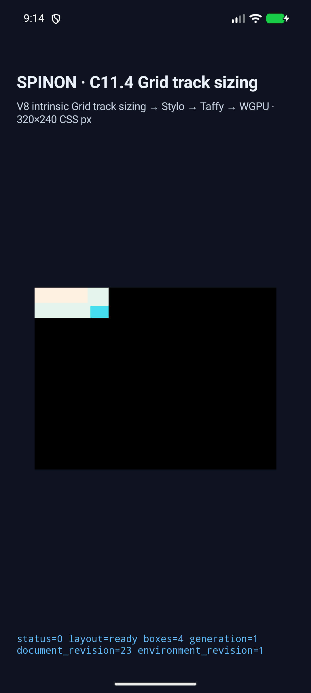
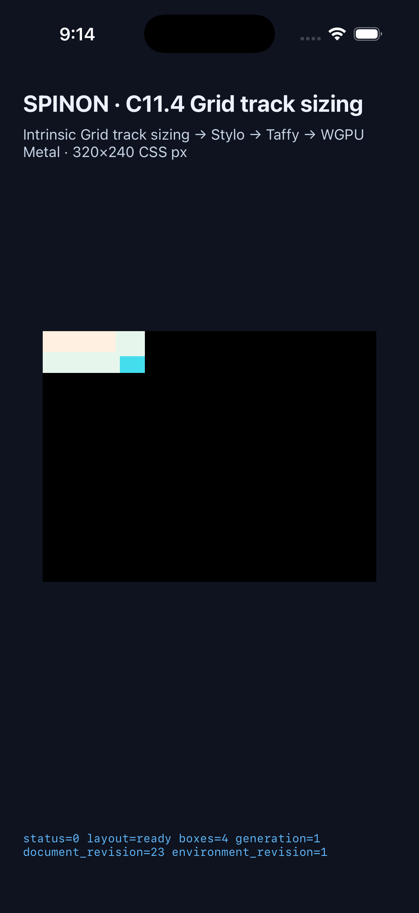

# C11.4 nested Grid 행 축 runtime 실행 근거

## 고정 oracle

[계획 PR #444](https://github.com/ohah/spinon/pull/444)은 merge SHA `1359f37024ad711df4b5253745d6dbf9b96af77f`로 병합됐다. 독립 기대값은 [CSS Grid 2025 CRD 기준 계획](https://github.com/ohah/spinon/blob/main/plan/c11-4-nested-grid-row-contribution.md) 및 [Chrome 156 사전 비교](../c11-4-nested-grid-rows-precomparison-2026-10-21/README.md)에 기록했다. Chrome은 한 build의 비교 관찰자이고 규범 근거는 아니다.

| scene | outer row tracks (CSS px) | root frame | nested frame | text / image frame |
| --- | --- | --- | --- | --- |
| `nested-grid-text-image-row-span-two` | `[18,18]` | `98×40` | `98×40` | text `(0,0) 70×20`; image `(74,24) 24×16` |
| `nested-grid-text-image-row-one-track` | `[40,0]` | `98×44` | `98×40` | text `(0,0) 70×20`; image `(74,24) 24×16` |
| `nested-grid-text-image-row-definite-flex-control` | `[28,28]` | `98×60` | `98×60` | text `(0,0) 70×20`; image `(74,24) 24×16` |

## Android API 37 ARM64 AVD

선택된 AVD `emulator-5558` (`sdk_gphone64_arm64`, API 37, ARM64, Android 17 image)에서 세 scene이 3/3 통과했다. 각 scene은 `layout=ready`, 4 boxes, 정확한 node frames와 Rows track, draw/present 성공을 보고했다. 각 trace는 10 chunks이고 superseded retry는 0이다. 빌드 APK와 설치 APK SHA-256은 `52f86f877eb499665c097ffeba793a9c56612c921c7c878c98e414fa36151f75`로 일치한다.

- <a href="/spinon/internal/evidence/c11-4-nested-grid-rows-runtime-2026-10-21/android-avd-c114-nested-grid-row-contribution-android-avd-20261021T121414290Z-91ea5c67/result.json">전체 결과 JSON</a> · <a href="/spinon/internal/evidence/c11-4-nested-grid-rows-runtime-2026-10-21/android-avd-c114-nested-grid-row-contribution-android-avd-20261021T121414290Z-91ea5c67/simulator.json">시뮬레이터·APK metadata</a>
- <a href="/spinon/internal/evidence/c11-4-nested-grid-rows-runtime-2026-10-21/capture-scene-list.json">182-scene runner allowlist</a> · <a href="/spinon/internal/evidence/c11-4-nested-grid-rows-runtime-2026-10-21/simulator-cross-check.json">6개 platform-scene cross-check</a>
- span-two 화면: `android-row-span-two.png`; one-track: <a href="/spinon/internal/evidence/c11-4-nested-grid-rows-runtime-2026-10-21/android-avd-c114-nested-grid-row-contribution-android-avd-20261021T121414290Z-91ea5c67/nested-grid-text-image-row-one-track.png">PNG</a>; flex control: <a href="/spinon/internal/evidence/c11-4-nested-grid-rows-runtime-2026-10-21/android-avd-c114-nested-grid-row-contribution-android-avd-20261021T121414290Z-91ea5c67/nested-grid-text-image-row-definite-flex-control.png">PNG</a>
- 개별 runtime 및 launch 로그는 해당 run directory에 있다.

## iOS Simulator

iPhone 17 Pro / iOS 26.2 Simulator (`ACA7BF91-E2D5-4CF7-909A-08D1AD95FF3D`)에서 세 scene이 3/3 통과했다. 각 scene은 `layout=ready`, 4 boxes, 정확한 node frames와 Rows track, draw/present 성공을 보고했다. 각 trace는 20 chunks이고 superseded retry는 0이다. 앱 산출물 SHA-256은 `eebfab3e9d6572d71c755a91c74d38adbd6c71f013b8ddcbfe144e6dda998003`이다.

- <a href="/spinon/internal/evidence/c11-4-nested-grid-rows-runtime-2026-10-21/ios-simulator-c114-nested-grid-row-contribution-ios-simulator-20261021T121423466Z-bc4832ab/result.json">전체 결과 JSON</a> · <a href="/spinon/internal/evidence/c11-4-nested-grid-rows-runtime-2026-10-21/ios-simulator-c114-nested-grid-row-contribution-ios-simulator-20261021T121423466Z-bc4832ab/simulator.json">시뮬레이터·앱 metadata</a>
- span-two 화면: `ios-row-span-two.png`; one-track: <a href="/spinon/internal/evidence/c11-4-nested-grid-rows-runtime-2026-10-21/ios-simulator-c114-nested-grid-row-contribution-ios-simulator-20261021T121423466Z-bc4832ab/nested-grid-text-image-row-one-track.png">PNG</a>; flex control: <a href="/spinon/internal/evidence/c11-4-nested-grid-rows-runtime-2026-10-21/ios-simulator-c114-nested-grid-row-contribution-ios-simulator-20261021T121423466Z-bc4832ab/nested-grid-text-image-row-definite-flex-control.png">PNG</a>
- 개별 runtime·launch·screenshot 로그는 해당 run directory에 있다.

## 구현 및 검증

새 opt-in fixture adapter는 세 root scene을 allowlist하고 기존 nested text/image adapter에 row-axis dispatch를 연결한다. auto block-size nested Grid의 행 sizing에는 definite inline-size가 유지되는 bounded intrinsic-row subset만 허용했다. auto-repeat, percentage/flexible tracks 및 지원 밖 track grammar는 indefinite-height path에서 fail-closed한다. 이 제한은 일반 auto-height Grid 지원을 선언하지 않는다.

- <a href="/spinon/internal/evidence/c11-4-nested-grid-rows-runtime-2026-10-21/cargo-fmt.log">Rust 포맷 검사</a> · <a href="/spinon/internal/evidence/c11-4-nested-grid-rows-runtime-2026-10-21/runtime-focused-test.log">runtime test</a> · <a href="/spinon/internal/evidence/c11-4-nested-grid-rows-runtime-2026-10-21/layout-focused-test.log">layout 제한 회귀</a> · <a href="/spinon/internal/evidence/c11-4-nested-grid-rows-runtime-2026-10-21/ffi-focused-test.log">FFI scene allowlist test</a>
- <a href="/spinon/internal/evidence/c11-4-nested-grid-rows-runtime-2026-10-21/fixture-module-boundary-test.log">fixture module boundary 검사</a> · <a href="/spinon/internal/evidence/c11-4-nested-grid-rows-runtime-2026-10-21/capture-runner-node-check.log">capture runner Node 문법 검사</a> · <a href="/spinon/internal/evidence/c11-4-nested-grid-rows-runtime-2026-10-21/workspace-clippy.log">workspace Clippy</a>
- <a href="/spinon/internal/evidence/c11-4-nested-grid-rows-runtime-2026-10-21/default-artifact-build.log">기본 archive build</a>에서는 세 신규 scene ID가 모두 빠졌다. <a href="/spinon/internal/evidence/c11-4-nested-grid-rows-runtime-2026-10-21/fixture-artifact-build.log">fixture opt-in positive control</a>에서는 세 scene ID와 `c14-1-png-basic.png` payload marker가 포함됐다. 두 archive의 SHA-256은 각각 기본 `default-artifact-sha256.txt`, fixture `fixture-artifact-sha256.txt`다.
- Android 및 iOS fixture app build 로그는 <a href="/spinon/internal/evidence/c11-4-nested-grid-rows-runtime-2026-10-21/android-build-pass2.log">Android</a>, <a href="/spinon/internal/evidence/c11-4-nested-grid-rows-runtime-2026-10-21/ios-build-pass2.log">iOS</a>다.
- 전체 문서 RSPress build는 기존 internal evidence의 미포함 `.json`/`.log` artifact 링크로 실패했다. 이 build는 새 evidence README의 artifact 링크도 RSPress page 경로로 해석해 dead-link 목록에 올렸다. <a href="/spinon/internal/evidence/c11-4-nested-grid-rows-runtime-2026-10-21/docs-build-failure-summary.txt">docs build failure summary</a>는 이번 Grid slice 검사가 아니다. 기존 Tailnet 미리보기 절차는 선택 route와 artifact를 별도 포함하고 dead-link inspection을 끈다.

첫 Android 앱 실행은 새 scene ID가 당시 앱 argument allowlist에 없어 `SPINON_C114_GRID_ARGUMENT_ERROR rejected=true`로 종료됐다. Android와 iOS harness의 scene allowlist 및 예상 frame/box count를 수정해 양쪽 앱을 재빌드한 후 위 결과를 얻었다. 실패 기록은 <a href="/spinon/internal/evidence/c11-4-nested-grid-rows-runtime-2026-10-21/android-avd-c114-nested-grid-row-contribution-android-avd-20261021T121208241Z-40e4af8e/runtime-nested-grid-text-image-row-span-two.log">첫 Android 시도 로그</a>에 보존했다.

대표 실행 화면 (원본 크기: Android 1080×2400, iOS 1206×2622):

## 화면과 범위 한계

화면은 앱 surface의 box geometry를 보여준다. 이 검증은 Ahem glyph paint, PNG source texel equality, PixelCopy/Metal 색 표본, CSS border, Android 실기기, Android hardware GPU, iOS compositor 이후 surface, WPT 또는 전체 CSS Grid 적합성의 증거가 아니다. 현재 입력의 nested row contribution, runtime trace, frame 및 draw/present만 확인했다. C11.4 checkbox와 공식 완료 집계 `72/213`은 유지한다.

### 고정 입력 hash

| artifact | SHA-256 |
| --- | --- |
| Chrome 156 observation JSON | `76f9a09507eb1975626f54f244f1809a924ca627d29c130443ec3218ed064144` |
| Chrome 156 precomparison screenshot | `58dc1f947f83db934718292d123e89521da3241f0261ab4c601faf44c7dac0af` |
| Android span-two screenshot | `eb55509d044e8b1e7a71ba772dc0f7cf6206acbc071d88246b3503f6e6366e4d` |
| iOS span-two screenshot | `2ac8b54d6be930c6e01278dfc594a0d5cfafd47168e46198b3d62feba77be726` |
