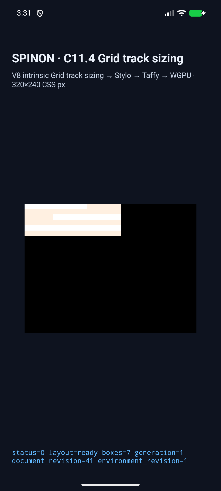
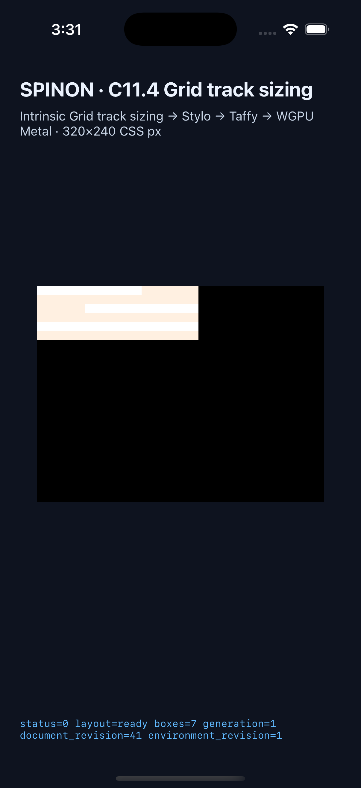

# C11.4 depth-three nested Grid text multi-span Simulator 근거

## 범위와 독립 기대값

이 변경은 `c11-4-grid-track-sizing-fixture-test`에서만 접근 가능한 네 고정 scene이다. root → middle → branch → inner 네 HTML `div` Grid 안에 Ahem direct-leaf text item 두 개 또는 세 개가 놓인다. adapter는 scene ID, namespace/tag, parent·child 순서, text, typography, Grid track·placement·box style subset을 exact allowlist로 검사하고 다른 shape는 fail closed한다. CSS Grid sizing algorithm 자체를 변경하지 않았다.

Chrome 156 Agent Browser 관측과 [CSS Grid 2025 CRD §11.5.1에서 계산한 독립값](../c11-4-nested-grid-multispan-precomparison-2026-10-22/README.md)은 분리해 유지한다. Ahem 10px/10px, edges/gaps 0px인 입력의 독립 inner Columns는 두 span-2 item일 때 `[25,35,35,0]`, span-3 item 추가 시 `[160/3,190/3,190/3,0]`이다. 모든 nested Grid의 폭은 각각 95px와 180px이고 height는 60px다.

| scene | DOM order | inner Columns | 각 Grid frame |
| --- | --- | --- | --- |
| `nested-text-span2-forward` | A → B | `[25,35,35,0]` | `95×60px` |
| `nested-text-span2-reversed` | B → A | `[25,35,35,0]` | `95×60px` |
| `nested-text-span2-before-span3` | A → B → C | `[160/3,190/3,190/3,0]` | `180×60px` |
| `nested-text-span3-before-span2` | C → B → A | `[160/3,190/3,190/3,0]` | `180×60px` |

Rust tests, app harness와 capture verifier는 모든 Grid frame, Columns/Rows final track, direct text intrinsic source/order/font revision, item span contribution, 세 parent contribution을 검사한다. Capture trace는 네 inner Columns contribution의 종류·span·값·순서도 독립 기대와 대조한다.

## Simulator 실행

- Android: API 37 ARM64 Google AVD `emulator-5558` (`qemu=1`, model `sdk_gphone64_arm64`, Android 17). Local APK SHA-256과 설치된 `base.apk` SHA-256은 모두 `8374ca2aff544a1f5ac5b7fc92acefdfe48f85a6790647e4f46b8d962d55912f`로 일치한다.
- iOS: iPhone 17 Pro, iOS 26.2 Simulator, UDID `ACA7BF91-E2D5-4CF7-909A-08D1AD95FF3D`. App SHA-256은 `aa8ad649a2b01b13f9d1379500beb0c4b05bf3d9e2e69b03b0045e5ae418b740`이다.
- capture runner inventory는 기존 198개에 네 scene을 추가한 총 202개를 나열하고 신규 ID 네 개를 포함한다. 전체 목록은 `scene-inventory.log`에 있다.
- 두 앱은 `SPINON_ENABLE_C04_RUNTIME_GPU=1` 및 `SPINON_ENABLE_C04_RUNTIME_GPU_FIXTURE_TEST=1`로 다시 빌드했다. [Android build log](./android-simulator-build.log), [iOS build log](./ios-simulator-build.log).
- 최종 신규 scene run은 [Android AVD](./android-avd-c114-nested-grid-text-multispan-android-avd-20261021T183127758Z-2de15bbf/result.json)와 [iPhone Simulator](./ios-simulator-c114-nested-grid-text-multispan-ios-simulator-20261021T183136986Z-31c4f687/result.json)에 있다. 두 플랫폼 모두 4/4 scene에서 expected frame/track, `drawPresented=true`, `supersededRetries=0`이다. Android box counts는 `6/6/7/7`, trace chunks는 `14/14/16/16`; iOS는 같은 box counts와 `27/27/31/31` trace chunks다.
- 기존 direct-leaf text multi-span 네 scene도 별도 [Android controls](../c11-4-nested-grid-text-multispan-controls-2026-10-22/android-avd-c114-text-multispan-contributions-android-avd-20261021T183018815Z-88607b65/result.json)와 [iOS controls](../c11-4-nested-grid-text-multispan-controls-2026-10-22/ios-simulator-c114-text-multispan-contributions-ios-simulator-20261021T183028424Z-4c2cc2df/result.json)에서 각 4/4 통과했다. 두 순서는 `[25,35,35,0]`, span-3을 포함한 두 scene은 `[53.333335876464844,63.333335876464844,63.333335876464844,0]`을 관찰했다.

Representative screen captures:

PR [#464](https://github.com/ohah/spinon/pull/464)의 본문에서 Agent Browser 0.31.1로 두 raw image를 열어 각각 `complete=true`, Android 1080×2400, iOS 1206×2622 intrinsic size를 확인했다. 확인 결과는 [pr-image-agent-browser-verification.json](./pr-image-agent-browser-verification.json)에 있다. 확인 후 browser 세션과 그 세션이 시작한 Chrome/Agent Browser process를 종료했다.

## 집중 검사와 fixture 분리

- Runtime feature tests: 신규 정상/잘못된 입력 2개, nested Grid depth/replaced/row 회귀 7개, mixed text/image span control 1개 통과. 로그는 `runtime-multispan-focused.log`, `runtime-nested-grid-controls.log`, `runtime-mixed-span-control.log`다.
- FFI feature tests: 신규 fixed-scene allowlist와 기존 direct-leaf text multi-span allowlist 각 1개 통과. `ffi-multispan-focused.log`, `ffi-direct-text-control.log`.
- `cargo fmt --all -- --check`, workspace all-target Clippy `-D warnings`, runtime 및 FFI fixture-feature all-target Clippy, fixture module boundary Node tests 6/6, capture script `node --check`, `git diff --check` 통과. Logs: `format-check.log`, `workspace-clippy.log`, `fixture-runtime-clippy.log`, `fixture-ffi-clippy.log`, `fixture-module-boundary.log`, `capture-js-check.log`, `diff-check.log`.
- Android Gradle build와 iOS Simulator build 성공. iOS linker는 vendored V8 archive의 duplicate debug-map timestamp 경고를 출력했지만 Xcode build는 성공했다.
- 기본 제품 FFI archive에는 신규 scene ID가 없고 fixture-test positive control에는 네 ID와 고정 payload가 있음을 별도 build/hash/strings 검사로 확인했다. [세부 artifact 경계](./artifact-boundary.md).

Simulator metadata의 `sourceRevision.trackedDiffSha256`는 당시 tracked diff만 포함한다. 신규 Rust source 파일은 untracked 상태라 해당 요약 hash에서 빠져 있어 [source-files-sha256.txt](./source-files-sha256.txt)에 Simulator app/capture 경로의 SHA-256을 따로 기록했다. pure unit-test 파일은 app binary에 컴파일되지 않으며 현재 분리된 파일은 [test-source-files-sha256.txt](./test-source-files-sha256.txt)에 따로 기록했다. 최종 screenshot, result와 simulator metadata는 [SHA256SUMS.txt](./SHA256SUMS.txt)에 있다.

## 한계

이 결과는 고정 fixture 입력과 두 simulator의 layout/runtime trace·draw/present 확인이다. Android 실기기, hardware GPU, glyph pixel equality, iOS compositor 이후 화면, WPT, 일반 cascade에서 arbitrary nested Grid/text, 일반 CSS Grid 전체 또는 C11.4 완료를 의미하지 않는다. 공식 C11.4 checkbox는 미완료로 두고 완료 수 `72/213`을 유지한다.

구현/runtime 실패 관점 20개는 [implementation-review-20.md](./implementation-review-20.md), 최종 PR diff review 30개는 [pr-diff-review-30.md](./pr-diff-review-30.md)에 기록한다.
