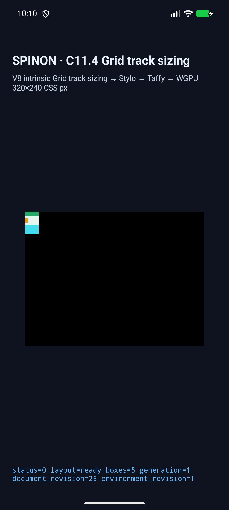
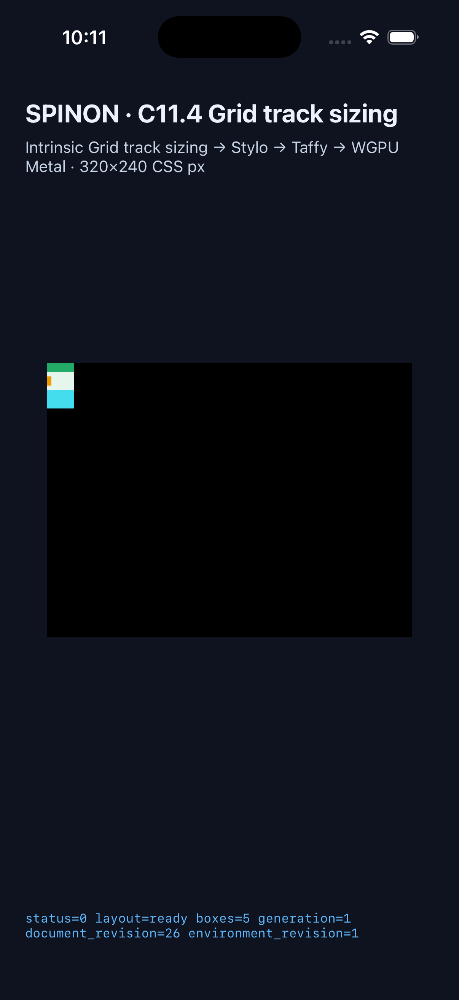
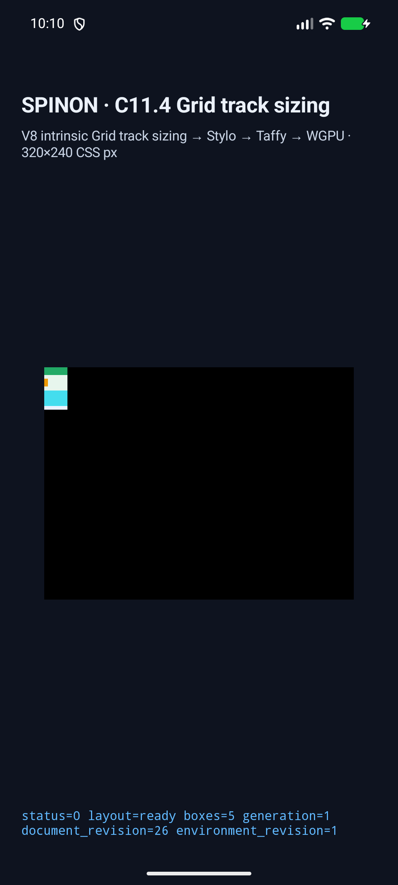
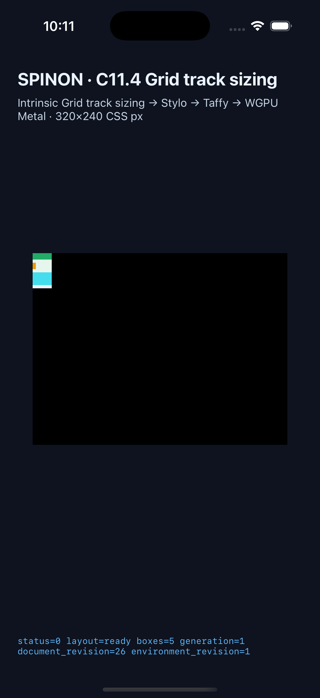

# C11.4 nested Grid positive implicit row runtime 근거

## 범위와 판정 기준

이 evidence는 기존 C11.4 opt-in `c11-4-grid-track-sizing-fixture-test` 경로에서 nested Grid의 positive implicit rows 두 개가 outer Grid의 block-axis intrinsic contribution으로 전달되는 고정 입력 두 개를 기록한다. CSS admission이나 일반 nested Grid 지원을 추가하지 않는다.

규범 기대값은 [CSS Grid Layout Module Level 1, 2025 CRD](https://www.w3.org/TR/2025/CRD-css-grid-1-20250326/) §§7.5–7.6, 11.3–11.5.1에서 독립 계산했다. nested Grid는 explicit row 하나 뒤에 `grid-row:3/4` item을 배치한다. `grid-auto-rows:min-content max-content` list가 positive implicit rows에 순환 적용되어 inner track 크기는 `[8,8,16]px`이고 두 4px row gap을 포함한 nested Grid contribution은 40px이다. Chrome 156 관측은 이 계산과 분리해 [사전 비교 README](../c11-4-nested-implicit-row-precomparison-2026-10-21/README.md)에 기록했다.

| scene | nested outer placement | outer Rows | root / nested height | inner Rows |
| --- | --- | --- | --- | --- |
| `nested-grid-implicit-row-span-two` | `1 / 3` | `[18,18]px` | `40 / 40px` | `[8,8,16]px` |
| `nested-grid-implicit-row-one-row` | `1 / 2` | `[40,0]px` | `44 / 40px` | `[8,8,16]px` |

모든 frame·track 값은 CSS px이며 허용 오차는 0px이다. `[40,0]`의 두 번째 outer track은 0px이지만 4px gutter slot은 별도로 trace에 포함된다.

## 구현과 실행 결과

Runtime fixture adapter는 scene ID 두 개, HTML namespace와 `div`/`img` topology, node owner·child order, computed Grid/placement/box style subset, allowlisted PNG URL과 `24×16px` natural size를 검사한다. PNG는 intrinsic-size 입력이다. 각 layout input은 intrinsic revision 1을 사용한다. Direct-layout/runtime trace는 inner·outer Grid의 Columns/Rows pass와 gap gutter, outer `MinContent` contribution item·span·40px 값을 확인한다.

Android API 37 ARM64 QEMU AVD `sdk_gphone64_arm64` (`emulator-5558`)와 iPhone 17 Pro / iOS 26.2 Simulator에서 최신 source APK/app으로 각각 두 scene을 실행했다. 각 플랫폼 2/2 scene에서 다섯 node frame과 outer Rows가 기대값과 정확히 일치하고 inner/outer track trace가 모두 완전했다. Android trace는 scene당 8 chunks, iOS는 16 chunks다. 두 플랫폼 모두 `layout=ready boxes=5`, draw/present 성공, superseded retry 0건이다.

| 실행 | 기기 | 결과 | 원본 |
| --- | --- | --- | --- |
| Android AVD | API 37, `arm64-v8a`, QEMU 1, `sdk_gphone64_arm64` | 2/2 scene 통과; 설치 APK와 로컬 APK SHA-256 일치 | [result](./android-avd-c114-nested-implicit-rows-android-avd-20261021T131027256Z-da4d5365/result.json) · [simulator](./android-avd-c114-nested-implicit-rows-android-avd-20261021T131027256Z-da4d5365/simulator.json) · [설치 APK hash](./android-avd-c114-nested-implicit-rows-android-avd-20261021T131027256Z-da4d5365/installed-apk-verification.json) |
| iOS Simulator | iPhone 17 Pro, iOS 26.2 | 2/2 scene 통과 | [result](./ios-simulator-c114-nested-implicit-rows-ios-simulator-20261021T131119319Z-a589fa3c/result.json) · [simulator](./ios-simulator-c114-nested-implicit-rows-ios-simulator-20261021T131119319Z-a589fa3c/simulator.json) |

Android AVD 캡처 SHA-256: span-two `c3d4cff65fc19b5db0f490f806192bf7f85282ccf610abc9ee74cbc0aee38ee5`, one-row `a1949505ac819a7cd0a5e5da95215ec3396ee919983b3751ce6aa8e5bfc6a6c2`. iOS Simulator 캡처 SHA-256: span-two `d4b8fd68dff595187d1f0cb819d4741ba83ca7cfedaea859eb79cca78cf9abf8`, one-row `70510bd8e7d4c23377ebf6727992712bd485d77e6db92b246cdb1bee90ad3aae`.

| scene | Android AVD | iOS Simulator |
| --- | --- | --- |
| span-two |  |  |
| one-row |  |  |

화면은 app fixture에서 그린 CSS box/background와 layout 상태를 보여주는 실행 캡처다. PixelCopy/Metal 표면 readback은 이 작업에서 하지 않았다. iOS draw/present 성공도 compositor 뒤의 픽셀 확인이 아니다.

## 검사 기록

- `cargo test --locked -p spinon-layout --lib nested_positive_implicit_rows_contribute_through_the_outer_grid -- --nocapture`: 1 passed.
- `cargo test --locked -p spinon-runtime --features c11-4-grid-track-sizing-fixture-test nested_grid_positive_implicit_rows_contribute_to_outer_rows_at_runtime -- --nocapture`: 1 passed.
- `cargo test --locked -p spinon-ffi --features c04-runtime-gpu-fixture-test emits_only_two_fixed_nested_positive_implicit_row_scenes -- --nocapture`: 1 passed.
- `cargo clippy --locked --workspace --all-targets -- -D warnings`: 통과.
- `mise exec -- bun test tools/css-reference/fixture-module-boundary.test.mjs`: 6 passed. `node --check tools/css-reference/capture-c11-4-auto-repeat-neighbors-simulator.mjs`와 `--list-scenes`도 통과했고 list는 184 scenes를 반환했다.
- Android fixture build `SPINON_ENABLE_C04_RUNTIME_GPU=1 SPINON_ENABLE_C04_RUNTIME_GPU_FIXTURE_TEST=1 mise exec -- bun run build:android`: 성공. iOS fixture build의 `mise exec -- bun run build:ios-sim`: 성공.
- 기본 `cargo build --locked -p spinon-ffi --lib` archive SHA-256 `3340b3834ebf7069252bf48aca65001ea24738f354cd596ac7522c8553002b41`: 두 신규 scene ID와 C14 PNG payload가 없다. Opt-in `--features c04-runtime-gpu-fixture-test` archive SHA-256 `b1f6d84c875d64cf38e1af60124d7229382f0d872c7fb0e80cecb38731d1716e`: 두 scene ID와 payload가 포함된다. 이는 static archive fixture boundary이며 최종 release/app binary 크기 검증이 아니다.
- `cargo fmt --all -- --check`를 통과했다. 소스·문서 diff whitespace 검사는 통과한다. 원본으로 보존한 device/build logs에는 tool output의 trailing whitespace와 마지막 빈 줄이 있어 전체 staged diff에서 `git diff --check`가 이를 보고한다. 로그를 정규화해 원본 출력을 바꾸지는 않았다. 전체 workspace test suite는 실행하지 않았다.

원본 로그와 JSON은 이 디렉터리에 보존한다: focused layout/runtime/FFI logs, workspace Clippy, fixture module boundary, default/fixture builds, Android/iOS builds, simulator result/logs/screenshots, archive boundary JSON.

## Capture 반복에서 발견해 수정한 점

1. 첫 AVD capture는 app을 새 fixture scene ID로 다시 빌드하기 전에 시작해 기존 설치 앱에서 scene allowlist 오류가 났다. fixture APK를 재빌드·설치하고 설치/local SHA-256 일치를 확인한 뒤 재실행했다.
2. 첫 rebuilt capture의 앱 검증기는 track trace에 저장되는 4px gap gutter slot을 row track 배열과 함께 기대하지 않았다. Android와 iOS 검증기에 outer/inner row gutter 상태를 추가하고 다시 빌드해 통과시켰다.
3. 다음 runner는 자연 크기 intrinsic만 필요한 이미지에 실제 image draw count 1을 요구했다. 이 입력은 PNG texel을 paint하는 fixture가 아니므로 해당 오판정 조건을 제거했다. 마지막 AVD/iOS 결과에서 draw/present만 확인하며 PNG 이미지 픽셀 표시를 주장하지 않는다.

실패한 capture logs도 삭제하지 않고 동일 evidence directory에 보관했다. 위 세 시도는 최종 2/2 결과에 포함하지 않는다.

## 범위와 한계

- 두 allowlisted scene의 고정 topology·style·track profile만 다룬다. 임의 HTML/CSS, 일반 nested Grid, subgrid, nested Grid depth, 다른 `grid-auto-rows` grammar, 자동 배치와 negative implicit rows를 추가하지 않는다.
- PNG는 natural-size intrinsic input이다. 화면 캡처의 청록색은 CSS background이며 PNG texel paint는 검사하지 않았다.
- border 밖 overflow, border stroke, PixelCopy/Metal surface sample, physical Android, Android hardware GPU, iOS compositor 이후 화면, WPT와 cross-browser 적합성은 검증하지 않았다.
- `spec/STATUS.md`의 C11.4 parent checkbox 및 공식 완료 수 `72/213`은 유지한다. 이 slice만으로 C11.4나 C11을 완료로 표시하지 않는다.

## 파일

- [계획](../../../../plan/c11-4-nested-implicit-row-contribution.md)
- [사전 비교·규범 기대값·Chrome observation](../c11-4-nested-implicit-row-precomparison-2026-10-21/README.md)
- [Capture source revision, APK/app, source and screenshot hashes](./source-revision.json)
- [계획 검토 20개](../../../../plan/c11-4-nested-implicit-rows-plan-review-20.md)
- [구현/runtime 실패 관점 검토 20개](./implementation-review-20.md)
