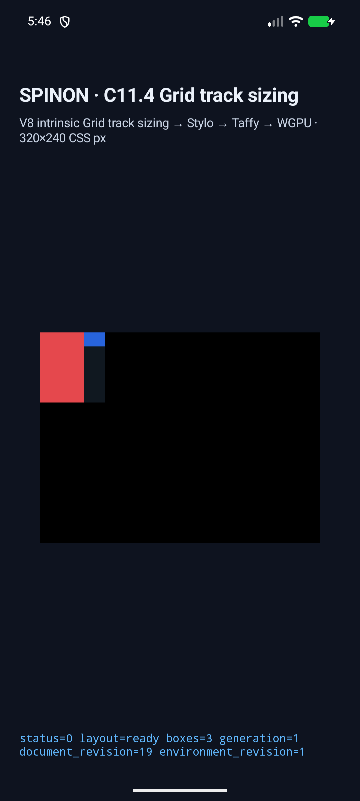
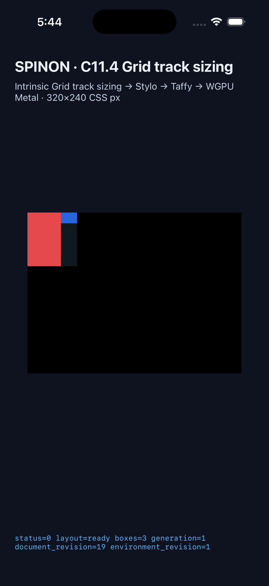

# C11.4 orthogonal text/image row intrinsic runtime

2026-10-25, 고정된 orthogonal text와 natural image Grid scene 4개를 opt-in Runtime fixture와 Android/iOS 앱 경로에서 확인했다. 최종 style-only guard가 포함된 같은 staged source로 기존 #611/#620 scene 8개까지 합쳐 두 플랫폼에서 각각 12/12를 재검증했다. 이 결과는 C11.4 전체, public CSS 지원 또는 제품 적합성 완료를 뜻하지 않는다.

두 플랫폼 실행은 당시 staged source/index tree `45bb3313f5c126fd724eb54e877f86746107a715`를 사용했다. 최종 적대 검토 후 `crates/spinon-layout/src/intrinsic_measurement.rs`와 `crates/spinon-text-layout/src/engine/intrinsic.rs`의 Rustdoc 설명만 좁혔다. 실행 코드, fixture, 입력과 expected output은 변경하지 않았다. 캡처 manifest와 APK/app hash는 각 simulator 실행 시점의 source와 binary를 특정한다. 설명 수정 뒤 `cargo fmt --all -- --check`도 통과했다.

## 고정 입력과 기대 geometry

Parent Grid는 `horizontal-tb`, `74px` wide, `50px 24px` columns, `min-content` 또는 `max-content` row다. Text는 direct `vertical-rl` Ahem `XX XXXXX`; image는 natural `24×16px` PNG다. Text min/max inline contribution은 각각 `50px`/`80px`이므로 row/root/text 높이는 각각 `50px`/`80px`이다. DOM source order는 forward/reversed로 바꿔도 명시적 placement와 geometry가 같아야 한다.

| Scene | Root | Columns / rows | Text | Image |
| --- | --- | --- | --- | --- |
| `direct-orthogonal-row-min-content-forward` | `74×50` | `[50,24]` / `[50]` | `(0,0) 50×50` | `(50,0) 24×16` |
| `direct-orthogonal-row-min-content-reversed` | `74×50` | `[50,24]` / `[50]` | `(0,0) 50×50` | `(50,0) 24×16` |
| `direct-orthogonal-row-max-content-forward` | `74×80` | `[50,24]` / `[80]` | `(0,0) 50×80` | `(50,0) 24×16` |
| `direct-orthogonal-row-max-content-reversed` | `74×80` | `[50,24]` / `[80]` | `(0,0) 50×80` | `(50,0) 24×16` |

## Android API 37 AVD

`spinon_api37_1_compat16k`, ARM64, qemu=1, 16 KB pages, `emulator-5570`에서 검증 당시 staged source로 직교 4개와 기존 #611/#620 회귀 8개를 모두 재실행했다. 네 orthogonal 장면과 전체 12개 scene이 native matcher, frames, tracks, contributions, trace와 draw 검사를 통과했다. 최종 local/installed APK SHA-256은 `cf978a383a3abceeaa99fe37d2f5c202f859193f20a352d4eea67dd0626371af`로 같고 source snapshot SHA-256은 `2cae262c3b1cc8bfcb420b84313f53540909c711d834f001d69058dde249ce11`이다. AVD 종료도 확인했으며 실기기는 조회하지 않았다.

12 scene별 최종 PNG·trace·실행 로그·설치 및 종료 확인은 [Android 최종 회귀 근거](./regression-previous-row-scenes/android-avd/final-post-style-only-guard/README.md)에 있다. 이전 실행의 source/APK 차이는 [source comparison](./regression-previous-row-scenes/README.md)에 보존했다. 초기 실행의 원본 log와 preflight 기록은 [초기 Android 결과](./android-avd/README.md)에 남아 있다.

## iOS Simulator

iPhone 17 Pro / iOS 26.2 전용 Simulator에서 기존 8개 회귀 scene과 직교 4개 scene을 같은 staged source로 모두 재실행해 12/12 native matcher를 통과했다. 최종 앱 SHA-256은 `ceadb3552b5bb50fcc9a75e813e58c9927f988ed4a10a20315d3c284f3563b93`, 807개 source/config 파일 manifest SHA-256은 `954ef11bb9478de7391a0cc06ec63ccd6455ff43f4792627e5a680c7da94435f`다. 기존 및 중간 실행의 source/build 차이는 [source comparison evidence](./regression-previous-row-scenes/README.md)에 보존했다. 전용 Simulator만 종료하고 기존 Booted Simulator 둘은 유지했다.

최종 12개 scene의 run ID, source manifest, app hash, trace, logs 및 PNG는 [iOS 최종 회귀 근거](./regression-previous-row-scenes/ios-simulator/final-post-style-only-guard/README.md)에 있다. 첫 orthogonal 실행의 기록은 [초기 iOS 결과](./ios-simulator/README.md)에 남아 있다.

## Rust 검증

- `cargo test --locked -p spinon-runtime --features c11-4-grid-track-sizing-fixture-test`: 최종 재실행 227 passed, 3 ignored, 0 failed; 추가 integration 대상 3/3과 16/16. [최종 로그](./runtime-feature-tests-final.log).
- Style→Layout feature suite: 261 passed, 0 failed. It includes a regression that rejects vertical writing-mode values when the style-only layout entry has no text projection profile. [Final log](./style-to-layout-tests-final.log).
- Other focused results: layout 1/1, Stylo cascade 10/10, FFI 3/3.
- `cargo fmt --all -- --check` 통과. 작성한 source/doc에는 whitespace 진단이 없다. 전체 staged `git diff --cached --check`의 175개 진단은 원본 capture 파일 34개(build/emulator/runtime/test log, simulator JSON EOF 공백)에만 있으며 원본 증거를 보존했다.
- `mise exec -- node --test tools/css-reference/fixture-module-boundary.test.mjs`: 12/12 통과.
- Feature-enabled 관련 crates Clippy와 default `cargo clippy --locked --workspace --all-targets -- -D warnings`가 통과했다. [feature log](./feature-clippy-final.log) · [workspace log](./workspace-clippy-final.log).
- Default FFI static archive는 scene marker 0/4·fixture ABI symbol 0/2이고, fixture-test positive control은 4/4·2/2다. [Archive logs, scans, hashes](./artifact-boundary/README.md).
- 20개 정적 구현 실패 관점은 [검토 기록](./implementation-review-20.md), PR 변경 독립 실패 30개는 [PR diff 검토](./pr-delta-review-30.md)에 기록했다.

## 범위와 한계

- `align-items:normal`은 Grid adapter에서 `normal`로 보존한다. 이 고정 scene에서는 orthogonal text가 stretch되고 replaced image는 natural size를 유지한다.
- 화면은 layout geometry를 보여준다. iOS/Android draw telemetry의 `runtime_image_count`, `runtime_text_count`, `glyph_batch_draw_count`는 0이므로 실제 image 또는 text glyph pixel painting을 증명하지 않는다.
- Android AVD는 software rendering 경로다. 실기기, Android hardware GPU, iOS compositor 이후 surface와 public HTML/CSS admission은 미검증이다.
- 4 KB Android preflight, oversized run ID 인자 거부, 최종 flexible-track assertion 전 실행은 acceptance 결과에서 제외하고 별도 파일로 보존했다.
- C11.4 parent checkbox와 공식 완료 집계 `72/213`은 그대로 미완료다.
