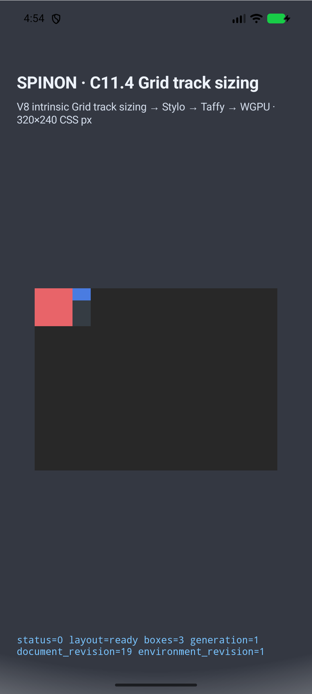
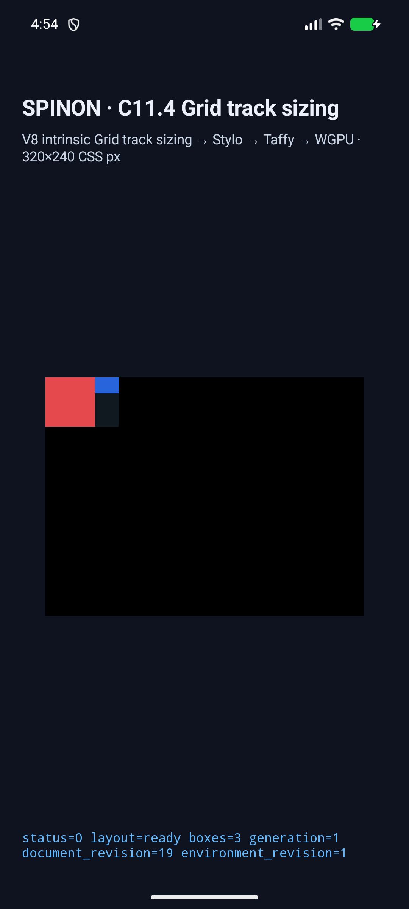
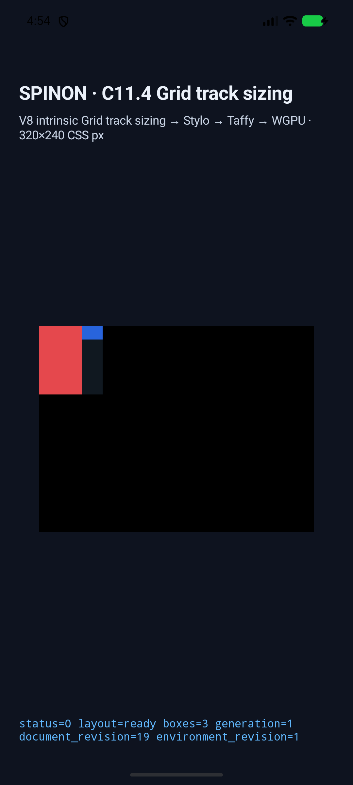
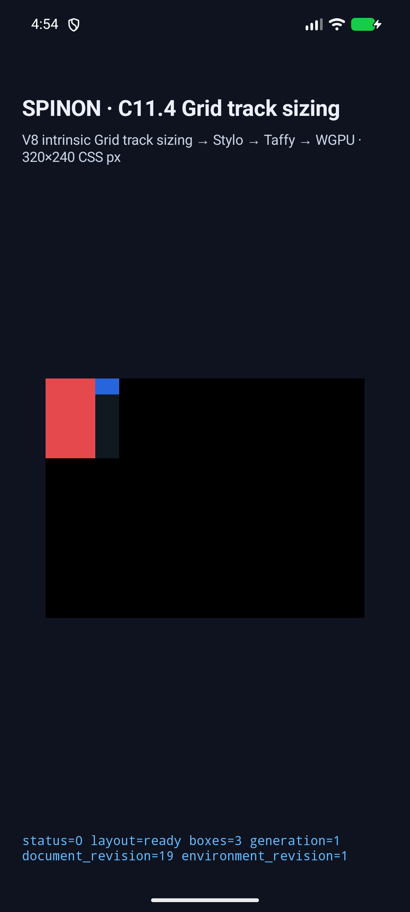

# C11.4 orthogonal text and image row intrinsic scenes — Android AVD

이 문서는 최종 lint 수정 전 Android 실행의 원본 기록이며 여기에 적힌 APK SHA-256 `7778fa0e...f61db61`은 최신 실행 해시가 아니다. 최종 Clippy source orthogonal 4-scene 결과는 [final-source evidence](../regression-previous-row-scenes/android-avd/final-clippy-source/)를, 기존 8-scene 회귀와 source/APK 버전 비교는 [source comparison](../regression-previous-row-scenes/README.md)을 기준으로 한다.

## Acceptance device

- AVD: `spinon_api37_1_compat16k` on `emulator-5570`; API 37, ABI `arm64-v8a`, qemu=1, page size 16384 bytes.
- Model/device: `sdk_gphone16k_arm64` / `emu64a16k`; fingerprint `google/sdk_gphone16k_arm64/emu64a16k:17/CP31.260623.012/16064790:userdebug/dev-keys`.
- Display: Physical size: 1080x2400, Physical density: 420.
- Installed APK SHA-256: `7778fa0e2b8c91c5bfbb89ced21e3dcc4ab3651586748a2cf9c7ca188f61db61` (matches local APK).
- All ADB commands used the explicit serial `emulator-5570`; no physical device was queried.
- Every orthogonal row contribution must have `span=1` and `crossesFlexibleTrack=false`.

The earlier `spinon_api37_0_applied_txn` run was only a 4 KB-page preflight and is excluded. Its logs and metadata are retained as `preflight-4k-*`; no scene result from it is counted.
The oversized run-ID argument rejection and the successful run before adding the flexible-track matcher check are retained as preflight evidence and excluded from final acceptance. Final results use the short IDs listed below after the matcher update.

## Results

| Scene | Run ID | Root | Text | Image | Row track | Contribution records | Matcher | Draw |
| --- | --- | --- | --- | --- | ---: | ---: | --- | --- |
| `direct-orthogonal-row-min-content-forward` | `c114-orth-min-f` | `74×50` | node 2 `50×50` | node 4 `24×16` | 50.0 | 4 | PASS | PASS |
| `direct-orthogonal-row-min-content-reversed` | `c114-orth-min-r` | `74×50` | node 3 `50×50` | node 2 `24×16` | 50.0 | 4 | PASS | PASS |
| `direct-orthogonal-row-max-content-forward` | `c114-orth-max-f` | `74×80` | node 2 `50×80` | node 4 `24×16` | 80.0 | 6 | PASS | PASS |
| `direct-orthogonal-row-max-content-reversed` | `c114-orth-max-r` | `74×80` | node 3 `50×80` | node 2 `24×16` | 80.0 | 6 | PASS | PASS |

## Screenshots

### `direct-orthogonal-row-min-content-forward`

### `direct-orthogonal-row-min-content-reversed`

### `direct-orthogonal-row-max-content-forward`

### `direct-orthogonal-row-max-content-reversed`

## Build diagnostics

- Opt-in Android build completed; local/installed APK SHA-256: `7778fa0e2b8c91c5bfbb89ced21e3dcc4ab3651586748a2cf9c7ca188f61db61`.
- Android build warning/error entries: 1; this is the AGP SDK 37.2 compatibility recommendation.
- Java compile success: `True`; compile warning/error entries: 1 (AGP compatibility recommendation only).
- Targeted `git diff --check` passed; no compiler errors or C11.4 dead_code warning remain.

## Artifacts

- `avd-metadata.json`: AVD, APK/build hashes, adapter hash, compiler diagnostics, shutdown proof, and scene outcomes.
- `android-results.json`: machine-readable final scene results.
- `android-java-compile.log`: successful Android Java compile output.
- `android-runtime-<scene>-matcher-final.log`: C11.4 summary, frames, trace chunks, and draw evidence.
- `android-trace-<scene>.json`: reassembled trace, including repeated contributions and flexible-track flags.
- `android-<scene>.png`: final 16 KB AVD screenshot.
- `emulator-shutdown.log`: shutdown output; the exact 5570 serial/process was gone afterward.
- `negative-preflight-oversized-run-id-*`, `pre-crosses-flexible-check-*`, and `preflight-4k-*`: retained but excluded earlier attempts.
