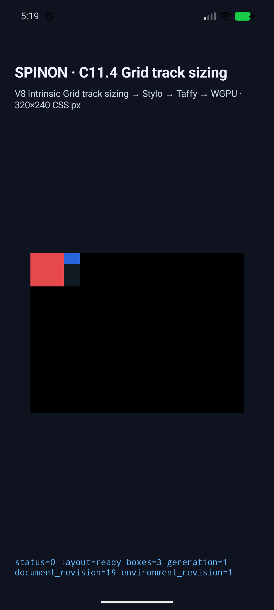
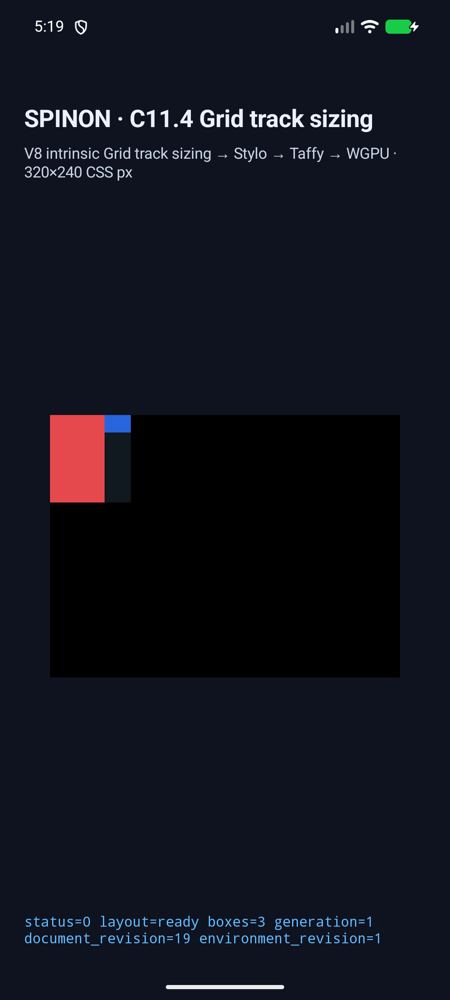

# C11.4 orthogonal row scenes — final Android source

2026-10-25, Android API 37 ARM64 / 16 KB page AVD `spinon_api37_1_compat16k`에서 최종 Clippy source로 고정된 orthogonal 4개 scene을 다시 실행했다. 기존 8개 regression은 이전 source build 결과이며 [source comparison](../../README.md)에 별도로 기록했다.

## Build provenance

- Source snapshot SHA-256: `d61efa1d843c87ff06928e65f03a941ce5726c77d755556661405b5a0e0e2ed7`
- Tracked diff SHA-256: `0a0e1791121cbad942828ea6cc7b86bdc6c0edfb6c9c87441b66ed543d47c203`
- Local and installed APK SHA-256: `7c4077ab4e50c3b3511adbd72423cc4a06df902f111cf801301bd4e24ba27767`
- Build command: `mise exec -- env SPINON_ENABLE_C04_RUNTIME_GPU_FIXTURE_TEST=1 bun run build:android`
- AVD: API 37, `arm64-v8a`, qemu=1, 16384-byte pages; only serial `emulator-5570` was queried.
- `android-build.log` and `android-install.log` record build/install. The APK installed on the AVD matches the local file hash.

## Results

| Scene | Root | Text | Image | Columns / rows | Matcher / draw |
| --- | --- | --- | --- | --- | --- |
| `direct-orthogonal-row-min-content-forward` | `74×50` | `50×50` | `24×16` | `[50,24]` / `[50]` | PASS / PASS |
| `direct-orthogonal-row-min-content-reversed` | `74×50` | `50×50` | `24×16` | `[50,24]` / `[50]` | PASS / PASS |
| `direct-orthogonal-row-max-content-forward` | `74×80` | `50×80` | `24×16` | `[50,24]` / `[80]` | PASS / PASS |
| `direct-orthogonal-row-max-content-reversed` | `74×80` | `50×80` | `24×16` | `[50,24]` / `[80]` | PASS / PASS |

Each runtime log verifies the three expected frames, row/column tracks, trace, and draw status. Every selected row contribution used span `1` and `crossesFlexibleTrack=false`.

| Scene | Screenshot | Runtime log | Trace |
| --- | --- | --- | --- |
| min forward |  | [log](android-runtime-direct-orthogonal-row-min-content-forward.log) | [trace](android-trace-direct-orthogonal-row-min-content-forward.json) |
| min reversed |  | [log](android-runtime-direct-orthogonal-row-min-content-reversed.log) | [trace](android-trace-direct-orthogonal-row-min-content-reversed.json) |
| max forward |  | [log](android-runtime-direct-orthogonal-row-max-content-forward.log) | [trace](android-trace-direct-orthogonal-row-max-content-forward.json) |
| max reversed |  | [log](android-runtime-direct-orthogonal-row-max-content-reversed.log) | [trace](android-trace-direct-orthogonal-row-max-content-reversed.json) |

After capture, `emulator-5570` was shut down and its serial/process absence verified in [shutdown log](emulator-shutdown.log). The screenshots establish layout geometry and surface submission; draw telemetry reports no image or glyph draws, so they do not establish painted pixels. The AVD uses software rendering; physical hardware and Android GPU rendering were not tested.
