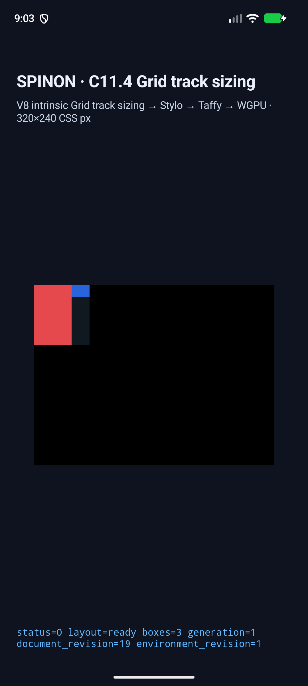
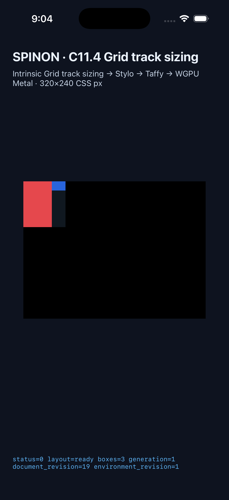

# C11.4 orthogonal text intrinsic generalization: 실행 근거

이 기록은 [계획](https://github.com/ohah/spinon/blob/work/c11-4-orthogonal-text-intrinsic-generalization-20261025/plan/c11-4-orthogonal-text-intrinsic-generalization.md)의 고정된 범위만 다룬다. `vertical-rl` Grid item의 Ahem text intrinsic inline contribution을 `min-content`/`max-content` row sizing에 전달하는 opt-in runtime fixture다. C11.4 전체 지원이나 공식 완료 판정은 아니다.

## 실행 결과

Android API 37 ARM64 AVD에서 22/22, iPhone 17 Pro iOS 26.2 Simulator에서 22/22 장면이 native matcher와 draw/present 검사를 통과했다. 각 플랫폼 행렬은 신규 target 10개와 기존 orthogonal text/image 회귀 12개로 구성된다. target은 `ABC`, `A BC`, `AB CDE F`, collapsed whitespace, spaces-only 입력의 min/max track sizing이다.

Matcher는 기대 intrinsic pair, 선택된 text contribution, Grid row track, root/item frame 및 완전한 trace chunk를 비교한다. 캡처 harness는 UTC timestamp가 든 고유 run ID를 사용한다. frame summary와 세 개의 Grid node-frame 기록은 해당 run summary와 같은 앱 process ID에 묶고, draw/present도 같은 process, document revision, render-tree revision, 기대 root frame을 요구한다. PNG는 이 scene-bound draw 확인 뒤 1초를 기다리고, 400ms 간격으로 찍은 연속 두 프레임의 hash가 같을 때 저장한다. 현재 renderer에는 text glyph draw가 없으므로 이 검증은 글리프 모양이나 화면 픽셀 동등성을 증명하지 않는다. 저장한 PNG는 시뮬레이터 화면 기록이며 픽셀 oracle이 아니다.

| 플랫폼 | 실행 환경 | scene | 앱 산출물 SHA-256 |
| --- | --- | ---: | --- |
| Android | API 37, ARM64, 16 KiB page AVD `emulator-5560` | 22/22 | APK `a56d26808e2befb156c081257fd43909b938a1dd3816d71c6b3396ffe14ddd55` |
| iOS Simulator | iPhone 17 Pro, iOS 26.2, `9DCCE836-7659-4914-B6C1-13F54BFFA9DB` | 22/22 | executable `42b78b0ef3c39d59da0e500441449ad1994bf1c935b86f8e61948d51019d1631` |

상세한 장면별 입력·기대값·matcher 결과·scene-bound draw 증거·log 및 screenshot hash는 [matrix-metadata.json](https://github.com/ohah/spinon/blob/work/c11-4-orthogonal-text-intrinsic-generalization-20261025/spec/internal/evidence/c11-4-orthogonal-text-generalization-runtime-2026-10-25/matrix-metadata.json)에 있다. PR에는 원본 byte를 그대로 복원할 수 있는 `.log.gz`와 PNG를 `android/`, `ios-simulator/` 아래에 포함한다. 대표 화면:

| Android API 37 AVD | iPhone 17 Pro Simulator |
| --- | --- |
|  |  |

시뮬레이터 캡처 harness는 [capture-simulator-matrix.py](https://github.com/ohah/spinon/blob/work/c11-4-orthogonal-text-intrinsic-generalization-20261025/spec/internal/evidence/c11-4-orthogonal-text-generalization-runtime-2026-10-25/capture-simulator-matrix.py)다. 저장된 APK/executable을 설치해 다시 실행하려면 기기 식별자를 환경 변수로 지정하고 다음을 실행한다.

```sh
SPINON_ANDROID_EMULATOR_SERIAL=emulator-5560 \
SPINON_IOS_SIMULATOR_UDID=9DCCE836-7659-4914-B6C1-13F54BFFA9DB \
python3 spec/internal/evidence/c11-4-orthogonal-text-generalization-runtime-2026-10-25/capture-simulator-matrix.py
```

저장된 결과를 다시 묶어 검증하려면 `python3 spec/internal/evidence/c11-4-orthogonal-text-generalization-runtime-2026-10-25/capture-simulator-matrix.py --verify-existing`을 실행한다. 현재 구현 source snapshot, 두 앱 hash, 고유 run ID, 로그의 frame/draw 귀속, 보존 PNG hash를 검사하고 장면별 metadata를 갱신한다.

## 구현·빌드·회귀 검증

- `spinon-text-layout` 전체 단위 검사: 44 passed.
- Style projection, layout, runtime 및 FFI의 C11.4 focused 회귀가 통과했다. 여기에는 동일한 numeric font revision이더라도 다른 opaque registry token은 거부하는 negative control이 포함된다.
- `cargo fmt --all -- --check`, `git diff --check`, workspace `cargo clippy --locked --workspace --all-targets -- -D warnings`, FFI fixture-test feature의 all-target Clippy가 통과했다.
- `mise exec -- node --test tools/css-reference/fixture-module-boundary.test.mjs`: 12/12 passed.
- Android fixture app은 `SPINON_ENABLE_C04_RUNTIME_GPU=1 SPINON_ENABLE_C04_RUNTIME_GPU_FIXTURE_TEST=1 mise exec -- bun run build:android`로 빌드했다.
- iOS Simulator fixture app은 같은 feature 환경에서 `mise exec -- bun run build:ios-sim`으로 빌드했다. Xcode 결과는 `BUILD SUCCEEDED`였다.

최종 source snapshot의 Git HEAD는 `0c7c34b8f956a6b063a180ec68942fd0d1c8798f`이며, 구현 파일 집합 SHA-256은 `b505d00b10e143279053e58102028fd200d74593f8873552c49f056f51fd6b42`다. 장면 실행의 `source`와 `finalSource` snapshot은 일치한다.

## 입력 계약과 발견 사항

- 이 profile은 비어 있지 않은 ASCII 영문자·숫자와 U+0020 공백만 처리한다. 기존 `UnsupportedVerticalIntrinsicProfile` 경계는 다른 입력에서 fail closed 한다.
- 텍스트 스타일은 `line-break: normal`, `vertical-rl` 및 상속된 `text-orientation: mixed`를 사용한다. 앱 fixture에서 `text-orientation`을 직접 선언하면 현재 parser/style gate가 거부한다는 점을 첫 Android preflight에서 발견했다. 계약과 일치하게 부모로부터 상속하도록 scene을 바꿔 최종 양 플랫폼 행렬을 재실행했다.
- 최종 실행 전에 두 개의 preflight 실패를 보존했다. 첫 번째는 위의 미지원 authored style 입력이다. 두 번째는 이전 실행 로그를 새 실행으로 오인한 캡처 predicate 결함이며, run ID 및 `SpinonBootstrap` tag를 묶어 검색하도록 harness를 수정했다. 이후 PR 검토에서 draw·node-frame·frame-summary 일부가 이전 실행 로그에서 선택될 수 있음을 찾아 unique run ID, process-bound frame/draw gate와 stable-frame capture를 추가했다. UTC timestamp prefix를 발급해 과거 logcat 이벤트와 중복되지 않게 하고 최종 행렬을 재실행한 뒤 보존 로그를 재검증했다. 원본 preflight metadata와 Android log는 `preflight-failure-metadata.json`, `preflight-run2-capture-predicate-metadata.json`, raw Android log에 남아 있다.
- `matrix-metadata.json`의 `androidInstallCommandOutputSha256`와 `iosInstallCommandOutputSha256`는 설치 명령 stdout의 해시다. iOS `simctl install`은 성공 시 stdout이 비어 있어 빈 문자열의 SHA-256이며 앱 바이너리 해시가 아니다. 앱 산출물 식별자는 위 표의 `androidApkSha256`와 `iosExecutableSha256`을 사용한다.
- 원본 runtime log는 작업 폴더에서 `.log`로 보존하고, PR 제출본은 deterministic gzip으로 압축했다. `compressed-log-manifest.json`은 각 압축 파일과 복원된 원본의 byte 수·SHA-256을 기록한다. 압축 파일을 검증하려면 [package-runtime-logs.py](https://github.com/ohah/spinon/blob/work/c11-4-orthogonal-text-intrinsic-generalization-20261025/spec/internal/evidence/c11-4-orthogonal-text-generalization-runtime-2026-10-25/package-runtime-logs.py)에 `--verify`를 전달한다.

## 정적 archive fixture 경계

macOS ARM64 `spinon-ffi` 정적 archive의 기본 제품 feature와 fixture-test feature를 각각 빌드해 확인했다. 기본 제품 archive에는 10개 scene ID, C11.4 전용 DOM prefix, fixture FFI export가 없었다. `c11_4::orthogonal_text_intrinsic` 모듈 심볼도 없었다. Fixture-test positive control에는 10개 scene ID, 동적 DOM root ID의 template prefix/suffix와 fixture FFI export가 포함됐다. 양쪽 `llvm-nm` 실행은 exit 0이다.

| Archive | 크기 | SHA-256 | Scene ID | C11.4 DOM prefix | Fixture FFI export |
| --- | ---: | --- | ---: | --- | --- |
| product `c04-runtime-gpu` | 75,131,768 bytes | `0eb62fd8e73253e5f0cacb50777efea04a90aa6ed29616bdb8414885344d0d07` | 0/10 | 없음 | 없음 |
| fixture-test | 78,484,008 bytes | `240aa82b4d00a003654476261cb40e392843a0da143612c0072f1d4675fac024` | 10/10 | 있음 | 있음 |

상세 marker·심볼 표와 build 명령은 [artifact-boundary/README.md](./artifact-boundary/README.md), [scan-results.json](https://github.com/ohah/spinon/blob/work/c11-4-orthogonal-text-intrinsic-generalization-20261025/spec/internal/evidence/c11-4-orthogonal-text-generalization-runtime-2026-10-25/artifact-boundary/scan-results.json), [build-and-scan.py](https://github.com/ohah/spinon/blob/work/c11-4-orthogonal-text-intrinsic-generalization-20261025/spec/internal/evidence/c11-4-orthogonal-text-generalization-runtime-2026-10-25/artifact-boundary/build-and-scan.py)에 있다. 완성된 DOM ID는 실행 중 `format!`으로 조립돼 archive 문자열로 저장되지 않는다. 일반 문자열 `-grid`는 제품 archive에도 있으므로 단독 제외 marker로 보지 않는다. 이 결과는 정적 archive에만 해당하며 APK/IPA 전체 fixture 제외를 증명하지 않는다.

## 범위 밖 및 공식 상태

이 증거는 Android/iOS 시뮬레이터 실행이다. Android 실기기와 하드웨어 GPU, WPT, 임의 HTML/CSS, 다른 문자 집합·폰트·문장부호, `vertical-lr`, upright orientation, nested/anonymous topology 일반화, 글리프 페인팅, iOS compositor 이후 화면은 검증하지 않았다. C11.4 전체를 완료로 표시하지 않고 공식 집계 `72/213`을 유지한다. 상태 대장과 공개 conformance 문서에도 이 제한을 반영한다: [STATUS](../../../STATUS.md), [conformance](../../../0001-conformance.md), [내부 Grid 계약 0059](../../0059-c11-grid-layout.md).

## 문서 빌드 확인

`mise exec -- bun run docs:build`는 종료 코드 1로 끝났다. 현재 workspace의 다른 문서에서 RSPress가 893개 dead-link error group을 보고했다. 최종 빌드 로그에는 이 slice의 README·계획·상태·conformance·Grid 계약 경로 오류가 없었다. 초기 시도에서 발견된 이 README의 dead link는 문서 route 또는 GitHub 파일 링크로 고쳤다. 따라서 전체 docs build는 통과로 표시하지 않는다.
