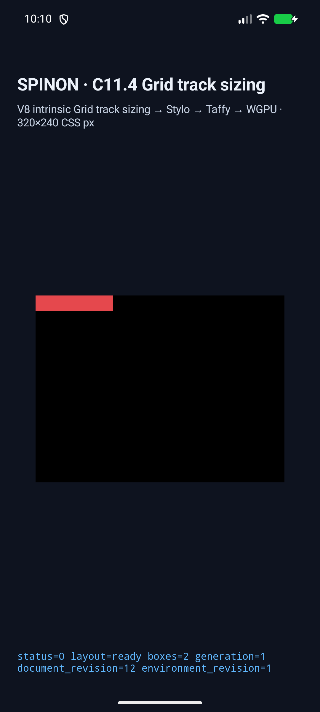
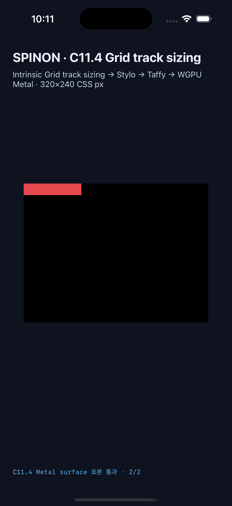

# C11.4 two-track span overflow automatic minimum runtime 근거

2026-10-28의 제한된 앱 runtime fixture slice다. `c11-4-grid-track-sizing-fixture-test` opt-in feature에서만 다섯 고정 scene을 CSS cascade, computed style, style-to-layout projection, Grid track sizing trace, frame, draw/present까지 연결했다. 이 근거는 일반 CSS admission이나 C11.4 전체 완료를 뜻하지 않는다.

## 독립 기준과 고정 기대값

- [Chrome 156 관측과 CSS Grid 계산](../c11-4-auto-minmax-max-content-span-overflow-precomparison-2026-10-28/README.md)
- [Chrome 및 독립 계산 expected.json](../c11-4-auto-minmax-max-content-span-overflow-precomparison-2026-10-28/expected.json)
- 상위 제한 계획: [C11.4 runtime 계획](../../../../plan/c11-4-auto-minmax-span-overflow-runtime.md)

모든 scene은 `80×20px` Grid, 두 `minmax(auto,max-content)` columns, 20px row, span 2의 Ahem `XXXXXXXXXX`(min-content/max-content 각각 100px)를 사용한다. item의 authored `overflow-x` 값과 computed 축 값, Minimum contribution 및 최종 track/item 크기는 다음과 같다.

| authored x | computed x / y | Minimum source / value | columns | item width |
|---|---|---|---:|---:|
| `visible` | `visible` / `visible` | `AutomaticMinimum` / 100px | 50px, 50px | 100px |
| `clip` | `clip` / `visible` | `AutomaticMinimum` / 100px | 50px, 50px | 100px |
| `hidden` | `hidden` / `auto` | `OverflowAutomaticMinimum` / 0px | 40px, 40px | 80px |
| `auto` | `auto` / `auto` | `OverflowAutomaticMinimum` / 0px | 40px, 40px | 80px |
| `scroll` | `scroll` / `auto` | `OverflowAutomaticMinimum` / 0px | 40px, 40px | 80px |

모든 경우 MaxContent contribution은 100px로 유지된다. runtime verifier는 각 scene에서 computed overflow x/y, root와 item frame, 두 Columns track의 base size, 정확히 하나의 Minimum source/value, MaxContent contribution 및 Columns/Rows trace를 확인한다.

## Android API 37 ARM64 AVD

- AVD: `sdk_gphone16k_arm64`, API 37, `arm64-v8a`, serial `emulator-5554` (실기기 아님)
- [최종 run JSON](./android-avd-c114-overflow-auto-minimum-android-avd-20261028T131044798Z-be8fd926/result.json) · [기기와 source hash](./android-avd-c114-overflow-auto-minimum-android-avd-20261028T131044798Z-be8fd926/simulator.json)
- 5/5 scene에서 runtime frame/track/trace, draw/present가 통과했다. 각 scene의 PixelCopy 표본은 root 안 `(79,18)`에서 `#e5484d`, root 바깥 `(90,18)`에서 `visible`/`clip`은 `#e5484d`, `hidden`/`auto`/`scroll`은 검정으로 모두 exact match했다.
- APK와 설치 APK SHA-256은 모두 `88ae241538d60e4a89adf2559754fcf67c24f14edfd3cbcb7bd121abbc460a41`이다.
- [첫 scene runtime log](./android-avd-c114-overflow-auto-minimum-android-avd-20261028T131044798Z-be8fd926/runtime-columns-span2-visible-content-minimum.log)

## iOS Simulator

- 기기: iPhone 17 Pro (`iPhone18,1`), iOS 26.2, UDID `9DCCE836-7659-4914-B6C1-13F54BFFA9DB`
- [최종 run JSON](./ios-simulator-c114-overflow-auto-minimum-ios-simulator-20261028T131136894Z-1022eba3/result.json) · [시뮬레이터와 source hash](./ios-simulator-c114-overflow-auto-minimum-ios-simulator-20261028T131136894Z-1022eba3/simulator.json)
- 5/5 scene에서 runtime frame/track/trace, draw/present가 통과했다. 제출 전 Metal drawable 표본은 scene마다 2/2 exact이며, root 안 `(79,18)`은 `#e5484d`, root 바깥 `(90,18)`은 `visible`/`clip`에서 `#e5484d`, `hidden`/`auto`/`scroll`에서 검정이다. 이 표본은 compositor가 최종 표시한 OS 화면 검증은 아니다.
- 빌드 앱과 설치 앱 SHA-256은 모두 `34b035a7a0240c435fa47bb5b8488b3fda6c16acd070a77cd05f0e73a3bfa42b`이다.
- [첫 scene runtime log](./ios-simulator-c114-overflow-auto-minimum-ios-simulator-20261028T131136894Z-1022eba3/runtime-columns-span2-visible-content-minimum.log)

## 빌드와 검사

- Android 앱: `SPINON_ENABLE_C04_RUNTIME_GPU=1 SPINON_ENABLE_C04_RUNTIME_GPU_FIXTURE_TEST=1 SPINON_ENABLE_C11_GRID_METAL_SURFACE_PIXELS_TEST=1 tools/build-android-app.sh` 통과
- iOS Simulator 앱: 같은 세 환경 값을 `1`로 둔 `tools/build-ios-sim.sh` 통과
- `cargo fmt --all -- --check` 통과
- `cargo test --locked -p spinon-style --features c11-4-grid-track-sizing-fixture-test overflow_fixture_cascade_keeps_axis_conversion_out_of_the_base_profile` 통과 (1/1)
- `cargo test --locked -p spinon-ffi --features c04-runtime-gpu-fixture-test exposes_only_the_five_fixed_overflow_automatic_minimum_scenes` 통과 (1/1)
- `cargo check --locked -p spinon-ffi --features c04-runtime-gpu-fixture-test` 통과
- `cargo clippy --locked -p spinon-ffi --features c04-runtime-gpu-fixture-test --lib -- -D warnings` 통과
- feature-off `target/debug/libspinon_ffi.a`: fixture scene marker 없음, SHA-256 `5327db6bd4632d61acfb0f6ac0b04d68fed4fdc143a595961f01279910a0ecbc` (514,502,560 bytes)
- `c04-runtime-gpu-fixture-test` positive-control archive: fixture marker 있음, SHA-256 `58f55bdbee16809a0a05e683019ce499444e4b66a5785337c3327a8a3dab87ce` (715,495,824 bytes)
- archive 비교는 기본 및 fixture-test FFI static archive에 한정되며 APK/IPA 전체의 fixture exclusion이나 release artifact를 증명하지 않는다.

새 runtime 검증기를 조이는 중 빈 Grid line-name group을 authored name으로 오인해 첫 AVD 재시도가 거부된 것을 발견했다. 검증기는 비어 있지 않은 실제 name만 거부하도록 고쳤고, 그 뒤 최종 Android/iOS build 및 모든 scene을 다시 실행해 통과했다. 또한 frame 목록을 map으로 모을 때 중복·추가 frame이 가려질 수 있어 원본 frame 수와 고유 node 수가 정확히 2인지 검사하도록 고쳤다.

## 범위 한계

이 fixture는 fixed direct Grid item과 두 columns의 고정 조합만 다룬다. 일반 author HTML/CSS의 overflow 허용, clipping/scrolling 동작, scroll offset, scrollbar, 다른 Grid track 조합, hardware GPU·실기기·iOS compositor 이후 pixel, 전체 WPT는 확인하지 않았다. 특히 `clip` scene의 외부 red sample은 Grid item box의 overflow 위치만 보여 주며 clipping semantics 검증이 아니다. C11.4 상위 checkbox와 공식 완료 `72/213`은 미완료로 유지한다.

- [서로 다른 구현/runtime 실패 관점 20개](./implementation-runtime-review-20.md)
- [PR 변경분 30개 검토](./pr-diff-review-30.md)
- [기본/fixture-test archive 경계](./artifact-boundary.md)
