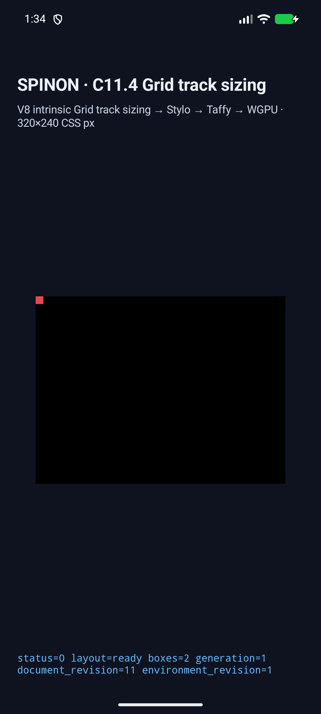
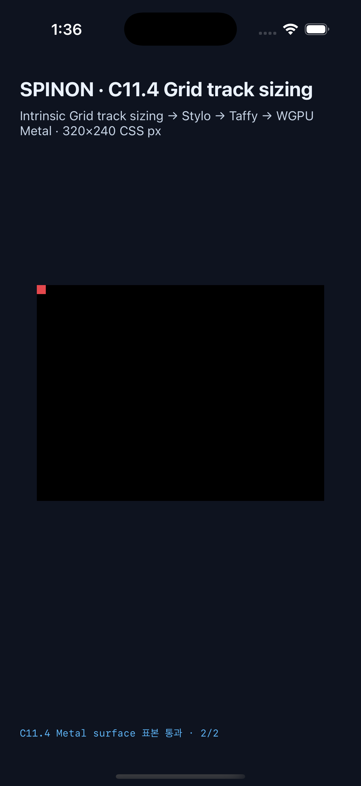

# C11.4 overflow automatic minimum 양축 runtime 근거

2026-10-29의 14-scene opt-in 앱 runtime 행렬이다. 공식 `C11.4 intrinsic track sizing` 항목은 계속 미완료이며, 공식 완료 수는 `72/213`이다. 일반 CSS admission, clipping·scroll 동작 또는 전체 C11.4 완료를 의미하지 않는다.

## 실행 결과

- Android API 37 ARM64 AVD `emulator-5556` (`sdk_gphone64_arm64`)에서 frame, used track, contribution trace, strict presentation identity, draw/present를 포함해 14/14 scene이 통과했다. [실행 결과](./android-avd-c114-overflow-auto-minimum-android-avd-20261028T163438739Z-7b4f0097/result.json) · [AVD 및 앱 hash](./android-avd-c114-overflow-auto-minimum-android-avd-20261028T163438739Z-7b4f0097/simulator.json)
- iPhone 17 Pro / iOS 26.2 Simulator (`ACA7BF91-E2D5-4CF7-909A-08D1AD95FF3D`)에서도 같은 commit/tree/dirty source snapshot으로 14/14 scene이 통과했다. [실행 결과](./ios-simulator-c114-overflow-auto-minimum-ios-simulator-20261028T163550852Z-0719d120/result.json) · [Simulator 및 앱 hash](./ios-simulator-c114-overflow-auto-minimum-ios-simulator-20261028T163550852Z-0719d120/simulator.json)
- 각 행 scene의 고정 10×10 PNG를 runtime render scene에 연결했다. Android PixelCopy와 iOS 제출 전 Metal drawable 로그 모두 `runtime_image_count=1`, `image_draw_count=1`을 기록한다.
- row visible의 root 바깥 `(5,7)` 표본은 PNG red `#e5484d`, item 아래 `(5,11)` 표본은 검정 `#000000`으로 두 플랫폼에서 exact match했다. [Android runtime log](./android-avd-c114-overflow-auto-minimum-android-avd-20261028T163438739Z-7b4f0097/runtime-row-visible-content-minimum.log) · [iOS runtime log](./ios-simulator-c114-overflow-auto-minimum-ios-simulator-20261028T163550852Z-0719d120/runtime-row-visible-content-minimum.log)

Android는 emulator의 SwiftShader 경로다. iOS 표본은 Metal drawable 제출 전 픽셀을 읽었으며 OS compositor 이후 화면을 뜻하지 않는다. 이 표본은 `visible` replaced item이 root 경계 아래로 실제 draw되는지 확인한다. `clip`, scrollbar, scroll offset 동작은 검사하지 않는다.

## 빌드와 재검증

- Android APK와 설치 APK SHA-256은 `1508582564976f861eaabfa33dfbdaff69122c3c62ee9ee01e484795ba1c9cc2`이다. C04 runtime GPU, fixture-test, C11 Grid fixture-test를 opt-in했다.
- iOS Simulator 앱과 설치 앱 SHA-256은 `c9e40e79fff7ded8964495fcaca97d42d722be8dd80282212b1cf9ce9540cc6f`이다. 같은 fixture 조합과 Metal surface pixel 검사를 켰다.
- `cargo test --locked -p spinon-runtime --features c11-4-grid-track-sizing-fixture-test`: 291 passed, 3 ignored, 0 failed.
- `cargo test --locked -p spinon-ffi --features c04-runtime-gpu-fixture-test runtime_gpu::fixtures::c11_4::overflow_auto_minimum`: 2 passed. 새 author stylesheet `visibility:collapse` rejection 테스트도 1/1 통과했다.
- fixture-feature `cargo clippy --lib -- -D warnings`, `cargo fmt --all -- --check`, `node --check tools/css-reference/capture-c11-4-auto-repeat-neighbors-simulator.mjs`가 통과했다.
- [Product/opt-in archive 경계](./artifact-boundary.md): 일반 `c04-runtime-gpu` archive에는 새 route marker가 없고 fixture-test 양성 대조에는 14개 scene ID와 PNG URL이 있다.
- 첫 Android 전체 행렬은 Columns 7개 뒤 첫 row image 장면에서 intrinsic revision 전달 누락을 찾았다. 이를 고친 재실행은 renderer helper가 PNG를 scene에 추가하지 않는 두 번째 누락을 발견했다. helper를 일곱 row scene에 한정해 연결한 뒤 Android와 iOS 각 14-scene 행렬을 다시 실행해 통과했다.

마지막 검토에서 trace가 정확히 2 pass일 것을 요구한 조건은 `column-hidden-zero-minimum`의 정상 subpass를 거부했다. 실제 trace 계약에 맞게 pass 수 조건을 완화하고 축 존재·sequence·각 subpass contribution 검사는 유지했다. 해당 장면과 최신 양 플랫폼 14-scene 행렬을 재실행했다. 첫 실패와 수정을 숨기지 않고 [20개 구현/runtime 실패 관점 검토](./implementation-runtime-review-20.md)에 기록했다.

C11.4 공식 항목은 미완료이며 완료 수 `72/213`을 유지한다. [PR diff 30관점 검토](./pr-diff-review-30.md)를 마쳤다. 새 구현 PR 생성, GitHub checks 및 merge proof는 남아 있다.
