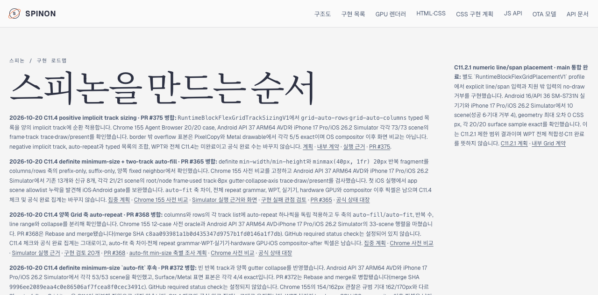
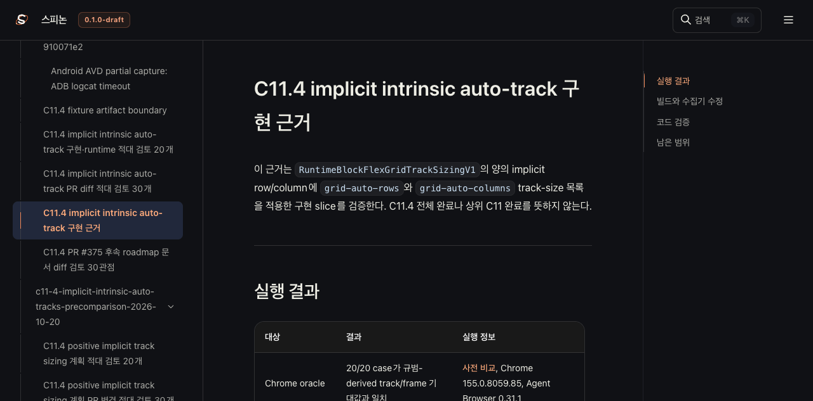

# C11.4 positive implicit track sizing Tailnet roadmap 동기화

**기준:** 구현 PR [#375](https://github.com/ohah/spinon/pull/375) merge SHA `e01f0dfc386e5d77ad0cdf8fb3e3b11df40696f8`; 후속 문서 PR [#376](https://github.com/ohah/spinon/pull/376) merge SHA `98d4910539f0cc69ee8065f266038f1e996c03ce`. 
**범위:** PR #376의 roadmap·계획·내부 계약·실행 근거를 Tailscale 정적 preview `/spinon/`에 반영했다. GitHub Pages는 배포하지 않았고 앱이나 실기기를 실행하지 않았다.

## 반영 내용

- roadmap에 PR #375의 positive implicit `grid-auto-rows/columns` slice와 Android/iOS Simulator 실행 범위를 기록했다.
- 옛 roadmap 항목에 남아 있던 “앱 구현 전” 표현을 병합 상태에 맞게 고쳤다.
- Agent Browser에서 내부 계약 heading의 실제 ID가 `c114-positive-implicit-grid-auto--track-size-lists`인 것을 확인하고 roadmap fragment를 고쳤다. 첫 동기화 pass16 화면에서 단일 하이픈 링크가 대상을 찾지 못한 결과는 [초기 관찰](./browser-contract-pass16.json)에, 수정 뒤 `anchor_found=true` 결과는 [pass17 관찰](./browser-contract-pass17.json)에 기록했다. 이 확인 결과를 [별도 30관점 문서 검토](../c11-4-implicit-intrinsic-auto-tracks-2026-10-20/roadmap-pr-diff-review-30.md)에도 반영했다.
- C11.4/C11 checkbox와 공식 완료 수는 변경하지 않았다. 전체 C11.4, negative implicit track, auto-repeat과 typed 목록 결합, WPT는 미완료다.

## 선택 빌드

Rspress `2.0.22`의 기존 workspace 설치를 사용해 선택된 Tailnet root를 빌드했다. 최종 pass18 root는 131개 source/destination mapping으로 3,413개 staging file을 만들었고, SHA-256 입력 manifest는 중복 없는 74개 source의 1,437개 파일을 기록한다. route 중복은 `internal/`과 `spec/internal/` preview 경로를 함께 보존하기 위한 것이다.

세 pass 모두 staging과 산출물 텍스트의 host/worktree 경로를 제거했고 남은 경로는 0개다. pass18은 generated JavaScript 한 파일에서 host 경로를 정리했다. 선택 빌드 설정은 저장소 전체에 있는 기존 dead link와 무관한 문서 때문에 dead-link/dead-image 검사를 비활성화한다. 이 결과를 전체 문서 링크 적합성으로 확대하지 않으며, 아래에서 지정 route와 이미지 로드를 따로 확인했다.

## 정적 preview 복사와 제공 확인

| pass18 항목 | 결과 |
| --- | ---: |
| preview 파일 수 / source bytes | 2,815 / 114,459,611 |
| 생성 / 교체 / 동일 | 103 / 102 / 2,610 |
| 삭제 | 없음 |
| 원자 복사 대상 검증 | 205/205 |
| 교체 전 backup 검증 | 102/102 |
| Tailnet HTTP 200·byte·SHA-256 | 2,815/2,815 일치 |

pass18 사전 비교, 열린 handle, 복사·backup 및 served hash 결과는 [preflight](./preflight-pass18.json), [open handles](./open-handles-before-copy-pass18.json), [copy and backup](./copy-and-backup-pass18.json), [served verification](./served-verification-pass18.json)에 있다. `lsof`는 교체 대상 102개 중 기존 Tailnet 서버 PID 1191이 열고 있던 HTML 두 개를 찾았다. 두 파일의 이전 bytes를 실행별 backup에 보존하고 hash를 확인한 뒤, 같은 디렉터리의 temporary file을 원자적으로 rename했다. 서버와 기존 tmux 세션은 종료하지 않았다.

pass16/17의 초기 결과, pass별 selected build·sanitize·manifest·preflight·copy·served 파일도 폴더에 보존했다. pass16의 잘못된 fragment를 pass17에서 고친 뒤 pass18에는 최종 문서 검토 결과를 추가 동기화했다.

## Agent Browser 확인

Agent Browser로 Tailnet의 roadmap, 공식 상태, 계획, 내부 계약 fragment, 구현 근거와 문서 diff 검토 페이지를 확인했다. pass17 roadmap에는 `212개 표시 · 공식 완료 72/212`가 보이고 C11.4 `intrinsic track sizing` checkbox는 unchecked다. 계획 페이지에는 PR #375 merge SHA와 남은 범위가 표시됐다. 내부 계약 fragment는 실제 heading에 도달했고 pass18 검토 페이지도 30번 관점의 수정·재검증 결과를 표시했다.

실행 근거의 overflow 링크는 Android `1080×2400`, iOS `1206×2622`로 모두 로드됐다. 이는 C11.4 앱 실행 근거 이미지이며, 여기에 추가한 pass17 스크린샷은 Tailnet 문서 화면이다.

[roadmap browser 결과](./browser-roadmap-pass17.json) · [STATUS browser 결과](./browser-status-pass17.json) · [계획 browser 결과](./browser-plan-pass17.json) · [계약 fragment 결과](./browser-contract-pass17.json) · [Android/iOS 이미지 로드 결과](./browser-implementation-evidence-pass17.json) · [30관점 검토 화면 결과](./browser-review-pass18.json).

pass16·17·18 Agent Browser 세션은 각각 종료했고 전용 session 상태와 프로세스 종료를 확인했다([pass16](./browser-close-pass16.json), [pass17](./browser-close-pass17.json), [pass18](./browser-close-pass18.json)). 기존 공유 Agent Browser PID 67317은 건드리지 않았고 preview server PID 1191은 계속 실행 중이다.

## 남은 범위

이 Tailnet 정적 preview 갱신은 C11.4 전체 Grid 지원이나 WPT 적합성, 실기기/hardware GPU/iOS compositor 이후 픽셀 검증을 추가하지 않는다. 공식 완료 수와 GitHub Pages 배포 상태도 변경하지 않는다.
