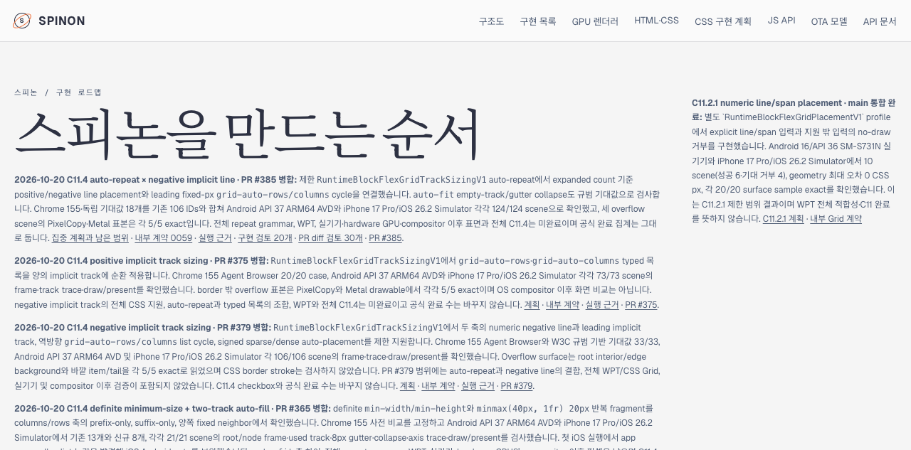
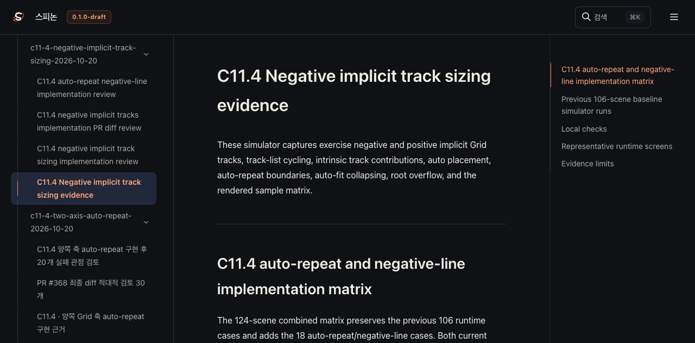

# C11.4 PR #385 병합 후 Tailnet 로드맵 동기화

## 기준과 범위

- 저장소 기준: PR #386 Rebase and merge commit a623819ff9148f12a1d784eaa9739043618ddf1f
- 구현 원본: PR #385 merge SHA 078f5708a5c13d956150b311d392490cc4faa311
- 미리보기 경로: https://macstudio.tailed42f2.ts.net/spinon/
- 디스크 제공 경로: /Users/yoonhb/Library/Application Support/SpinonPreview
- Tailnet preview server PID 1191은 계속 실행했다. tmux 세션은 변경하거나 종료하지 않았다.
- GitHub Pages와 앱은 이번 sync에서 배포·실행하지 않았다.

병합된 C11.4 설명을 선택 빌드와 Tailnet 정적 미리보기에 반영했다. C11.4 checkbox와 공식 완료 수는 유지했다. 내부 계약은 0.1.0이며 새 공개 API는 없다. 전체 repeat grammar, WPT, 실기기, hardware GPU, iOS compositor 이후 표면과 전체 C11.4/C11 완료는 주장하지 않는다.

## 선택 빌드

저장소에 이미 설치된 Rspress 2.0.22 CLI를 사용해 build/spinon/c11-4-pr385-tailnet-root-pass16을 build/spinon/c11-4-pr385-tailnet-site-pass16으로 빌드했다. 설정은 link/dead-image 검사만 끄고 고정된 선택 source root와 출력 경로를 사용한다.

- 선택 source SHA-256 837개: [입력 manifest](./SHA256SUMS-preview-inputs-pass16.txt)
- 선택 root 산출물과 링크 rewrite: [prepare-root-pass16.json](./prepare-root-pass16.json)
- Rspress build log: [selected-build-pass16.log](./selected-build-pass16.log)
- Build log의 표 출력 행 끝 공백과 마지막 빈 줄만 정리했다. 빌드 명령과 결과 내용은 바꾸지 않았다.
- 산출물 경로 정리: [sanitize-pass16.json](./sanitize-pass16.json)
- 선택 root에서는 host/worktree 경로 199개를 제거했다. 빌드 산출물에서도 남은 경로 한 개를 제거했고 최종 검색 결과는 0개다.
- 공개 roadmap, STATUS, 계약 0059, 두 C11.4 계획, PR #385 실행 README·리뷰, PR #386 문서 sync README·리뷰, 대표 Android/iOS 화면을 선택했다. 실패 캡처와 C12.4 증거 디렉터리는 선택하지 않았다.
- Preflight 당시 git working tree는 dirty였다. 보존 중인 simulator 중간 캡처와 C12.4 증거 및 이 sync의 로컬 근거 파일 때문이다. HEAD는 a623819ff9148f12a1d784eaa9739043618ddf1f이며 source manifest는 지정한 선택 경로만 기록한다. 무관한 untracked 폴더는 staging하거나 preview에 복사하지 않았다.

## Tailnet 파일 동기화

[사전 비교](./preflight-pass16.json)는 1,611개 파일, 69,930,889 bytes를 확인했다.

| 결과 | 파일 수 |
| --- | ---: |
| 신규 생성 | 113 |
| 기존 파일 원자 교체 | 90 |
| 바이트 동일 | 1,408 |
| 삭제 | 0 |
| 교체 전 파일 백업과 SHA-256 일치 | 90/90 |
| Tailnet HTTP 200 및 served SHA-256 일치 | 1,611/1,611 |

동기화 전에 server PID 1191이 교체 대상 중 spec/internal/evidence/c11-4-auto-repeat-two-track-min-size-2026-10-20/fixture-artifact-boundary.html 하나를 열고 있었다. 기존 파일은 별도 pass16 backup에 보존·검증한 뒤 같은 디렉터리 임시 파일을 원자 rename했다. server를 종료하거나 열린 파일을 truncate하지 않았다. [열린 파일 기록](./open-handles-before-copy-pass16.json) · [copy/backup 검증](./copy-and-backup-pass16.json) · [제공 바이트 검증](./served-verification-pass16.json).

## Agent Browser 확인

Agent Browser 0.31.1에서 로드맵, STATUS, 계획, 내부 계약 0059, PR #385 실행 근거, PR #386 문서 sync 근거를 열었다.

- 로드맵에 PR #385 병합 기록과 링크가 보인다. 새 note의 Tailnet 내부 링크 네 개는 모두 HTTP 200이고, plan 원문 링크는 GitHub main에서 열렸다.
- STATUS에서 PR #385 merge SHA가 보이고 C11.4 checkbox는 checked=false다.
- 실행 근거 페이지의 Android AVD 화면은 1080×2400, iOS Simulator 화면은 1206×2622로 모두 로드됐다.
- PR #386 문서 sync의 20개 및 30개 검토 링크를 확인했다.
- [browser-check-pass16.json](./browser-check-pass16.json)에 route, 이미지와 종료 결과를 기록했다. Agent Browser 세션과 agent-browser 프로세스는 종료했다.

## 적대적 검토

- [동기화 실패 관점 20개](./sync-review-20-pass16.md)
- [최종 PR diff 관점 30개](./pr-diff-review-30-pass16.md)

전체 검증 입력과 sync artifact SHA-256은 [evidence manifest](./SHA256SUMS-evidence-pass16.txt)에 기록한다. 이는 Tailnet 문서 화면 검증이며 앱 runtime 재실행이나 CSS Grid/WPT 적합성 검증이 아니다.
