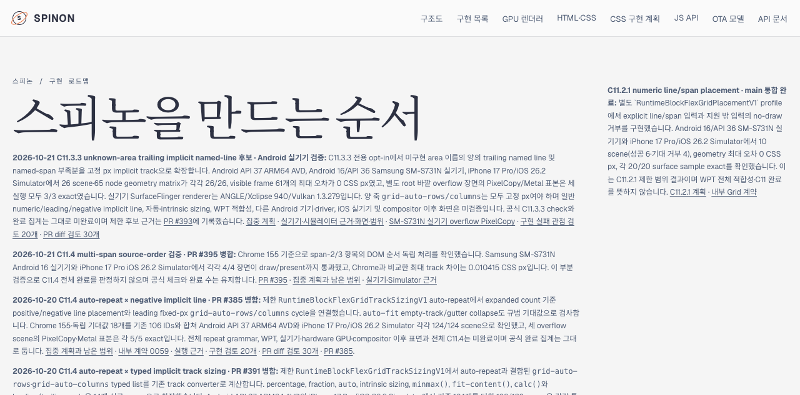
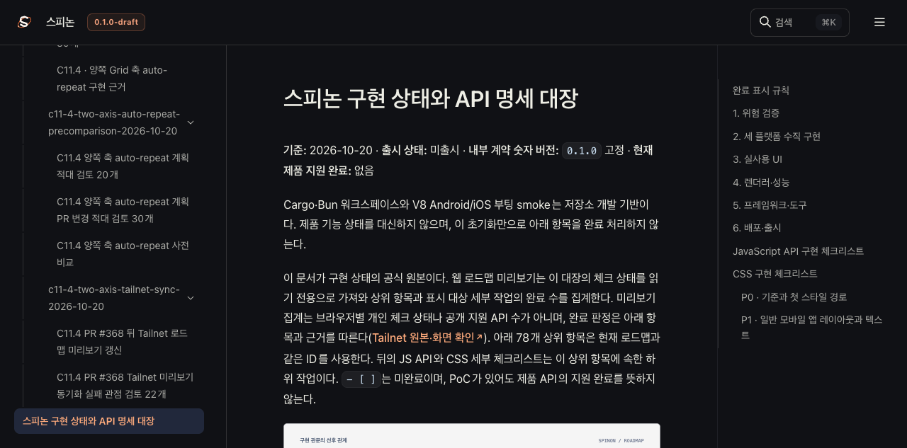
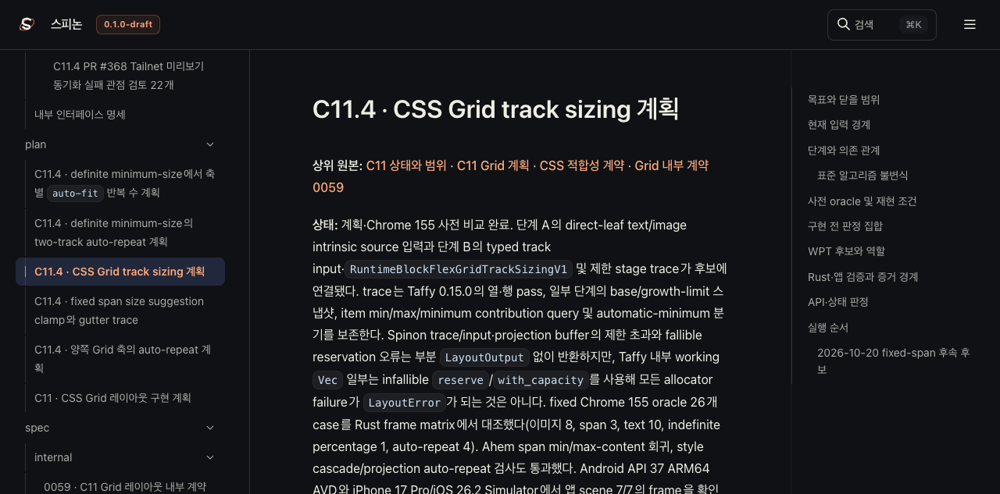
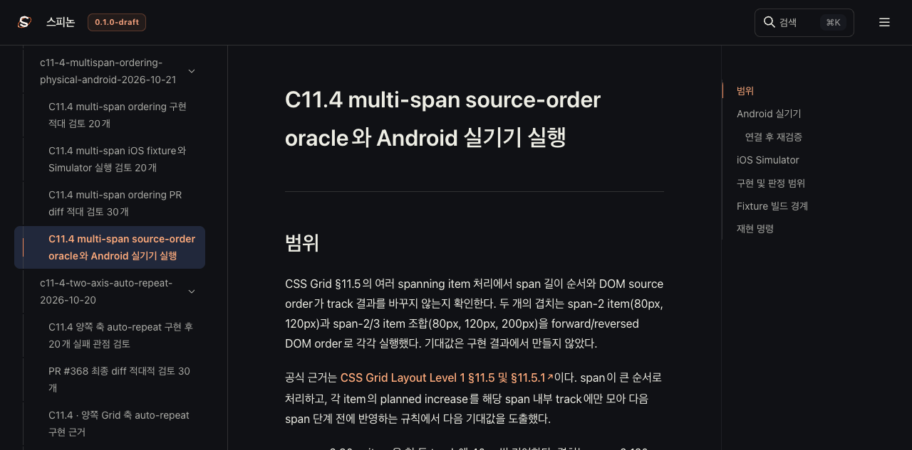

# C11.4 PR #395 뒤 Tailnet 로드맵 갱신

**기준 구현:** PR #395 Rebase and merge 결과 `8ec32c6bd2f1e730e05882b0bab5aa5f09a492d3`. 
**미리보기:** <https://macstudio.tailed42f2.ts.net/spinon/roadmap.html> 
**범위:** 선택한 상태 대장·C11.4 계획·실행 근거와 공개 로드맵의 Tailnet 정적 미리보기 `/spinon/`을 갱신했다. GitHub Pages 배포는 하지 않았다.

## 반영한 내용

- `spec/public/roadmap.html`에 PR #395의 multi-span 부분 검증, Android 실기기·iOS Simulator 결과, 남은 범위를 추가했다. C11.4 완료 체크와 완료 수는 변경하지 않았다.
- PR #395의 병합 결과와 기존 C11.4 계획·실행 근거를 선택된 문서 root에 포함했다.
- PR #370에서 사용한 백업 공간을 재사용하지 않도록 새 `pass15`/`pass16` 경로와 PR #395 전용 백업 디렉터리를 추가했다.
- `@rspress/core` 2.0.22 고정 버전을 사용했다. `packages/docs/package.json`과 `bun.lock`은 변경하지 않았다.

## Tailnet 동기화

두 실행은 삭제 없이 선택한 파일만 원자적으로 만들거나 교체했다. 교체 전 백업과 Tailnet 응답의 바이트 수·SHA-256을 모두 비교했다.

| 실행 | 목적 | 선택 파일 | 생성 | 교체 | 동일 | 검증된 교체 백업 | HTTP 200·byte·SHA 일치 |
| --- | --- | ---: | ---: | ---: | ---: | ---: | ---: |
| pass15 | PR #395 병합 뒤 선택 문서 반영 | 1,640 | 166 | 76 | 1,398 | 76/76 | 1,640/1,640 |
| pass16 | 공개 로드맵에 PR #395 진행 메모 추가 | 1,640 | 83 | 84 | 1,473 | 84/84 | 1,640/1,640 |

pass15와 pass16에서 Tailnet 서버가 열고 있던 선택 파일이 각각 하나씩 확인됐다. 실행 중인 서버를 멈추지 않고 같은 디렉터리 임시 파일을 만든 뒤 원자적으로 교체했다. 두 실행 모두 삭제 대상은 없었다. 상세값은 [pass15 사전 검사](./preflight-pass15.json), [pass15 백업·복사](./copy-and-backup-pass15.json), [pass15 제공 검증](./served-verification-pass15.json), [pass16 사전 검사](./preflight-pass16.json), [pass16 백업·복사](./copy-and-backup-pass16.json), [pass16 제공 검증](./served-verification-pass16.json)에 있다.

## Agent Browser 확인

Agent Browser로 로드맵, 상태 대장, C11.4 계획, Android 실기기·iOS Simulator 근거 페이지를 열었다. 로드맵에 PR #395 메모가 표시됐고 C11.4 체크는 미완료였다. 공개 로드맵 집계는 213개 표시·72개 완료로 유지됐다. Android 실기기 캡처(1080×2100)와 iOS Simulator 캡처(1206×2622)를 실제 크기로 불러왔다. 세션 종료 후 해당 Agent Browser daemon과 Chrome 프로세스가 남지 않은 것도 확인했다. 상세 관찰은 [browser check](./browser-check-pass16.json), 종료 결과는 [browser close](./browser-close-pass16.json)에 기록했다.

## 검토와 남은 범위

- Tailnet 경로·백업·원자 교체의 [독립 실패 관점 검토 20개](./sync-review-20.md)
- 이번 변경의 [PR diff 적대 검토 30개](./pr-diff-review-30.md)
- 선택 입력 해시: [pass15](./SHA256SUMS-preview-inputs-pass15.txt), [pass16](./SHA256SUMS-preview-inputs-pass16.txt)
- 선택 문서 build만 실행했다. 전체 문서 사이트, WPT, 앱 실행, GitHub Pages 배포는 이번 문서 PR의 검증 범위가 아니다.
- PR #395는 C11.4의 일부 multi-span 동작 근거다. 전체 C11.4 구현·공개 CSS 지원은 미완료다.

초기 빌드 시도는 임시 최신 Rspress 선택 또는 `SPINON_TAILNET_RUN` 누락으로 실패했다. 프로젝트의 설치된 2.0.22 실행 파일과 명시적 실행 ID로 다시 빌드해 두 최종 실행을 완료했다. 의존성 파일은 바꾸지 않았다.
