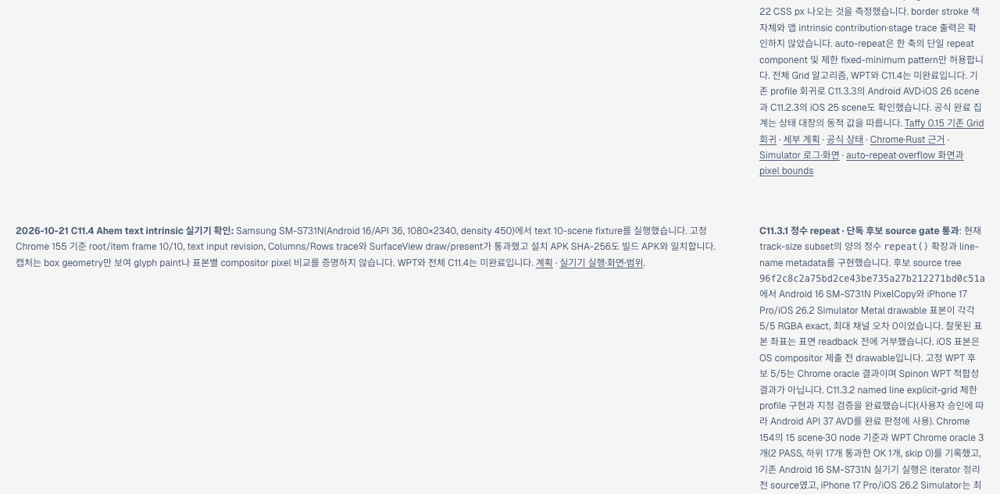
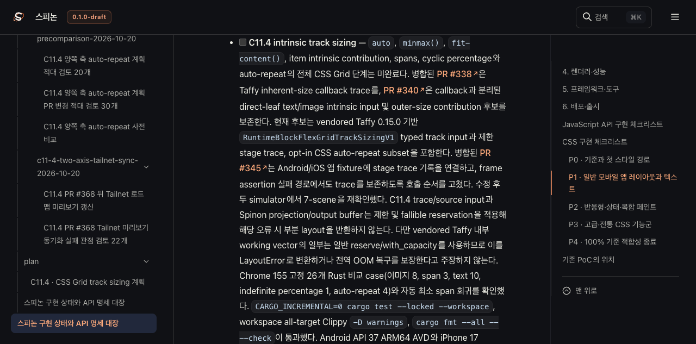
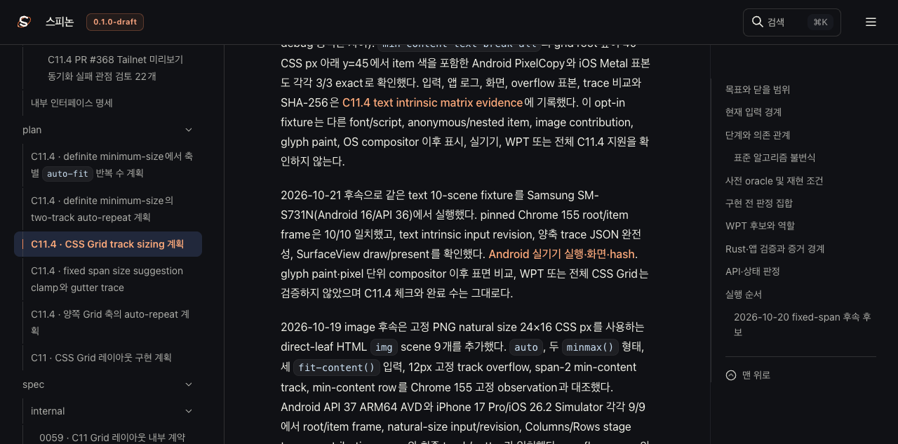
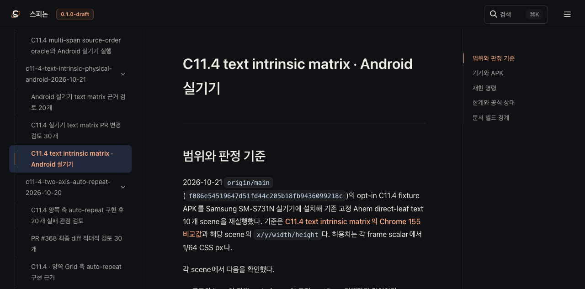

# PR #397 뒤 Tailnet 로드맵 미리보기 동기화

- 날짜: 2026-10-21
- 기준 커밋: `24267943981a9c7dee693155efb8607bcf8e405c` (`test(layout): C11.4 text intrinsic 실기기 검증 기록`, PR #397 병합)
- 미리보기: [구현 로드맵](https://macstudio.tailed42f2.ts.net/spinon/roadmap.html) · [공식 상태 대장](https://macstudio.tailed42f2.ts.net/spinon/STATUS.html) · [C11.4 계획](https://macstudio.tailed42f2.ts.net/spinon/plan/c11-4-grid-track-sizing.html) · [실기기 근거](https://macstudio.tailed42f2.ts.net/spinon/internal/evidence/c11-4-text-intrinsic-physical-android-2026-10-21/README.html)

## 반영 내용

PR #397 병합 뒤 현재 공식 상태 대장, C11.4 계획, 로드맵 HTML과 Samsung SM-S731N Android 실기기 근거를 같은 RSPress 선택 빌드에 넣어 Tailnet 미리보기를 갱신했다. HTML만 바꾸어 예전 JavaScript가 이전 본문을 되살리는 상태가 생기지 않도록 전체 선택 사이트를 한 번에 빌드했다.

선택 RSPress 입력은 이전 성공 빌드의 문서 집합에 현재 상태 대장·계획·로드맵·실기기 근거를 반영한 `build/spinon/c11-4-text-intrinsic-physical-tailnet-root-pass24/`다. `packages/docs`에서 `RSPRESS_PERSISTENT_CACHE=false`와 전용 pass24 설정을 사용해 `build/spinon/c11-4-text-intrinsic-physical-tailnet-site-pass24/`로 빌드했다. 실제 선택 설정은 [rspress-pass24.config.ts](./rspress-pass24.config.ts)에 보존했다. 선택 빌드는 성공했다. 저장소 전체 문서 빌드는 기존 dead-image 참조와 `rust,ignore` Shiki 언어 번들 오류로 계속 실패하므로 이를 전체 사이트 빌드 성공으로 취급하지 않는다. 선택 빌드는 기존 문서의 dead-link·dead-image 검사만 끈다.

## Tailnet 파일 검증

사전 목록에는 1,720개 파일, 총 72,945,136바이트가 있었다. 미리보기에서 92개를 만들고 91개를 교체했으며 1,537개는 이미 같았다. 파일 삭제는 하지 않았다. 기존 파일 91개는 `~/Library/Application Support/SpinonPreviewBackups/c11-4-pr397-tailnet-roadmap-sync-2026-10-21/pass24/` 아래에 보존했고 원본 SHA-256·크기를 모두 확인했다.

- [동기화 요약](./sync-summary-pass24.json): 사전 비교, 재개, 백업과 외부 검증 결과
- [파일별 manifest](./tailnet-files-pass24.jsonl): 빌드·Tailnet 본문 1,720개 경로·바이트·SHA-256
- [백업 manifest](./tailnet-backups-pass24.jsonl): 교체 전 파일 91개의 보존 경로·바이트·SHA-256
- [동기화 스크립트](./sync-tailnet-pass24.mjs) 및 [선택 RSPress 빌드 로그](./selected-build-pass24.log)

한 교체 대상은 미리보기 서버가 열어 둔 상태였다. `lsof`에서 해당 핸들의 소유자가 Tailnet 서버 PID 1191뿐이고 네트워크 핸들은 `127.0.0.1:8768`의 대기 소켓 하나인 것을 확인했다. 원본을 먼저 백업·해시 검증하고 같은 디렉터리에서 원자적으로 바꿨으며 서버 프로세스는 유지했다. 재개 후 전체 파일·백업·외부 응답을 다시 검증했다. [동기화 요약](./sync-summary-pass24.json)에 핸들 관찰을 기록했다.

## Agent Browser 화면 확인

터미널 브라우저는 사용하지 않았다. 전용 Agent Browser 세션으로 로드맵, 상태 대장, C11.4 계획과 실기기 근거를 열었다. 상태 대장과 계획 화면의 문서 메뉴가 각각 105개와 108개 링크로 표시되고, 실기기 근거 페이지에는 메뉴 95개와 1080px 화면 캡처 두 장이 모두 로드됐다. 브라우저 오류는 관찰되지 않았다.

브라우저 확인 뒤 `spinon-tailnet-c114-pass24` 세션을 닫았다. Agent Browser 세션 목록은 비었고 `session info`는 `active:false`, 프로세스 목록에는 Agent Browser/Chrome 브라우저 프로세스가 없었다. Tailnet 미리보기 서버 PID 1191은 계속 실행 중이다. 관찰 요약은 [browser-verification-pass24.json](./browser-verification-pass24.json)에 있다.

## 공식 상태와 검증 한계

[공식 상태 대장](../../../STATUS.md)의 C11.4 intrinsic track sizing 항목은 미완료로 유지된다. 완료 수, 지원 API, 버전 있는 CSS 계약은 바꾸지 않았다. 로드맵 노트는 Android 16/API 36 Samsung SM-S731N에서 기존 Ahem text 10-scene fixture가 통과한 결과와 한계를 함께 표시한다. 그 실행 근거는 [C11.4 실기기 기록](../c11-4-text-intrinsic-physical-android-2026-10-21/README.md)이며 box geometry·draw/present 증거는 glyph paint나 compositor 이후 pixel 정확성을 뜻하지 않는다.

문서 사이트는 수동 GitHub Pages 배포를 하지 않았으며, 이번 작업에서 Pages workflow를 실행하거나 `gh-pages`를 변경하지 않았다. 선택한 Tailnet 파일 집합만 갱신했다. 이 동기화의 별도 실패 관점은 [검토 기록](./sync-review-30.md)에 있다.
