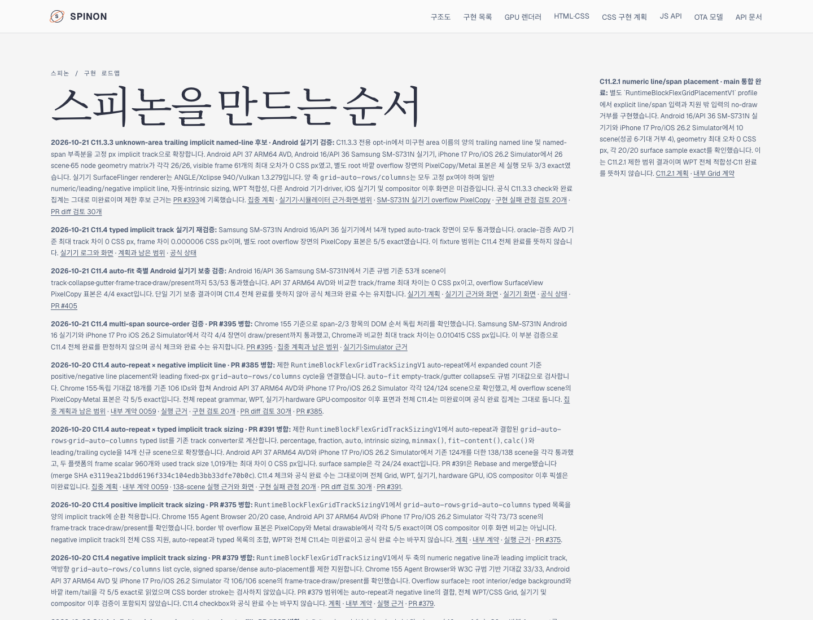
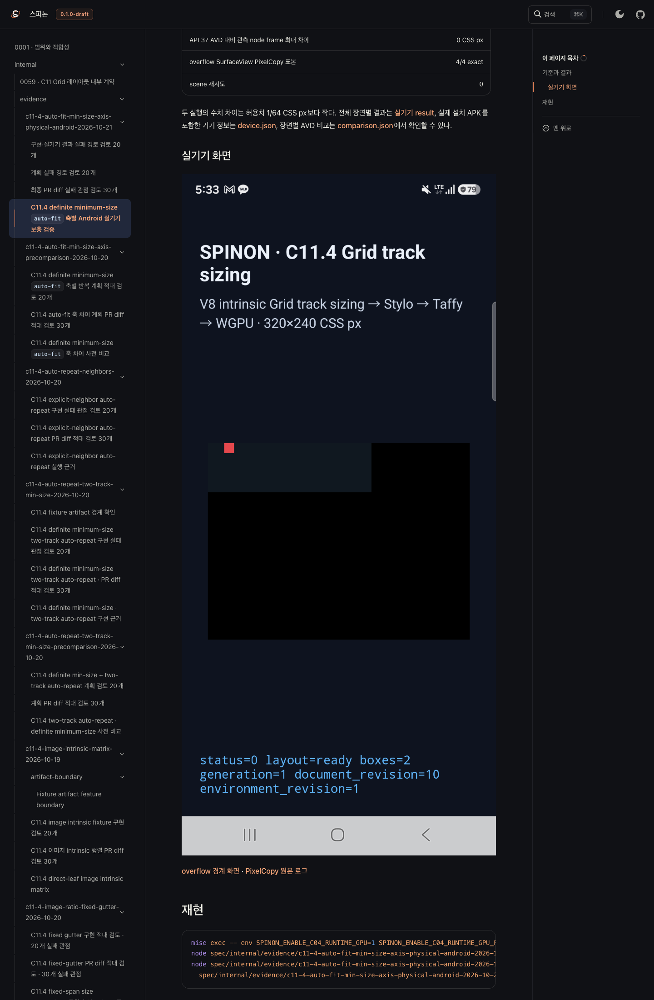

# PR #405 뒤 Tailnet 로드맵 미리보기 동기화

- 날짜: 2026-10-21
- 원본 revision: `3382436096fabd0ce0684d36f287cd90d4581ed9` (`main`, PR #405 병합 뒤)
- 미리보기: [구현 로드맵](https://macstudio.tailed42f2.ts.net/spinon/roadmap.html) · [상태 대장](https://macstudio.tailed42f2.ts.net/spinon/STATUS.html) · [C11.4 실기기 계획](https://macstudio.tailed42f2.ts.net/spinon/plan/c11-4-auto-fit-axis-physical-android.html) · [C11.4 실기기 근거](https://macstudio.tailed42f2.ts.net/spinon/internal/evidence/c11-4-auto-fit-min-size-axis-physical-android-2026-10-21/README.html)

## pass26 최종 반영

Tailnet 서버 PID 1191이 제공하는 `/Users/yoonhb/Library/Application Support/SpinonPreview`에 현재 `main`의 로드맵·상태 대장·계획·실행 근거를 반영했다. 서버는 `127.0.0.1:8768`에서 계속 실행 중이다. GitHub Pages나 `gh-pages`는 변경하지 않았다.

동기화 뒤 발견한 pass24 입력 기준의 누락을 바로잡기 위해 pass26은 pass24 기준 revision `24267943981a9c7dee693155efb8607bcf8e405c`와 현재 revision을 비교했다. 변경된 문서 경로 315개를 찾았고 선택 입력에 목적별 중복 경로를 포함해 629개 파일을 덮어썼다. 공식 상태와 roadmap뿐 아니라 현재 상태 대장에서 연결하는 C11.4·C13.3 계획과 근거도 포함한다.

RSPress 선택 빌드는 1,810개 파일, 81,661,358바이트를 만들었다. 사전 비교에서 새 파일 162개, 교체 파일 106개, 같은 파일 1,542개였다. 교체 전 106개 파일, 총 10,360,281바이트는 아래 백업 경로에 저장하고 원본 크기와 SHA-256을 재검증했다. 파일 삭제는 없었다. pass25에서 교체한 92개 파일의 별도 백업도 pass25 경로에 보존했다.

- [통합 요약](./sync-summary-pass26.json)
- [선택 입력 변경 manifest](./selection-manifest-pass26.json) · [RSPress 입력 정규화 내역](./selection-normalization-pass26.json)
- [pass26 파일별 manifest](./tailnet-files-pass26.jsonl) · [pass26 교체 전 백업 manifest](./tailnet-backups-pass26.jsonl)
- [사전 비교](./preflight-pass26.json) · [복사 및 백업 검증](./copy-and-backup-pass26.json) · [최종 파일 검증](./final-verification-pass26.json)
- [Tailnet 응답 검증](./served-verification-pass26.json) · [Agent Browser 검증](./browser-verification-pass26.json)
- [선택 입력 생성기](./prepare-selection-pass26.mjs) · [RSPress 입력 경로 보정기](./normalize-selection-pass26.mjs) · [선택 RSPress 설정](./rspress-pass26.config.ts) · [Tailnet 동기화 스크립트](./sync-tailnet-pass26.mjs) · [응답 검증기](./verify-served-pass26.mjs)
- [선택 빌드 로그](./selected-build-pass26-final.log)

### 서비스 검증

로드맵, 두 상태 대장 경로, 두 계획 경로, C11.4 실기기 근거, C13.3 Android/iOS 근거와 화면 이미지까지 14개 URL을 확인했다. 전부 HTTP 200이며 응답 바이트 수와 SHA-256이 선택 빌드 산출물과 일치했다. [상세 경로·hash 결과](./served-verification-pass26.json).

전용 Agent Browser로 로드맵과 C11.4/C13.3 근거 페이지를 열었다. PR #405 로드맵 항목과 53/53 실기기 결과가 보였고, Android 화면 이미지 1080×2340 및 iOS Simulator 이미지 1536×2048이 모두 완전히 로드됐다. 터미널 브라우저는 사용하지 않았다.

브라우저 탭을 닫았다. 전용 브라우저 데몬은 확인 명령과 프로세스 점검 사이에 종료됐으며 최종 프로세스 목록에는 Agent Browser/Chrome 프로세스가 없었다. 미리보기 서버 PID 1191은 유지했다.

## 선택 입력과 빌드 한계

선택 입력은 pass24 문서 집합을 복사한 뒤 PR #397 병합 revision 이후 현재 `main`까지의 문서 변경을 반영했다. RSPress가 bare Markdown image path를 package import로 해석하는 두 C13.3 근거 페이지는 선택 입력에서만 `./` 상대 경로로 보정했고, 인접 이미지 파일 존재를 확인했다. repository Markdown 원본은 수정하지 않았다. 실행 가능한 RSPress 설정을 포함한 두 이전 Tailnet 동기화 근거 폴더는 현재 공식 상태와 roadmap에서 링크되지 않아 RSPress 입력에서 제외했다. 해당 폴더의 Tailnet 대상 파일을 삭제하지 않았다.

재현 빌드는 저장소 문서 전체 빌드가 아니라 보존한 선택 RSPress 입력만 대상으로 한다. 선택 설정에서 기존 dead-link·dead-image 검사를 끈 상태로 빌드했다. 처음 pass26 전체 변경분을 포함했을 때 위 image path와 실행 가능한 Rspress 설정 파일 때문에 빌드가 실패했다. [첫 실패 로그](./selected-build-pass26.log)와 [입력 보정 내역](./selection-normalization-pass26.json)을 남겼고, 수정 입력의 최종 빌드는 성공했다.

pass25는 PR #405의 상태·roadmap·실기기 페이지를 먼저 반영했으나 pass24 기준 이후 추가된 문서 경로 315개를 포함하지 않은 초기 동기화였다. source-diff 점검에서 그 범위를 발견해 pass25 산출물과 백업을 보존하고 pass26으로 정정했다. [pass25 사전 비교](./preflight-pass25.json) · [pass25 복사·백업 결과](./copy-and-backup-pass25.json) · [pass25 응답 확인](./served-verification-pass25.json).

공식 상태 대장의 C11.4 체크와 완료 수는 유지된다. PR #405는 단일 Samsung SM-S731N 보충 근거이며 C11.4 전체, WPT, 다른 Android 기기나 OS compositor 이후 화면을 완료하지 않는다.
