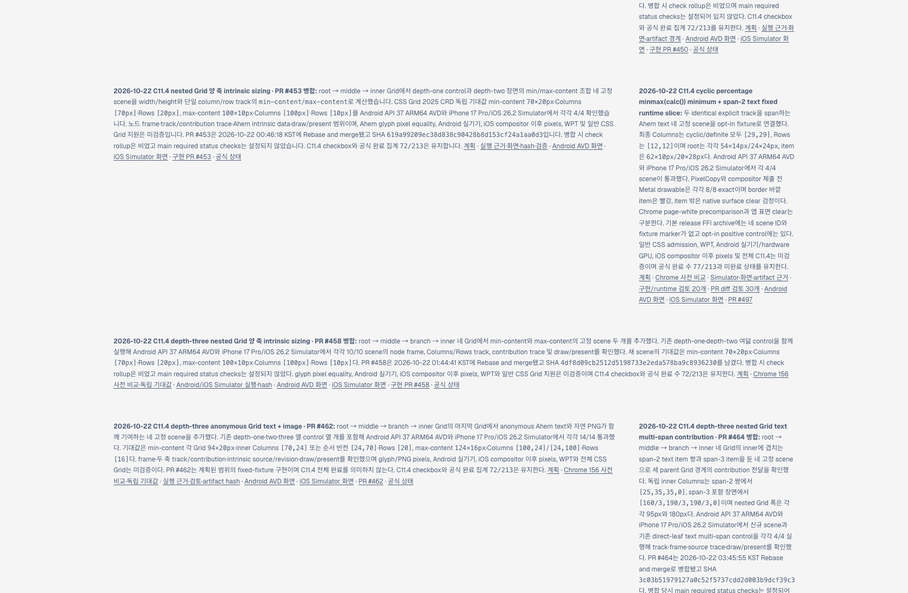
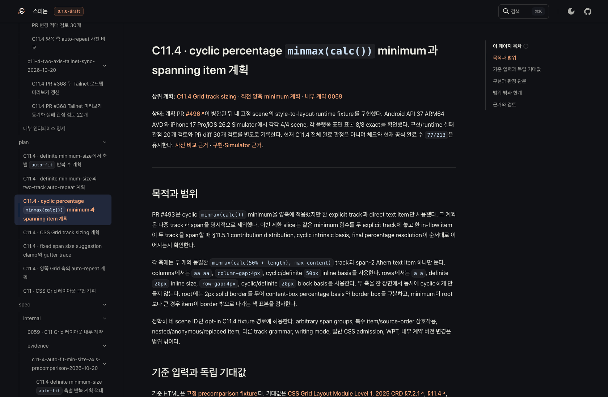
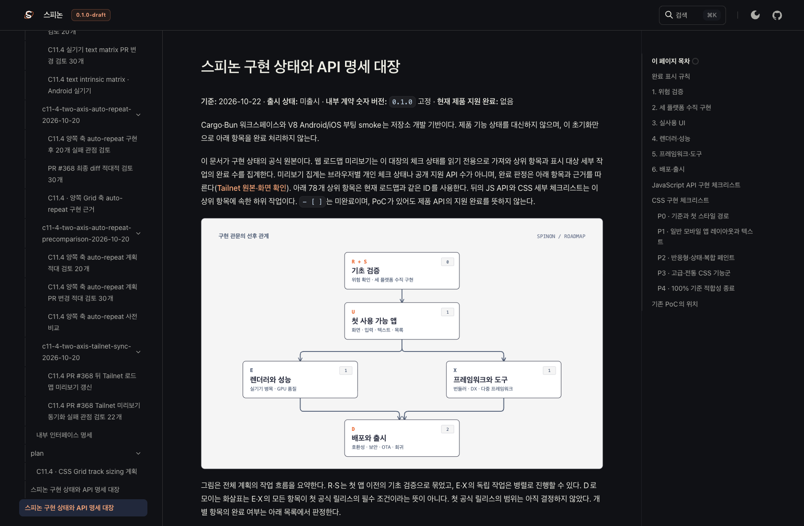
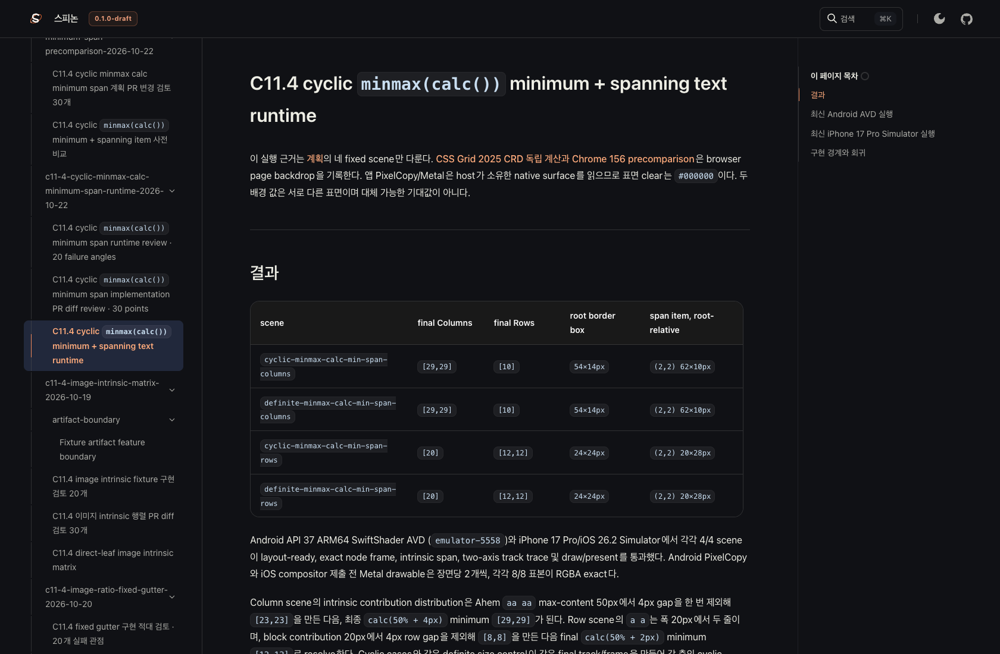

# PR #497 뒤 Tailnet 로드맵 미리보기 동기화

- 날짜: 2026-10-22
- 기준 병합: [PR #497](https://github.com/ohah/spinon/pull/497), Rebase and merge, merge SHA `7de0bc1983a5c824468c9994b9ee6404dadef7ad`
- 미리보기: [로드맵](https://macstudio.tailed42f2.ts.net/spinon/roadmap.html) · [공식 상태 대장](https://macstudio.tailed42f2.ts.net/spinon/STATUS.html) · [C11.4 계획](https://macstudio.tailed42f2.ts.net/spinon/plan/c11-4-cyclic-minmax-calc-minimum-span.html) · [Simulator 근거](https://macstudio.tailed42f2.ts.net/spinon/internal/evidence/c11-4-cyclic-minmax-calc-minimum-span-runtime-2026-10-22/README.html)

## 반영 내용과 공식 상태

병합된 main의 `spec/public/roadmap.html`, C11.4 계획, 내부 Grid 계약과 새 Android/iOS Simulator 실행 근거를 Tailnet 정적 미리보기에 반영했다. 현재 공식 완료 수 `77/213` 및 C11.4 미완료 상태를 유지한다. `spec/STATUS.md` 체크는 변경하지 않았고, GitHub Pages나 `gh-pages`에는 배포하지 않았다.

## 선택 문서 빌드 및 파일 검증

선택 RSPress 입력은 직전 Tailnet pass24 문서 집합에 main의 최신 로드맵·상태·내부 문서·계획·사전 비교·실행 evidence를 덮어 쓴 별도 root다. 고정된 RSPress `2.0.22`로 전체 선택 사이트를 만들었다. 기존 기록 자료에 남아 있는 dead image 참조 때문에 이 preview 전용 빌드에서만 dead-link/dead-image 검사 옵션을 끈다. 전체 문서 빌드나 전체 CSS 기능 검증으로 확대 해석하지 않는다.

초기 pass25 전체 파일 반영은 1,746개(생성 107, 교체 98, 동일 1,541), 원본 총 76,159,885 bytes였다. 기존 파일 98개는 `~/Library/Application Support/SpinonPreviewBackups/c11-4-pr497-tailnet-roadmap-sync-2026-10-22/pass25/`에 원본 길이·SHA-256과 함께 보관했다. 파일 삭제는 없다. 로컬 대상 1,746개와 백업 98개가 모두 일치했고, 미리보기 서버 HTTP 응답도 1,746/1,746 파일에서 로컬 대상과 길이·SHA-256이 일치했다.

선택 RSPress 설정, 동기화/백업 스크립트, 빌드 로그와 기계 판독 manifest는 저장소 evidence 디렉터리에 보존한다.

## Agent Browser 화면 확인

터미널 브라우저를 사용하지 않았다. 전용 Agent Browser session으로 Tailnet 로드맵에서 새 C11.4 항목의 `77/213` 및 PR #497 링크를 확인했다. 계획의 `[29,29]`, `[12,12]` track 값과 실행 evidence의 Android/iOS 페이지, 각 Simulator image도 로드됐다. 공식 STATUS의 C11.4 설명은 전체 Grid intrinsic track sizing 미완료를 유지한다.

브라우저 페이지는 별도 세션에서 확인했고, Agent Browser session/process 종료 상태는 로컬 동기화 기록에서 따로 확인한다.
