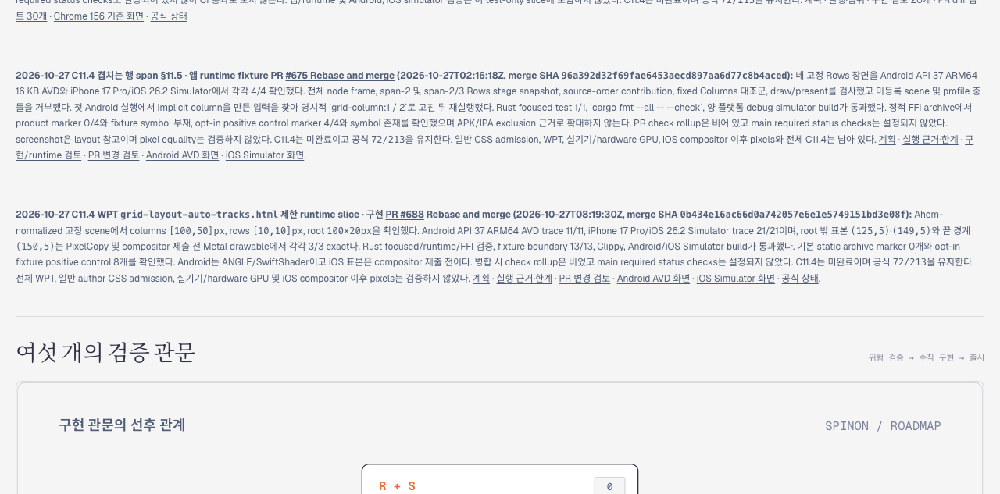

# C11.4 PR #688 병합 상태와 Tailnet 로드맵 동기화

PR [#688](https://github.com/ohah/spinon/pull/688)은 2026-10-27T08:19:30Z에 Rebase and merge됐고 merge commit은 `0b434e16ac66d0a742057e6e1e5749151bd3e08f`다. GitHub PR check rollup은 비어 있었고 main required status checks는 설정되지 않아 CI 통과로 기록하지 않는다. 이 업데이트는 C11.4의 제한 runtime slice만 병합된 상태를 반영한다. C11.4 checkbox는 미완료이고 공식 집계는 `72/213`이다.

## 문서 변경

- [`spec/STATUS.md`](../../../STATUS.md): PR #688 merge 시각·SHA와 check 상태를 반영했다.
- [`계획`](../../../../plan/c11-4-grid-layout-auto-tracks-wpt.md): 구현 후보에서 병합된 제한 runtime slice로 상태를 갱신했다.
- [`공개 로드맵`](../../../public/roadmap.html): PR #688 카드, 실제 simulator 관측, 범위 한계와 화면 링크를 추가했다.
- [`PR diff 검토 30개`](pr-diff-review-30.md): 상태·근거·지원 범위·링크를 서로 다른 실패 관점으로 확인했다.

## Tailnet 동기화

Tailscale backend가 `Running`이고 기존 preview server PID `28040`이 port `8768`에서 응답했다. `/spinon/roadmap.html` 하나만 대상으로 삼았다. 교체 전 local/Tailnet HTTP 응답은 모두 200, 341,512 bytes, SHA-256 `74f084cd679efbd0f480c5a72806d7f8fdfbd3f886577aa6e0d19d3ab4e93728`이었다. 기존 파일을 byte-exact 백업한 뒤 같은 디렉터리 임시 파일을 atomic rename했다. 다른 route는 변경하지 않았고 preview server를 재시작하거나 파일을 삭제하지 않았다.

- 원본 [`spec/public/roadmap.html`](../../../public/roadmap.html): 343,893 bytes, SHA-256 `2a3c75b4e77318f3828beb9be72131217f80f792f96a9eaed116fb6b06f3f425`.
- Tailnet 제공 파일과 local route 모두 교체 후 HTTP 200, 343,893 bytes, 위와 같은 SHA-256을 반환했다.
- byte-exact 백업: `/Users/yoonhb/Library/Application Support/SpinonPreviewBackups/c11-4-pr688-postmerge-tailnet-sync-2026-10-27/pass01/roadmap.html`.
- preflight·교체 결과는 [`preflight.json`](preflight.json), [`sync-result.json`](sync-result.json), 재현 가능한 guard는 [`sync-roadmap-only.mjs`](sync-roadmap-only.mjs)에 있다. 동기화 시점의 base HEAD와 수정된 source path를 구분해 기록했다.

## Agent Browser 확인

Agent Browser에서 Tailnet URL을 열어 제목 `스피논 구현 로드맵`, hero card 42개, 새 PR #688 항목, merge SHA, `72/213`, plan/evidence/screenshot 링크를 확인했다. 새 항목은 viewport 안에 놓인 상태로 캡처했다. [`관찰 기록`](agent-browser-observation.json)과 [`브라우저 종료 기록`](browser-close.json)에 화면·종료 정보를 남겼다.

캡처는 1280×633 PNG이며 SHA-256은 `fc2ea2e3d5575c3690d709cbd4b313d2b465792ffe1444baf681239f630f3564`다. Agent Browser를 닫은 뒤 process 검사에서 agent-browser·전용 Chrome/Chromium process가 남지 않았다.

## 범위

Tailnet 개발 미리보기의 정적 roadmap route만 갱신했다. GitHub Pages 배포나 C11.4 완료 상태 변경은 하지 않았다. AVD는 ANGLE/SwiftShader이고 iOS 표본은 compositor 제출 전이다. 전체 WPT, 일반 author CSS admission, 실기기·hardware GPU 및 iOS compositor 이후 pixels는 미검증이다. 해시 목록은 [`SHA256SUMS`](SHA256SUMS)다.
