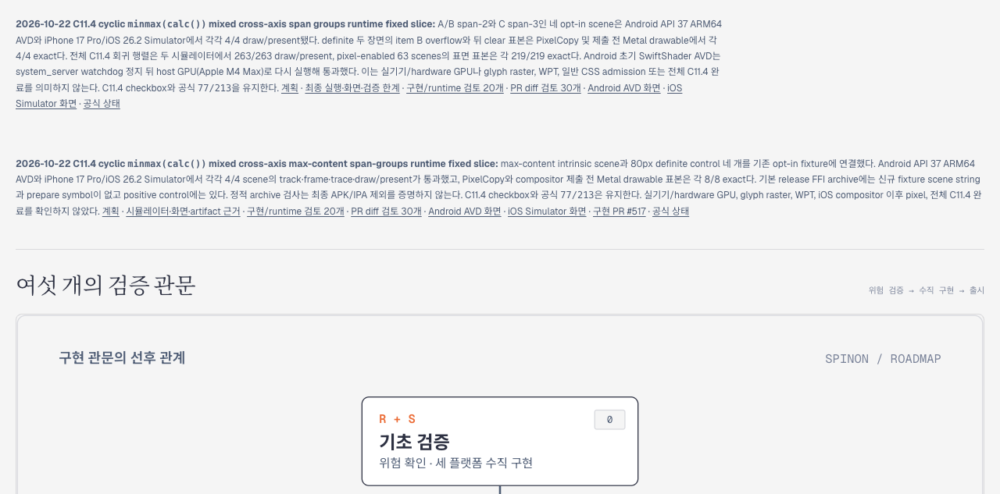

# C11.4 roadmap 카드 폭 보정 근거

**대상:** PR #517에 추가된 C11.4 max-content span-groups runtime 진행 카드

초기 Tailnet 화면에서 이 카드는 `.hero` grid의 오른쪽 열에 배치되어 `x=972px`, `width=288px`로 표시됐다. 같은 영역의 기존 진행 카드와 비교해 새 카드의 `hero-progress` class가 빠진 것을 확인했다. 이 class는 기존 `.hero > .hero-progress { grid-column: 1 / -1; }` 규칙을 적용한다.

## 확인 결과

- Agent Browser viewport: 1280×633
- `.hero` grid columns: 908px 288px
- 수정 카드 bounding box: x=20px, width=1240px
- 계산된 `grid-column`: `1 / -1`
- Tailnet 경로: `/spinon/roadmap.html`
- 패스53 게시본: 7,103개 파일, HTTP 200 및 원격 SHA-256 7,103/7,103 일치
- 공식 구현 상태는 변경하지 않았다. C11.4는 미완료이고 집계는 77/213이다.

## 브라우저 캡처

아래 캡처에서 대상 카드가 `.hero`의 두 열 전체 폭으로 표시된다.

